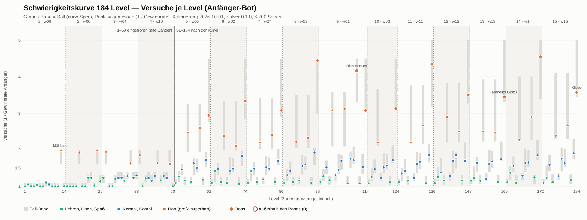

# Schwierigkeitskurve 184 Level

Stand: Kalibrierung 2026-10-01 13:39 UTC, Solver 0.1.0, je Bot ≤ 200 Seeds (Wilson-Abbruch ±0,05). Erzeugt mit `pnpm --filter @ee/tools-levels report`.

**Lesart.** Versuche = 1 / Gewinnrate des Anfänger-Bots (Proxy für menschliche Versuche, GDD 6.4). Das Soll-Band kommt aus `packages/core/src/generator/curve.ts`: Zonenschablone (Lehren · Üben · Normal · Spaß · **Hart** · Atempause · Kombi · Normal · **Hart** · Spaß · Normal · **Boss**), globale Rampe `1 + (b − 1)·(1 + 0,045·(z − 1))`, Deckel 5 (bis Zone 10: 4,5), Zonenstart ≤ 1,2, Atempause nach jeder Spitze ≤ 1,35. Level 1–50 sind eingefroren (Inhalt, IDs und Bänder unverändert).

## Überblick

| Zone | Welt | Level | Typenfolge | Anfänger-Versuche min / Median / max | starker Bot min | außerhalb |
|---|---|---|---|---|---|---|
| 1 | w09 | 1–14 | `ttttttppnfipHi` | 1,00 / 1,00 / 1,98 | 100 % | – |
| 2 | w06 | 15–26 | `pipiHfipniHp` | 1,00 / 1,01 / 1,98 | 86 % | – |
| 3 | w04 | 27–38 | `pHnfpnnpnHnn` | 1,00 / 1,23 / 1,94 | 87 % | – |
| 4 | w10 | 39–50 | `HfpnpnHpnnHf` | 1,00 / 1,23 / 1,85 | 98 % | – |
| 5 | w05 | 51–62 | `ipnfHicnHfnB` | 1,09 / 1,48 / 2,94 | 98 % | – |
| 6 | w02 | 63–74 | `ipnfHicnHfnB` | 1,06 / 1,45 / 3,33 | 97 % | – |
| 7 | w07 | 75–86 | `ipnfHicnHfnB` | 1,09 / 1,48 / 3,08 | 94 % | – |
| 8 | w08 | 87–98 | `ipnfHicnHfnB` | 1,09 / 1,49 / 4,44 | 93 % | – |
| 9 | w01 | 99–114 | `fpnfHncnHfnnSfcB` | 1,08 / 1,52 / 4,17 | 91 % | – |
| 10 | w03 | 115–124 | `fpnHncnfnB` | 1,08 / 1,49 / 3,13 | 97 % | – |
| 11 | w11 | 125–136 | `fpnfHncnHfnB` | 1,08 / 1,52 / 4,35 | 94 % | – |
| 12 | w12 | 137–148 | `fpnfHncnHfnB` | 1,08 / 1,54 / 3,51 | 96 % | – |
| 13 | w13 | 149–160 | `fpnfHncnHfnB` | 1,11 / 1,63 / 3,45 | 94 % | – |
| 14 | w14 | 161–172 | `fpnfHncnHfnB` | 1,09 / 1,59 / 4,55 | 94 % | – |
| 15 | w15 | 173–184 | `fpnfHncnHfnB` | 1,09 / 1,61 / 3,57 | 93 % | – |

Typenfolge: t Tutorial, i Lehren (intro), p Üben, n Normal, f Spaß, c Kombi, **H** Hart, **S** Superhart, **B** Boss. „starker Bot min“ ohne Boss.

**Spitzen für die Karte** (`spikeLevels()`, ersetzt `[13, 38, 63, 88]` in `packages/world/src/plane/path.ts`): 13, 19, 25, 28, 36, 39, 45, 49, 55, 59, 62, 67, 71, 74, 79, 83, 86, 91, 95, 98, 103, 107, 111, 114, 118, 124, 129, 133, 136, 141, 145, 148, 153, 157, 160, 165, 169, 172, 177, 181, 184.

**Nachjustierung:** alle 134 Level 51–184 haben ein kalibriertes Zugbudget (`tuning.ts`), 48 davon zusätzlich Zielgröße, Startmasse oder Spawn-Rate.

**Kurven-Checks:** 0 Fehler, 96 Warnungen.

- Warnung · Check 2 (1): nach der Spitze 36 folgt 37 mit hi 1.40 > 1,35
- Warnung · Check 3 (2): Zonenstart 27 (Zone 3) hat hi 1.30 > 1,2; Zonenstart 39 (Zone 4) hat hi 2.00 > 1,2
- Warnung · Check 4 (4): Zone 1 hat keinen Boss; Zone 2 hat keinen Boss; Zone 3 hat keinen Boss; Zone 4 hat keinen Boss
- Warnung · Check 6 (1): Zone 1: Spitzenanteil 7 % (Soll 17–25 %)
- Warnung · Check 13 (3): Level 7 und 8 haben dieselbe Signatur 5x5|reachTier|pillar|zufall; Level 27 und 29 haben dieselbe Signatur 5x5|reachTier|oil|zufall; Level 31 und 32 haben dieselbe Signatur 5x5|rescue|cage|zufall
- Warnung · Check 7 (2): Tutorial 2: Anfänger 0.95 < 0,97; Tutorial 5: Anfänger 0.96 < 0,97
- Warnung · Check 10 (80): Spitze 13: starker Bot siegt mit 57 % Restzügen (> 15 %); Spitze 19: starker Bot siegt mit 17 % Restzügen (> 15 %); Level 19: Anfänger verliert mit 50 % Zielfortschritt (< 70 %); Spitze 25: starker Bot siegt mit 32 % Restzügen (> 15 %); Spitze 28: starker Bot siegt mit 37 % Restzügen (> 15 %); Level 31: Anfänger verliert mit 0 % Zielfortschritt (< 70 %); Level 32: Anfänger verliert mit 50 % Zielfortschritt (< 70 %); Level 33: Anfänger verliert mit 50 % Zielfortschritt (< 70 %); Level 34: Anfänger verliert mit 67 % Zielfortschritt (< 70 %); Spitze 36: starker Bot siegt mit 49 % Restzügen (> 15 %); Level 37: Anfänger verliert mit 50 % Zielfortschritt (< 70 %); Level 38: Anfänger verliert mit 50 % Zielfortschritt (< 70 %) …
- Warnung · Check 9 (3): Level 19 (hard): starker Bot 0.90 < 0,9 (Glück); Level 25 (hard): starker Bot 0.86 < 0,9 (Glück); Level 38 (normal): starker Bot 0.87 < 0,9 (Glück)

## Zone 1 · w09 · Level 1–14 (eingefroren)

| Level | Name | Typ | Ziel | Raster | Züge | Soll | Ist | stark | Abweichung | Regler |
|---|---|---|---|---|---|---|---|---|---|---|
| 1 | Zwei werden eins | Tutorial | Stufe 3 | 3×1 fest | 99 | 1,00–1,10 | 1,00 | 100 % |  |  |
| 2 | Züge zählen | Tutorial | Stufe 4 | 3×2 fest | 10 | 1,00–1,10 | 1,05 | 100 % |  |  |
| 3 | Weiter so | Tutorial | Stufe 4 | 3×3 | 16 | 1,00–1,10 | 1,00 | 100 % |  |  |
| 4 | Punkte sammeln | Tutorial | 60 Punkte | 3×3 | 20 | 1,00–1,10 | 1,00 | 100 % |  |  |
| 5 | Der Vierundsechziger | Tutorial | Stufe 6 | 4×4 | 35 | 1,00–1,10 | 1,04 | 100 % |  |  |
| 6 | Der Pfeiler | Tutorial (pillar) | Stufe 4 | 3×3 fest | 18 | 1,00–1,10 | 1,00 | 100 % |  |  |
| 7 | Um die Ecke | Üben | Stufe 5 | 5×5 | 34 | 1,00–1,10 | 1,00 | 100 % |  |  |
| 8 | Zurückspulen | Üben | Stufe 6 | 5×5 | 38 | 1,00–1,10 | 1,10 | 100 % |  |  |
| 9 | Punkte am Pfeiler | Normal | 260 Punkte | 5×5 | 36 | 1,00–1,10 | 1,05 | 100 % |  |  |
| 10 | Ehrenrunde | Spaß | Stufe 7 | 5×5 fest | 30 | 1,00–1,10 | 1,00 | 100 % |  |  |
| 11 | Schrott | Lehren (scrap) | Schrott räumen | 3×3 fest | 12 | 1,00–1,10 | 1,00 | 100 % |  |  |
| 12 | Mehr Schrott | Üben | Schrott räumen | 5×5 | 34 | 1,00–1,10 | 1,00 | 100 % |  |  |
| 13 | Schrotthügel | **Hart** | Schrott räumen | 5×5 | 31 | 1,60–2,00 | 1,98 | 100 % |  |  |
| 14 | Sporen | Lehren (spore) | 2 Sporen | 3×3 fest | 12 | 1,00–1,10 | 1,00 | 100 % |  |  |

## Zone 2 · w06 · Level 15–26 (eingefroren)

| Level | Name | Typ | Ziel | Raster | Züge | Soll | Ist | stark | Abweichung | Regler |
|---|---|---|---|---|---|---|---|---|---|---|
| 15 | Sporenfeld | Üben | 5 Sporen | 5×5 | 34 | 1,00–1,10 | 1,00 | 100 % |  |  |
| 16 | Die Amöbe | Lehren (amoeba) | Stufe 5 | 3×3 fest | 16 | 1,00–1,10 | 1,00 | 100 % |  |  |
| 17 | Pflücken | Üben | 4 Sporen | 5×5 | 34 | 1,00–1,10 | 1,00 | 100 % |  |  |
| 18 | Aufbruch | Lehren (cap) | 2× Aufbruch | 3×3 fest | 16 | 1,00–1,10 | 1,00 | 100 % |  |  |
| 19 | Zwei Aufbrüche | **Hart** | 2× Aufbruch | 5×5 | 18 | 1,60–2,00 | 1,92 | 90 % |  |  |
| 20 | Ehrenrunde II | Spaß | 1× Aufbruch | 5×5 fest | 30 | 1,00–1,10 | 1,00 | 100 % |  |  |
| 21 | Verdorrt | Lehren (withered) | heilen | 3×3 fest | 12 | 1,00–1,10 | 1,00 | 100 % |  |  |
| 22 | Tief verdorrt | Üben (deepWithered) | heilen | 5×5 | 34 | 1,10–1,30 | 1,23 | 100 % |  |  |
| 23 | Heilen am Pfeiler | Normal | heilen | 5×5 | 28 | 1,20–1,40 | 1,23 | 100 % |  |  |
| 24 | Der Strahl | Lehren (line) | Schrott räumen | 4×4 fest | 24 | 1,00–1,10 | 1,02 | 100 % |  |  |
| 25 | Der erste Riss | **Hart** | Schrott räumen + Stufe 6 | 5×5 | 29 | 1,60–2,00 | 1,98 | 86 % |  |  |
| 26 | Fossilwand | Üben (fence) | Stufe 6 | 5×5 | 30 | 1,10–1,30 | 1,13 | 100 % |  |  |

## Zone 3 · w04 · Level 27–38 (eingefroren)

| Level | Name | Typ | Ziel | Raster | Züge | Soll | Ist | stark | Abweichung | Regler |
|---|---|---|---|---|---|---|---|---|---|---|
| 27 | Flüssig | Üben (oil) | Stufe 6 | 5×5 | 30 | 1,10–1,30 | 1,23 | 100 % |  |  |
| 28 | Sirupfalle | **Hart** | Stufe 6 | 5×5 | 25 | 1,60–2,00 | 1,94 | 96 % |  |  |
| 29 | Verschnaufer | Normal | Stufe 4 | 5×5 | 26 | 1,00–1,10 | 1,00 | 100 % |  |  |
| 30 | Ehrenrunde III | Spaß | Stufe 7 | 5×5 fest | 25 | 1,00–1,10 | 1,00 | 100 % |  |  |
| 31 | Der Käfig | Üben (cage) | 1× retten | 5×5 | 28 | 1,10–1,30 | 1,20 | 100 % |  |  |
| 32 | Zwei Käfige | Normal | 2× retten | 5×5 | 28 | 1,20–1,40 | 1,23 | 100 % |  |  |
| 33 | Käfig hinter der Wand | Normal | 2× retten | 5×5 | 28 | 1,20–1,40 | 1,23 | 100 % |  |  |
| 34 | Der Knall | Üben (burst) | Schrott räumen | 5×5 | 26 | 1,10–1,30 | 1,15 | 100 % |  |  |
| 35 | Tausch | Normal | heilen | 5×5 | 28 | 1,20–1,40 | 1,27 | 100 % |  |  |
| 36 | Sirupsumpf | **Hart** | Schrott räumen | 5×5 | 22 | 1,60–2,00 | 1,63 | 100 % |  |  |
| 37 | Rettung im Sirup | Normal | 2× retten | 5×5 | 28 | 1,20–1,40 | 1,23 | 100 % |  |  |
| 38 | Sirupkreuzung | Normal | 1× retten + Stufe 5 | 5×5 | 28 | 1,20–1,40 | 1,30 | 87 % |  |  |

## Zone 4 · w10 · Level 39–50 (eingefroren)

| Level | Name | Typ | Ziel | Raster | Züge | Soll | Ist | stark | Abweichung | Regler |
|---|---|---|---|---|---|---|---|---|---|---|
| 39 | Knall am Käfig | **Hart** | 2× retten | 5×5 | 18 | 1,60–2,00 | 1,85 | 100 % |  |  |
| 40 | Ehrenrunde IV | Spaß | Stufe 7 | 5×5 fest | 25 | 1,00–1,10 | 1,00 | 100 % |  |  |
| 41 | Kruste | Üben (crust) | Stufe 6 | 5×5 | 30 | 1,10–1,30 | 1,21 | 100 % |  |  |
| 42 | Doppelkruste | Normal | 1× retten + Stufe 6 | 5×5 | 30 | 1,20–1,40 | 1,23 | 100 % |  |  |
| 43 | Rissformen | Üben | Stufe 5 | 6×6 | 28 | 1,10–1,30 | 1,15 | 100 % |  |  |
| 44 | Riss und Kruste | Normal | Stufe 5 | 5×5 | 25 | 1,20–1,40 | 1,28 | 100 % |  |  |
| 45 | Sirupschlucht | **Hart** | 2× retten | 6×6 | 22 | 1,60–2,00 | 1,64 | 98 % |  |  |
| 46 | Gasquelle | Üben | Stufe 6 | 5×5 | 30 | 1,10–1,30 | 1,16 | 100 % |  |  |
| 47 | Quellen und Dürre | Normal | heilen | 5×5 | 28 | 1,20–1,40 | 1,28 | 100 % |  |  |
| 48 | Quellen und Käfige | Normal | 3× retten | 5×5 | 24 | 1,20–1,40 | 1,23 | 100 % |  |  |
| 49 | Quellensturm | **Hart** | Schrott räumen | 5×5 | 23 | 1,60–2,00 | 1,61 | 100 % |  |  |
| 50 | Der zweite Riss | Spaß | Stufe 6 + 1× retten | 6×6 fest | 20 | 1,00–1,10 | 1,00 | 100 % |  |  |

## Zone 5 · w05 · Level 51–62

| Level | Name | Typ | Ziel | Raster | Züge | Soll | Ist | stark | Abweichung | Regler |
|---|---|---|---|---|---|---|---|---|---|---|
| 51 | Schläfer | Lehren (sleeper) | Stufe 5 | 4×4 | 18 | 1,06–1,20 | 1,09 | 100 % |  |  |
| 52 | Weckruf | Üben | Stufe 6 | 5×4 | 27 | 1,12–1,41 | 1,27 | 100 % |  |  |
| 53 | Gas | Normal | Stufe 6 | 5×5 | 29 | 1,30–1,61 | 1,46 | 100 % |  |  |
| 54 | Funkenregen | Spaß | 300 Punkte | 5×5 | 32 | 1,04–1,24 | 1,15 | 100 % |  |  |
| 55 | Tiefschlaf | **Hart** | 2× Aufbruch | 4×4 | 20 | 1,94–3,24 | 2,47 | 100 % |  |  |
| 56 | Fäulnis | Lehren (rot) | Stufe 5 | 5×4 | 27 | 1,06–1,24 | 1,12 | 100 % |  | Start +2 |
| 57 | Fauler Schlaf | Kombi | Stufe 6 | 5×5 | 32 | 1,30–1,77 | 1,63 | 100 % |  | Start +1 |
| 58 | Fäulnis eindämmen | Normal | Fäulnis eindämmen | 4×5 | 31 | 1,38–1,74 | 1,50 | 100 % |  | Start +1 |
| 59 | Weckknall | **Hart** | Fäulnis eindämmen | 4×4 | 26 | 1,94–3,24 | 2,60 | 98 % |  |  |
| 60 | Ehrenrunde V | Spaß | Stufe 7 | 5×5 fest | 32 | 1,04–1,24 | 1,18 | 100 % |  |  |
| 61 | Bettruhe | Normal | Stufe 6 | 5×5 | 30 | 1,53–1,94 | 1,72 | 100 % |  | Start +3 |
| 62 | Die Wurzelkammer | **Boss** | Stufe 6 | 5×5 fest | 15 | 2,77–4,50 | 2,94 | 89 % |  | Start -2 |

## Zone 6 · w02 · Level 63–74

| Level | Name | Typ | Ziel | Raster | Züge | Soll | Ist | stark | Abweichung | Regler |
|---|---|---|---|---|---|---|---|---|---|---|
| 63 | Giftwolke | Lehren (toxic) | Stufe 5 | 4×4 | 20 | 1,06–1,20 | 1,09 | 100 % |  |  |
| 64 | Giftwolken | Üben | Stufe 6 | 5×4 | 33 | 1,12–1,43 | 1,41 | 100 % |  |  |
| 65 | Öl und Gift | Normal | Stufe 5 | 4×4 | 15 | 1,31–1,64 | 1,47 | 97 % |  |  |
| 66 | Strahlenfest | Spaß | Schrott räumen | 5×5 | 32 | 1,04–1,24 | 1,12 | 100 % |  | Start +1 |
| 67 | Giftfalle | **Hart** | 2× Aufbruch | 4×4 | 20 | 1,98–3,33 | 2,38 | 98 % |  | Start +1 |
| 68 | Schrottberg | Lehren (scrapMound) | Schrott räumen | 5×5 | 13 | 1,06–1,24 | 1,09 | 100 % |  |  |
| 69 | Bergstrahl | Kombi | Schrott räumen | 5×5 | 14 | 1,31–1,80 | 1,43 | 100 % |  |  |
| 70 | Lieferung | Normal | 2× Stufe 5 liefern | 4×5 | 26 | 1,40–1,77 | 1,48 | 97 % |  |  |
| 71 | Giftberg | **Hart** | Schrott räumen | 5×5 | 17 | 1,98–3,33 | 2,11 | 100 % |  |  |
| 72 | Ehrenrunde VI | Spaß | Stufe 7 | 5×5 fest | 10 | 1,04–1,24 | 1,06 | 100 % |  | Start +2 |
| 73 | Bestellung im Riss | Normal | 2× Stufe 5 liefern | 5×5 | 21 | 1,55–1,98 | 1,83 | 100 % |  |  |
| 74 | Der Nebelberg | **Boss** | Schrott räumen + Stufe 6 | 5×5 fest | 27 | 2,84–4,50 | 3,33 | 84 % |  |  |

## Zone 7 · w07 · Level 75–86

| Level | Name | Typ | Ziel | Raster | Züge | Soll | Ist | stark | Abweichung | Regler |
|---|---|---|---|---|---|---|---|---|---|---|
| 75 | Rohrpaar | Lehren (portal) | Stufe 5 | 4×4 | 19 | 1,06–1,20 | 1,09 | 100 % |  |  |
| 76 | Feuerrohr | Üben | Stufe 6 | 5×4 | 32 | 1,13–1,44 | 1,41 | 100 % |  |  |
| 77 | Feuer und Öl | Normal | Fäulnis eindämmen | 4×4 | 15 | 1,32–1,66 | 1,48 | 100 % |  | Start -3 |
| 78 | Funkenflug | Spaß | Schrott räumen | 5×5 | 14 | 1,04–1,25 | 1,12 | 100 % |  |  |
| 79 | Brennende Rohre | **Hart** | Fäulnis eindämmen + Stufe 5 | 4×4 | 21 | 2,02–3,41 | 2,20 | 94 % |  | Start -1 |
| 80 | Nebel | Lehren (fog) | Stufe 5 | 4×4 | 18 | 1,06–1,25 | 1,19 | 100 % |  |  |
| 81 | Nebelrohr | Kombi | Stufe 6 | 5×5 | 25 | 1,32–1,83 | 1,52 | 100 % |  |  |
| 82 | Nebelbrand | Normal | Fäulnis eindämmen | 4×5 | 10 | 1,41–1,79 | 1,48 | 100 % |  | Start -1 |
| 83 | Nebeltor | **Hart** | 2× Aufbruch | 4×5 | 17 | 2,02–3,41 | 2,41 | 96 % |  |  |
| 84 | Ehrenrunde VII | Spaß | Stufe 7 | 5×5 fest | 24 | 1,04–1,25 | 1,11 | 100 % |  | Start +2 |
| 85 | Rohrbrand | Normal | Fäulnis eindämmen + 1× Stufe 5 liefern | 5×5 | 10 | 1,57–2,02 | 1,69 | 100 % |  | Start +2 |
| 86 | Das Kirchenschiff | **Boss** | Fäulnis eindämmen + Stufe 6 | 5×5 fest | 24 | 2,91–4,50 | 3,08 | 72 % |  | Start -2 |

## Zone 8 · w08 · Level 87–98

| Level | Name | Typ | Ziel | Raster | Züge | Soll | Ist | stark | Abweichung | Regler |
|---|---|---|---|---|---|---|---|---|---|---|
| 87 | Gasstrom | Lehren (current) | Stufe 5 | 4×4 | 18 | 1,07–1,20 | 1,09 | 100 % |  |  |
| 88 | Strömung | Üben | Stufe 6 | 5×4 | 32 | 1,13–1,46 | 1,31 | 100 % |  |  |
| 89 | Krustenstrom | Normal | Stufe 6 | 4×4 | 30 | 1,33–1,68 | 1,43 | 100 % |  |  |
| 90 | Heilfeuer | Spaß | heilen | 5×5 | 29 | 1,04–1,26 | 1,12 | 100 % |  |  |
| 91 | Stromschnelle | **Hart** | 2× Aufbruch | 4×4 | 16 | 2,05–3,50 | 2,22 | 96 % |  | Start +1 |
| 92 | Streuner | Lehren (stray) | 1× beruhigen + Stufe 5 | 4×4 | 18 | 1,07–1,26 | 1,15 | 100 % |  |  |
| 93 | Streuner im Strom | Kombi | 1× beruhigen + Stufe 6 | 5×5 | 29 | 1,33–1,85 | 1,55 | 100 % |  |  |
| 94 | Dürrestrom | Normal | heilen | 4×5 | 14 | 1,43–1,82 | 1,60 | 100 % |  |  |
| 95 | Krustenstreuner | **Hart** | Stufe 6 + 1× beruhigen | 5×4 | 19 | 2,05–3,50 | 2,33 | 93 % |  |  |
| 96 | Ehrenrunde VIII | Spaß | heilen + Stufe 7 | 5×5 fest | 16 | 1,04–1,26 | 1,09 | 100 % |  | Start +2 |
| 97 | Verdorrte Kruste | Normal | heilen | 5×5 | 12 | 1,59–2,05 | 1,92 | 93 % |  |  |
| 98 | Die Scheune brennt | **Boss** | heilen + 1× beruhigen | 5×5 fest | 12 | 2,97–4,50 | 4,44 | 78 % |  |  |

## Zone 9 · w01 · Level 99–114

| Level | Name | Typ | Ziel | Raster | Züge | Soll | Ist | stark | Abweichung | Regler |
|---|---|---|---|---|---|---|---|---|---|---|
| 99 | Lichtung | Spaß | heilen | 5×5 | 30 | 1,04–1,20 | 1,12 | 100 % |  |  |
| 100 | Tiefe Wurzeln | Üben | heilen | 4×4 | 16 | 1,14–1,48 | 1,27 | 100 % |  |  |
| 101 | Ölwurzeln | Normal | heilen | 4×5 | 25 | 1,34–1,71 | 1,52 | 100 % |  | Ziel +1 |
| 102 | Ehrenrunde IX | Spaß | 400 Punkte | 5×5 fest | 25 | 1,04–1,27 | 1,16 | 100 % |  |  |
| 103 | Dornen | **Hart** | heilen | 4×4 | 26 | 2,09–3,58 | 3,08 | 95 % |  | Start +1 |
| 104 | Atempause | Normal | Stufe 5 | 4×4 | 13 | 1,14–1,35 | 1,31 | 100 % |  |  |
| 105 | Brennholz | Kombi | heilen | 5×5 | 21 | 1,34–1,88 | 1,45 | 100 % |  |  |
| 106 | Pfeilerhain | Normal | heilen + Stufe 5 | 5×5 | 32 | 1,44–1,85 | 1,69 | 100 % |  |  |
| 107 | Ölwald | **Hart** | 2× Aufbruch | 4×4 | 26 | 2,09–3,58 | 3,13 | 100 % |  | Start +2 |
| 108 | Sporenregen | Spaß | 4 Sporen | 5×5 | 31 | 1,04–1,27 | 1,08 | 100 % |  |  |
| 109 | Dickicht | Normal | heilen | 4×5 | 16 | 1,51–1,95 | 1,75 | 100 % |  |  |
| 110 | Wurzelbrand | Normal | 1× Stufe 5 liefern | 5×4 | 22 | 1,61–2,09 | 1,71 | 98 % |  | Ziel -1, Start +1 |
| 111 | Der Riesenbaum | **Superhart** | Stufe 7 | 5×5 fest | 20 | 3,31–4,50 | 4,17 | 91 % |  |  |
| 112 | Kronendach | Spaß | heilen + Stufe 7 | 5×5 fest | 32 | 1,04–1,27 | 1,08 | 100 % |  | Start +2 |
| 113 | Wurzelquelle | Kombi | heilen | 5×5 | 32 | 1,34–1,88 | 1,53 | 100 % |  |  |
| 114 | Der Aufzug hinab | **Boss** | heilen + Stufe 6 | 5×5 fest | 25 | 3,04–4,50 | 3,08 | 91 % |  |  |

## Zone 10 · w03 · Level 115–124

| Level | Name | Typ | Ziel | Raster | Züge | Soll | Ist | stark | Abweichung | Regler |
|---|---|---|---|---|---|---|---|---|---|---|
| 115 | Funkenkuppel | Spaß | Schrott räumen | 5×5 | 21 | 1,04–1,20 | 1,08 | 100 % |  |  |
| 116 | Kuppelkäfig | Üben | 1× retten | 4×4 | 11 | 1,14–1,49 | 1,25 | 100 % |  |  |
| 117 | Zaungast | Normal | 1× retten + Stufe 5 | 5×4 | 15 | 1,35–1,73 | 1,47 | 100 % |  |  |
| 118 | Brennender Käfig | **Hart** | 4× retten | 4×4 | 8 | 2,12–3,67 | 2,20 | 100 % |  | Ziel +2 |
| 119 | Unter der Kuppel | Normal | Stufe 5 | 4×5 | 16 | 1,14–1,35 | 1,22 | 100 % |  | Ziel -1 |
| 120 | Schrottzaun | Kombi | Schrott räumen | 5×5 | 21 | 1,35–1,91 | 1,52 | 100 % |  |  |
| 121 | Faule Käfige | Normal | Fäulnis eindämmen + 1× retten | 5×5 | 11 | 1,46–1,88 | 1,56 | 97 % |  |  |
| 122 | Ehrenrunde X | Spaß | Schrott räumen + Stufe 7 | 5×5 fest | 10 | 1,04–1,28 | 1,12 | 100 % |  | Start +2 |
| 123 | Gitterwerk | Normal | Schrott räumen | 4×4 | 10 | 1,63–2,12 | 1,71 | 98 % |  | Ziel +1, Start +1 |
| 124 | Die Kuppel | **Boss** | 2× retten + Schrott räumen | 5×5 fest | 13 | 3,11–4,50 | 3,13 | 83 % |  |  |

## Zone 11 · w11 · Level 125–136

| Level | Name | Typ | Ziel | Raster | Züge | Soll | Ist | stark | Abweichung | Regler |
|---|---|---|---|---|---|---|---|---|---|---|
| 125 | Nebelweide | Spaß | 4 Sporen | 5×5 | 31 | 1,04–1,20 | 1,11 | 100 % |  |  |
| 126 | Sporen im Gras | Üben | 3 Sporen | 4×4 | 14 | 1,15–1,51 | 1,35 | 100 % |  |  |
| 127 | Schlafende Sporen | Normal | 2 Sporen | 4×5 | 10 | 1,36–1,75 | 1,42 | 100 % |  | Ziel -1 |
| 128 | Ehrenrunde XI | Spaß | Stufe 6 | 5×5 fest | 18 | 1,04–1,29 | 1,15 | 100 % |  | Ziel -1 |
| 129 | Giftnebel | **Hart** | 2× Aufbruch | 4×4 | 20 | 2,16–3,76 | 2,20 | 100 % |  | Start -1 |
| 130 | Weidegang | Normal | Stufe 6 | 5×5 | 32 | 1,15–1,35 | 1,22 | 100 % |  | Start +1 |
| 131 | Schlafgift | Kombi | Stufe 6 | 5×5 | 29 | 1,36–1,94 | 1,61 | 100 % |  |  |
| 132 | Nebelsporen | Normal | 3 Sporen | 4×5 | 30 | 1,47–1,91 | 1,67 | 100 % |  | Start +1 |
| 133 | Tiefer Schlaf | **Hart** | 2× Aufbruch | 4×4 | 14 | 2,16–3,76 | 2,67 | 94 % |  |  |
| 134 | Sporenfest | Spaß | 5 Sporen | 5×5 | 18 | 1,04–1,29 | 1,08 | 100 % |  |  |
| 135 | Giftsporen | Normal | 3 Sporen | 5×5 | 20 | 1,65–2,16 | 1,85 | 100 % |  | Ziel -1 |
| 136 | Der Nebelhirte | **Boss** | 3 Sporen + Stufe 6 | 5×5 fest | 26 | 3,18–5,00 | 4,35 | 85 % |  |  |

## Zone 12 · w12 · Level 137–148

| Level | Name | Typ | Ziel | Raster | Züge | Soll | Ist | stark | Abweichung | Regler |
|---|---|---|---|---|---|---|---|---|---|---|
| 137 | Goldfeuer | Spaß | Stufe 5 | 5×5 | 27 | 1,04–1,20 | 1,08 | 100 % |  | Ziel -1 |
| 138 | Krustenhang | Üben | Stufe 5 | 4×4 | 13 | 1,15–1,52 | 1,25 | 100 % |  |  |
| 139 | Streuner am Hang | Normal | 1× beruhigen + Stufe 5 | 4×5 | 26 | 1,37–1,78 | 1,38 | 97 % |  |  |
| 140 | Ehrenrunde XII | Spaß | Schrott räumen | 5×5 fest | 17 | 1,04–1,30 | 1,15 | 100 % |  |  |
| 141 | Krustenstrahl | **Hart** | 2× Stufe 5 liefern | 5×5 | 15 | 2,20–3,84 | 2,90 | 100 % |  |  |
| 142 | Hangpause | Normal | Stufe 5 | 4×4 | 18 | 1,15–1,35 | 1,28 | 100 % |  |  |
| 143 | Goldstreuner | Kombi | 1× beruhigen + Stufe 5 | 5×5 | 10 | 1,37–1,97 | 1,69 | 98 % |  |  |
| 144 | Goldkruste | Normal | 2× Stufe 5 liefern | 5×4 | 32 | 1,49–1,93 | 1,85 | 100 % |  | Start +1 |
| 145 | Wilder Hang | **Hart** | 1× Aufbruch + 1× beruhigen | 4×4 | 8 | 2,20–3,84 | 2,50 | 96 % |  | Spawn-2 ×2 |
| 146 | Strahlenhang | Spaß | Schrott räumen | 5×5 | 11 | 1,04–1,30 | 1,15 | 100 % |  |  |
| 147 | Brandkruste | Normal | 1× beruhigen + Stufe 5 | 5×5 | 17 | 1,67–2,20 | 1,69 | 100 % |  |  |
| 148 | Der goldene Grat | **Boss** | 1× beruhigen + Stufe 6 | 5×5 fest | 23 | 3,24–5,00 | 3,51 | 80 % |  | Ziel -1, Start -1 |

## Zone 13 · w13 · Level 149–160

| Level | Name | Typ | Ziel | Raster | Züge | Soll | Ist | stark | Abweichung | Regler |
|---|---|---|---|---|---|---|---|---|---|---|
| 149 | Monolithfest | Spaß | Schrott räumen | 5×5 | 12 | 1,05–1,20 | 1,15 | 100 % |  |  |
| 150 | Rotes Gitter | Üben | 3× retten | 4×5 | 10 | 1,15–1,54 | 1,23 | 100 % |  | Ziel +1, Start -2 |
| 151 | Schrott am Fels | Normal | Schrott räumen | 4×5 | 13 | 1,39–1,80 | 1,64 | 96 % |  |  |
| 152 | Ehrenrunde XIII | Spaß | 2× retten + Stufe 7 | 5×5 fest | 13 | 1,05–1,31 | 1,15 | 100 % |  | Start +2 |
| 153 | Felsenkäfig | **Hart** | 2× retten | 4×4 | 13 | 2,23–3,93 | 2,50 | 98 % |  |  |
| 154 | Rast am Fels | Normal | Stufe 5 | 5×5 | 14 | 1,15–1,35 | 1,20 | 100 % |  | Ziel -1 |
| 155 | Knallkäfig | Kombi | 2× retten | 5×5 | 20 | 1,39–2,00 | 1,61 | 100 % |  |  |
| 156 | Sirupschrott | Normal | Schrott räumen | 5×4 | 11 | 1,50–1,96 | 1,68 | 97 % |  | Start -2 |
| 157 | Steilwand | **Hart** | Schrott räumen | 4×4 | 12 | 2,23–3,93 | 2,47 | 94 % |  |  |
| 158 | Sirupblüte | Spaß | heilen | 5×5 | 23 | 1,05–1,31 | 1,11 | 100 % |  |  |
| 159 | Der Aufzug | Normal | 1× retten + Schrott räumen | 5×5 | 16 | 1,69–2,23 | 1,74 | 97 % |  |  |
| 160 | Monolith-Gipfel | **Boss** | 2× retten + Schrott räumen | 5×5 fest | 14 | 3,31–5,00 | 3,45 | 80 % |  |  |

## Zone 14 · w14 · Level 161–172

| Level | Name | Typ | Ziel | Raster | Züge | Soll | Ist | stark | Abweichung | Regler |
|---|---|---|---|---|---|---|---|---|---|---|
| 161 | Stille Bucht | Spaß | Stufe 6 | 5×5 | 21 | 1,05–1,20 | 1,11 | 100 % |  | Ziel -1 |
| 162 | Buchtamöbe | Üben | Stufe 6 | 4×4 | 30 | 1,16–1,55 | 1,37 | 98 % |  |  |
| 163 | Rohrbucht | Normal | Stufe 6 | 4×5 | 32 | 1,40–1,82 | 1,55 | 98 % |  | Start +1 |
| 164 | Ehrenrunde XIV | Spaß | Stufe 7 | 5×5 fest | 10 | 1,05–1,32 | 1,09 | 100 % |  | Ziel -1, Start -3 |
| 165 | Schlafströmung | **Hart** | 2× Aufbruch | 4×4 | 17 | 2,27–4,01 | 2,27 | 96 % |  |  |
| 166 | Ebbe | Normal | Stufe 6 | 5×4 | 32 | 1,16–1,35 | 1,29 | 100 % |  |  |
| 167 | Strom und Rohr | Kombi | 2× Stufe 5 liefern | 5×5 | 29 | 1,40–2,03 | 1,64 | 100 % |  |  |
| 168 | Schlafende Bucht | Normal | Stufe 6 | 4×5 | 24 | 1,52–1,99 | 1,65 | 94 % |  |  |
| 169 | Gezeiten | **Hart** | Stufe 6 | 5×5 | 8 | 2,27–4,01 | 2,90 | 100 % |  | Ziel -1, Start +1 |
| 170 | Bootsfest | Spaß | 340 Punkte | 5×5 | 32 | 1,05–1,32 | 1,24 | 100 % |  | Ziel -1, Start +2 |
| 171 | Rohre im Schlaf | Normal | 2× Stufe 5 liefern | 5×5 | 26 | 1,71–2,27 | 1,85 | 98 % |  |  |
| 172 | Die Bucht | **Boss** | Stufe 7 | 5×5 fest | 27 | 3,38–5,00 | 4,55 | 70 % |  |  |

## Zone 15 · w15 · Level 173–184

| Level | Name | Typ | Ziel | Raster | Züge | Soll | Ist | stark | Abweichung | Regler |
|---|---|---|---|---|---|---|---|---|---|---|
| 173 | Blaue Terrassen | Spaß | 2× retten | 5×5 | 10 | 1,05–1,20 | 1,09 | 100 % |  |  |
| 174 | Terrassenkäfig | Üben | 2× retten | 5×4 | 10 | 1,16–1,57 | 1,23 | 100 % |  |  |
| 175 | Giftterrasse | Normal | 1× retten + Stufe 5 | 4×5 | 13 | 1,41–1,85 | 1,59 | 96 % |  |  |
| 176 | Ehrenrunde XV | Spaß | Schrott räumen + Stufe 7 | 5×5 fest | 24 | 1,05–1,33 | 1,11 | 100 % |  | Start +2 |
| 177 | Steile Stufen | **Hart** | Schrott räumen | 4×4 | 10 | 2,30–4,10 | 2,38 | 98 % |  |  |
| 178 | Nebelband | Normal | Stufe 6 | 5×5 | 32 | 1,16–1,35 | 1,27 | 100 % |  |  |
| 179 | Bergschrott | Kombi | Schrott räumen + Stufe 6 | 5×5 | 32 | 1,41–2,06 | 1,75 | 97 % |  | Start +1 |
| 180 | Käfigstufen | Normal | 4× retten | 5×5 | 10 | 1,53–2,02 | 1,63 | 95 % |  | Ziel +2, Start -3 |
| 181 | Kletterpartie | **Hart** | 2× retten | 4×4 | 8 | 2,30–4,10 | 2,67 | 93 % |  |  |
| 182 | Gipfelfest | Spaß | Schrott räumen | 5×5 | 11 | 1,05–1,33 | 1,17 | 100 % |  |  |
| 183 | Letzte Terrasse | Normal | Schrott räumen + 1× retten | 5×5 | 13 | 1,73–2,30 | 1,90 | 97 % |  | Start -3 |
| 184 | Die Klippe | **Boss** | Schrott räumen + 1× retten + Stufe 6 | 5×5 fest | 27 | 3,45–5,00 | 3,57 | 69 % |  |  |
