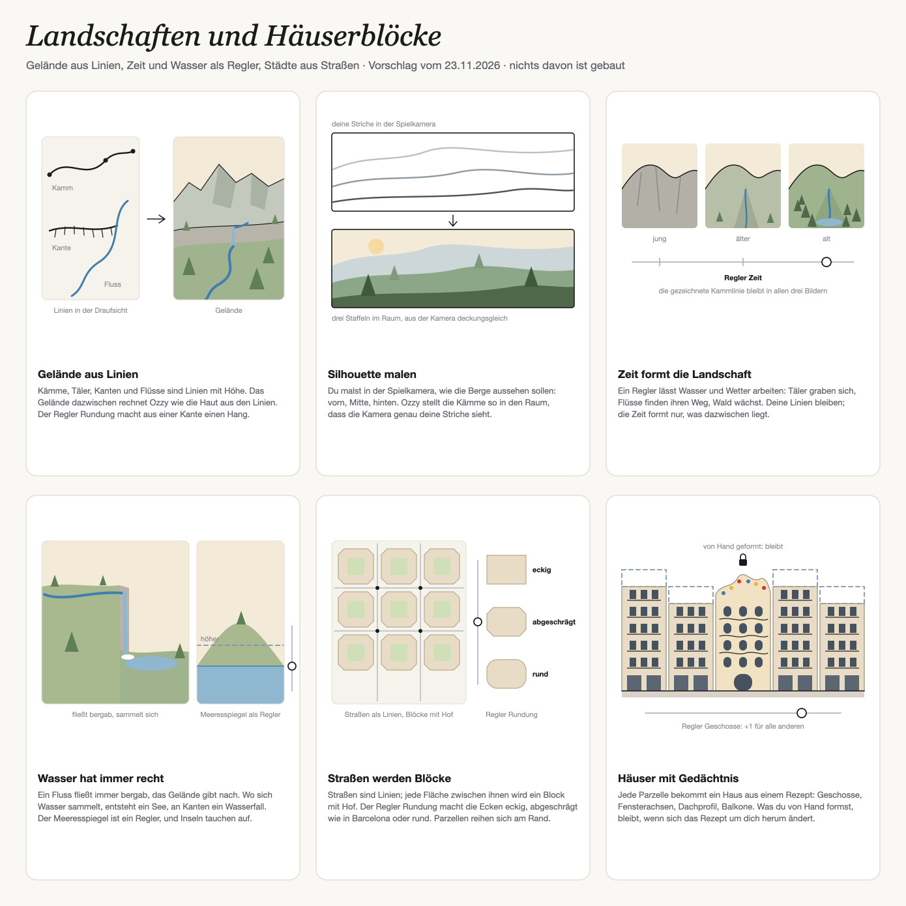

# Ozzy als Suite, Teil 10: Landschaften und Häuserblöcke

Stand 23.11.2026. Ohne Agenten, mit drei Suchen (Gebäude-Generatoren für Blender, Gelände-Werkzeuge, KI-Welten). Vorher: Teil 1
bis 9 (`2026-11-23-ozzy-suite-*.md`). Fortgesetzt werden der Häuserblock aus Teil 3 (C1 bis C9) und das Gelände aus Teil 8
(Abschnitt 3). Nichts davon ist gebaut.

**Dein Wort (23.11.):** „Mache mir gerne auch ein Konzept, wie man ganze Landschaften mit Ozzy bauen könnte. Ich kenne diese tollen
Blender-Plugins, die ganze realistische Häuserblocks erstellen. Das will ich mit Ozzy auch können, noch dynamischer und noch schöner.“

## 0 Kurzfassung

1. **Gelände aus Linien.** Kämme, Täler, Kanten, Ufer und Flüsse sind Linien mit Höhe; das Gelände dazwischen rechnet Ozzy so, wie es
   heute die Haut aus den Linien rechnet. Der Regler Rundung macht aus einer Kante einen Hang. Felsbögen, Überhänge und Höhlen sind
   Körper, die angesetzt oder ausgeschnitten werden; das kann eine reine Höhenkarte nicht.
2. **Silhouette malen.** In der Spielkamera malst du, wie die Berge aussehen sollen: vorn, Mitte, hinten. Ozzy stellt die Kämme so in
   den Raum, dass die Kamera genau deine Striche sieht (deine Projektionsansicht aus Teil 2, die Staffeln aus Teil 9).
3. **Zeit als Regler.** Wasser und Wetter arbeiten auf einen Zug am Regler: Täler graben sich, Flüsse finden ihren Weg, Wald wächst,
   Schnee fällt. Deine Linien sind Gesetz; die Zeit formt nur, was dazwischen liegt.
4. **Wasser hat immer recht.** Flüsse fließen bergab, Wasser sammelt sich zu Seen, an Kanten entstehen Wasserfälle. Der Meeresspiegel
   ist ein Regler.
5. **Pflanzen nach Sätzen.** „Am Nordhang Tannen, am Ufer Schilf, über der Schneegrenze Fels“; dazu Pinsel und Streuen mit Gedächtnis
   (Teil 8). Bäume sind Ozzy-Formen: Stamm und Äste als Linien, die Krone aufgeblasen.
6. **Städte aus Straßen.** Straßen sind Linien; jede Fläche dazwischen wird ein Block mit Hof. Der Regler Rundung macht die Ecken
   eckig, abgeschrägt wie im Eixample von Barcelona oder rund. Parzellen reihen sich am Rand, und jede bekommt ein Haus aus einem Rezept
   im gewählten Stil.
7. **Bauen mit Gedächtnis.** Was du von Hand änderst, bleibt, wenn sich Rezept, Zeit oder Stil ändern. Das ist der wichtigste
   Unterschied zu den Generatoren in Blender.
8. **Scribble, Vorbilder und Claude.** Striche werden Kämme, Flüsse, Wälder und Straßen. Vorbilder sind Bilder, Fotoscans, KI-Welten
   und echte Geländedaten. Claude füllt im Zweig und prüft mit Wächtern.

## 1 Was es gibt (November 2026)

| Art | Beispiele | stark | was fehlt |
| --- | --- | --- | --- |
| Häuser in Blender | Nodee Buildings (Geometry Nodes, 17 Vorlagen, für Blender 5.1 und 5.2), BRiCKiTECT (Backstein; Eckhäuser, Straßenzeilen, ganze Blöcke), Procedural Building Generator 2, Buildify (Baukasten), Geo-Buildings | realistische Häuser in Minuten | Bedienung über Knoten und Zahlen; Handarbeit am Ergebnis passt nicht zum Neuberechnen (entweder bleibt es prozedural, oder man wendet es an und verliert die Regler); kein Wachsen, kein Spielbudget |
| Städte in Blender | iCity: Straßennetz zeichnen, Häuser füllen es (Beta seit 2024) | Straßen zeichnen statt Zahlen eingeben | das Ergebnis lässt sich schwer von Hand weiterformen |
| Gelände | Gaea (Erosion, Knoten), World Creator (Erosion live auf der Grafikkarte, Fassung 2026.1), World Machine; in Blender TerrainLab (Erosion, Flüsse, Wind; ab Blender 5) und TerraScape | Erosion in hoher Güte | Höhenkarten ohne Überhänge; Knoten statt Zeichnen; meist eigene Programme mit Hin und Her |
| KI-Welten | World Labs Marble (seit November 2025: Welt aus Text, Bild oder Video), dazu Chisel: grobe Klötze legen, Text bestimmt den Stil | in Minuten eine ganze Welt | das Ergebnis ist keine Linie, die man weiterformt; der Stil kommt über Worte; fürs Spiel schwer im Budget zu halten |

Chisel trennt den Aufbau (grobe Formen) vom Stil (Text), so wie Ozzy Linien und Looks trennt. Das bestätigt den Weg. Ozzy macht den
Aufbau mit Strichen statt Klötzen und den Stil mit Vorbildern und Reglern statt Worten, und das Ergebnis bleibt bearbeitbar.

## 2 Der Grundgedanke: dieselbe Grammatik im Großen

- **Linie, Körper, Rundung, Verbindung** (Teil 4) gelten auch für Berge und Städte. Kämme und Straßen sind Linien; Gelände und Blöcke
  sind Körper; die Rundung macht Kanten zu Hängen und Blockecken zu Schrägen; die Verbindung schneidet Täler, Höhlen und Höfe aus und
  setzt Felsbögen an.
- **Frequenztrennung** (Teil 3): die großen Züge an den Linien, die mittleren aus der Zeit (Erosion, Wasser, Wachstum), die feinen im
  Werkstoff (Felsschichten, Gras, Schnee) und beim Streuen.
- **Alles bleibt Linie oder Regler,** damit Hand, Scribble und Claude dasselbe bedienen.

## 3 Gelände

- **Linien mit Höhe.** Punkte tragen ihre Höhe, Griffe die Steilheit. Arten: Kamm, Talweg, Kante (Abbruch), Ufer, Weg, Höhenlinie.
- **Die Haut dazwischen.** Ozzy rechnet eine glatte Fläche, die alle Linien trifft, wie die Haut aus den Linien. In der Forschung heißt
  das Gelände aus Merkmalslinien (Hnaidi und andere 2010). Der Löser für dünn besetzte Gleichungen (`packages/shape/src/loeser/`) kann
  das als neue Aufgabe übernehmen.
- **Kanten.** Rundung 0 ist eine senkrechte Wand (Klippe), Rundung 1 ein weicher Hang. Wo es steil wird, zeigt sich von selbst Fels
  (Werkstoff nach Steilheit).
- **Körper für alles, was überhängt.** Felsbögen, Überhänge, Felsnadeln und Höhlen sind Körper aus Stein, die mit der Verbindung
  angesetzt oder ausgeschnitten werden.
- **Genau auf Abruf.** Höhenlinien in Metern, Maße, Gefälle in Prozent: für Architektur und Gärten (Geländemodell).
- **Silhouette malen.** Du malst in der Spielkamera Striche für vorn, Mitte und hinten. Ozzy setzt für jeden Strich einen Kamm in
  passender Tiefe, so dass die Kamera genau deine Striche sieht; jeder Strich wird eine Staffel (Teil 9). Aus der Malansicht ist es
  genau, aus anderen Ansichten ist es Ozzys bester Vorschlag, den du weiterformst (wie bei der Projektionsansicht aus Teil 2).

## 4 Wasser

- **Flüsse fließen bergab.** Zeichnest du einen Fluss, prüft Ozzy das Gefälle; wo er bergauf liefe, gräbt sich der Talweg tiefer.
  Wasser hat immer recht.
- **Seen** entstehen, wo Wasser nicht abfließen kann: Die Senke füllt sich bis zur Überlaufkante (ein bewährtes Verfahren dafür:
  Priority-Flood, Barnes und andere 2014).
- **Wasserfälle** an Kanten, **Mündungen und Deltas** am Meer.
- **Meeresspiegel als Regler:** Inseln tauchen auf und ab, die Küste folgt.
- **Feuchte als Karte:** Nah am Wasser ist es feucht; das speist die Pflanzen (Abschnitt 6).
- **Werkstoff Wasser:** in Wirklichkeit spiegelnd und durchsichtig mit Schaum, im Stil Earle flache Bänder (Teil 9).

## 5 Zeit

- **Ein Regler lässt Wasser und Wetter arbeiten:** Gebirge heben sich und verwittern, Flüsse graben Täler, Schutt sammelt sich am Fuß,
  Seen verlanden. Vorbilder aus der Forschung: Hebung und Erosion (Cordonnier und andere 2016), Erosion und Pflanzen zusammen
  (Cordonnier und andere 2017).
- **Linien sind Gesetz.** Was du gezeichnet hast, verschiebt die Zeit nicht; sie formt nur, was dazwischen liegt. Bei Zeit 0 siehst du
  den reinen Entwurf. Einen Baum, den du gesetzt hast, fällt die Zeit nicht.
- **Vorgerechnet, dann flüssig.** Die Rechnung läuft in der Ruhe auf der Grafikkarte (am Mac schnell, am iPhone auf kleinerem Gitter
  oder gebacken) und legt Zwischenstände ab; der Regler fährt danach flüssig hin und her. Gleiche Samen ergeben die gleiche Landschaft.
- **Jahreszeit, Tageszeit, Wetter** sind Regler wie die Spielwerte aus Teil 8: Die Schneegrenze sinkt, Laub färbt sich, Nebel liegt im
  Tal.

## 6 Pflanzen, Steine und Leben

- **Biome als Sätze** (Studio): „Wo es flach und feucht ist: Wiese mit Blumen. Am Nordhang: Tannen. Über der Schneegrenze: Fels und
  Schnee. Am Ufer: Schilf.“ Die Bedingungen kommen aus Gelände, Wasser und Sonne.
- **Pinsel** für mehr, weniger und anders; Regler für Dichte, Vielfalt und Gruppen.
- **Streuen mit Gedächtnis** (Teil 8): einzelne Bäume greifen, versetzen, tauschen; sie bleiben.
- **Wachstum:** Wald breitet sich mit der Zeit aus, Bäume streiten um Licht und Wasser.
- **Bäume sind Ozzy-Formen:** Stamm und Äste sind Linien (Abzweigungen wie mit P), die Krone wird aufgeblasen oder aus Büscheln gebaut.
  Eine Baum-Leiter führt vom Setzling zum alten Baum (Teil 3); Wind ist Verhalten (Teil 3, C6).
- **Steine und Felsen** streut Ozzy nach Steilheit und Schutt; große Felsen sind Körper.
- **Leben:** Vögel, Rauch und Wolken als Verhalten; Tiere kommen mit dem Teil Physik.

## 7 Häuserblöcke und Städte

Teil 3 (C1 bis C9) zeigt ein einzelnes Haus vom Grundriss bis zur Leiter. Hier geht es eine Ebene höher.

- **Straßen sind Linien mit Kreuzungen,** wie die Kreuzungen im Kern. Breite und Profil (Gehweg, Fahrbahn, Baumreihe) sind Regler; die
  Straße legt sich aufs Gelände, und Bezüge halten sie befahrbar.
- **Blöcke entstehen von selbst:** Jede geschlossene Fläche zwischen Straßen wird ein Block. Die Rundung an den Ecken geht von eckig
  über abgeschrägt (wie im Eixample nach Cerdà) bis rund. Der Hof ist ein Loop nach innen; seine Tiefe ist ein Regler.
- **Parzellen** reihen sich am Blockrand: Breite von–bis, Zufall mit Samen; Ecken bekommen Eckhäuser.
- **Ein Haus-Rezept je Parzelle:** Geschosse (Regler), ein eigenes Erdgeschoss (Läden, Tore), Fensterachsen als Reihe mit Bezügen, das
  Dachprofil als Linie in der Seitenansicht (Satteldach, Mansarde, Flachdach mit Garten, Kuppel), Bausteine als Vorlagen mit
  Abweichungen (Balkon, Erker, Gesims, Gauben).
- **Stile als Rezepte:** Eixample und Modernisme (mit Panot und Trencadís aus dem Shader-Strang), Gründerzeit, Fachwerk, Bauhaus,
  Japan, Earle-Märchen. Ein Stil legt Bausteine, Maße, Werkstoffe und Regeln fest („Erker nur an Ecken“, „Balkone ab dem ersten
  Geschoss“). Lieber wenige ausgefeilte Stile als viele Mischungen (deine Regel aus dem Shader-Strang).
- **Bauen mit Gedächtnis:** Ein Haus, das du von Hand formst, mit der ganzen Grammatik bis zur Gaudí-Welle, bleibt, wenn sich das
  Rezept ändert. Die Nachbarn passen sich an (Anschluss, Brandwand).
- **Noch dynamischer:** Die Stadt wächst mit der Zeit oder mit dem Fortschritt im Spiel (Teil 8). Hütten werden Häuser, Lücken füllen
  sich, Straßen bekommen Pflaster; das ist die Leiter von 2 bis 2048 im Großen (Teil 3). Fenster leuchten nachts, Rauch steigt, Wäsche
  weht.
- **Noch schöner:** die Wirklichkeit als Kern (Teil 9) mit echtem Stein, Licht und Schatten in den Gassen, der Stil als Regler bis Earle.
  Dazu ein Regler „Handschrift“: Kanten leicht ungerade, Fenster nicht ganz gleich, wie gezeichnet; bei 0 genau wie im CAD.
- **Genau auf Abruf:** Maße in Metern, Geschosshöhe, Raster, Schnitt (Teil 3, C5).

## 8 Scribble statt Prompt

| Strich | wird |
| --- | --- |
| Zickzack (Draufsicht) | Kamm; die Höhe kommt aus der Seitenansicht oder einem zweiten Strich |
| Strich quer über die Spielkamera | Silhouette einer Staffel |
| Wellenlinie | Fluss; die Breite kommt aus der Strichstärke |
| geschlossener Umriss, schraffiert | See; mit kurzen Strichen außen dran: Plateau mit Kante |
| Schraffen quer zum Hang | Steilheit, wie auf alten Landkarten |
| Kringel, eng oder locker | Wald, dicht oder licht |
| Punkte | Felsen und Steine |
| kurze Striche entlang einer Linie | Terrassen, Weinberg, Reisfelder |
| Gitter aus Linien | Straßen; die Blöcke entstehen von selbst |
| Rechteck mit Dach | Haus; mehrere davon: Dorf |
| Rotstift: durchstreichen, umkreisen mit Fragezeichen | entfernen; Claude fragen |

Der Kontext entscheidet (Teil 6): Derselbe Kringel ist im Gelände ein Wald, an einer Figur eine Locke und an einer Straße eine Baumreihe.

## 9 Vorbilder und Claude

- **Vorbilder:** ein Bild (Earle) in der Spielkamera; ein Fotoscan (Teil 9); eine KI-Welt (Marble) als Vorbild im Raum; echte Daten,
  etwa Höhenmodelle (Copernicus, frei nutzbar mit Quellenangabe) und Straßen und Häuser aus OpenStreetMap (frei, mit Namensnennung).
  So lässt sich Barcelona als Vorbild laden und im Stil Earle zeigen.
- **Vom Vorbild zu Linien:** Ozzy und Claude legen Kämme, Flüsse und Straßen als Geister über das Vorbild; du nimmst, was passt.
- **Claude im Zweig:** Fleißarbeit (ein Tal füllen, ein Viertel bauen, die 15 Zonen der Karte), Varianten als Geister.
- **Wächter:** Flüsse fließen bergab; Wege und Straßen bleiben begehbar und befahrbar; nichts schwebt (Bäume und Häuser stehen auf dem
  Boden); Häuser überlappen nicht; das Budget fürs iPhone hält.

## 10 Wirklichkeit und Stil

- **Wirklichkeit als Kern** (Teil 9): ein physikalischer Himmel mit Dunst nach Entfernung, echte Felsschichten, Schnee nach Höhe und
  Steilheit, nasser Boden am Wasser.
- **Stil als Regler:** dieselbe Landschaft als Earle-Siebdruck (Staffeln, harte Stufen, Verlauf innen), als Ghibli oder Ukiyo-e. Die
  Kulissen aus dem nächsten Abschnitt machen den Stil zugleich schnell.

## 11 Tempo auf dem iPhone 16

- **Gelände in Kacheln** mit Detail nach Abstand; die Linien bleiben scharf.
- **Kulissen:** Ferne Berge und Stadtteile rendert Ozzy in der Ruhe in wenige gestaffelte Bilder mit Tiefe, wie Theaterkulissen und wie
  Earles Staffeln, und erneuert sie erst, wenn sich die Kamera weit bewegt. Das spart am meisten und passt zum Stil.
- **Pflanzen:** Instanzen je Art (wie im Spiel), nah als Form, mittel vereinfacht, fern als Bild (das Spiel zeigt ferne Bäume schon als
  Bilder).
- **Häuser:** Bausteine als Instanzen; die Fassaden ferner Blöcke als Bild auf einfachen Klötzen.
- **Zeit und Erosion** rechnen am Mac in der Ruhe; am iPhone auf kleinem Gitter oder gebacken. Der Regler fährt über vorgerechnete
  Stände.
- **Budgets als Wächter,** etwa die Draw Calls der Karte (höchstens 80 im Median und 100 im Höchstfall beim Schwenken).

## 12 Ins Spiel

- Die Karte (Teil 8) ist eine Landschaft aus diesem Teil; die Weltform biegt sie, der Ozzy-Player spielt sie ab (Teil 9).
- Beim Ausgeben backt Ozzy: Gelände in Kacheln, Kulissen, Instanzen, Atlanten. Was sich im Spiel ändern soll (die wachsende Stadt, die
  Jahreszeit), bleibt ein Spielwert.

## 13 Ehrlich in Frage gestellt

1. **Erosion in der Güte von Gaea oder World Creator ist jahrelange Arbeit.** Ozzy braucht „gut genug und steuerbar“ und kann
   Höhenkarten aus diesen Programmen als Vorbild oder Grundlage laden.
2. **Ganze Täler in voller Dichte am iPhone zu bearbeiten, ist unrealistisch.** Am iPhone formst du Linien und Regler; die schwere
   Rechnung läuft am Mac oder in der Ruhe.
3. **Realistische Städte brauchen viele gute Bausteine** (Fenster, Türen, Dächer, Gesimse). Das ist Inhaltsarbeit, nicht nur Code.
   Claude kann Bausteine als Ozzy-Formen vorschlagen; dein Auge entscheidet je Stil.
4. **Überhänge und Höhlen sind teurer** (Körper statt Höhenkarte). Zuerst die Höhenkarte mit Linien, die Körper für Felsen danach.
5. **KI-Welten sind schneller beim ersten Bild.** Ozzy gewinnt bei Kontrolle, Stil und Spieltauglichkeit, nicht beim Tempo vom Nichts
   zur Welt. Beides lässt sich verbinden: die KI-Welt als Vorbild.
6. **Was ich an Teil 3 und Teil 8 ändern würde:** Gelände ist nicht nur „ein Körper wie jeder andere“ (Teil 8), sondern Linien mit Höhe
   plus Zeit. Der Häuserblock aus Teil 3 beginnt künftig bei der Straße, nicht beim einzelnen Grundriss.

## 14 Bausteine und Proben

| Reihenfolge | Baustein | Probe (Vorschlag) |
| --- | --- | --- |
| 1 | Gelände aus Linien (Kamm, Talweg, Kante, Fluss) mit Rundung | du zeichnest in zwei Minuten ein Tal mit Fluss und Klippe, das du behalten willst; ein Kamm zieht sich auf dem iPhone flüssig |
| 2 | Silhouette malen | drei Striche in der Spielkamera werden drei Staffeln, aus der Kamera deckungsgleich mit deinen Strichen |
| 3 | Wasser | jeder gezeichnete Fluss fließt bergab, Seen füllen sich, der Meeresspiegel fährt flüssig |
| 4 | Zeit | Erosion und Wald vorgerechnet, der Regler fährt flüssig, deine Linien bewegen sich nicht |
| 5 | Pflanzen nach Sätzen, Streuen mit Gedächtnis | Bäume greifen, die Dichte ändern: deine Bäume bleiben |
| 6 | Straßen, Blöcke, Häuser | ein Straßengitter wird in einer Minute ein Eixample-Viertel; ein Haus von Hand bleibt, wenn du die Geschosse änderst |
| 7 | Vorbilder und Claude | aus einem Earle-Bild legt Claude Kämme und Fluss als Geister; du behältst sie bei zwei von drei Bildern |

## 15 Offene Entscheidungen (deine)

1. Gelände aus Linien als Wahrheit (Empfehlung) oder klassisch eine Höhenkarte mit Pinsel? Den Pinsel gibt es für Details so oder so.
2. Eigene Zeit und Erosion, gut genug und steuerbar (Empfehlung), oder Höhenkarten aus Gaea oder World Creator laden?
3. Erste Probe: ein Tal aus Linien mit Silhouette malen (Empfehlung) oder zuerst Straßen zu einem Eixample-Viertel?

## 16 Quellen

- Häuser und Städte in Blender:
  [Nodee Buildings](https://superhivemarket.com/products/nodee-buildings-generator),
  [BRiCKiTECT](https://superhivemarket.com/products/brickitect),
  [Procedural Building Generator](https://superhivemarket.com/products/procedural-building-generator-for-blender),
  [iCity (80 Level)](https://80.lv/articles/this-procedural-generator-lets-you-create-entire-cities-in-blender)
- Gelände: [TerrainLab](https://superhivemarket.com/products/terrainlab-realistic-terrain-generator),
  [TerraScape](https://superhivemarket.com/products/terrascape-procedural-terrain-generator-erosion-tool),
  [World Creator 2026.1](https://digitalproduction.com/2026/01/30/world-creator-2026-1-polishes-the-boring-bits/),
  [Übersicht (Liste, Methode unklar)](https://gitnux.org/best/terrain-creation-software/)
- KI-Welten: [Marble](https://www.worldlabs.ai/blog/marble-world-model),
  [Chisel (The Batch)](https://www.deeplearning.ai/the-batch/world-labs-makes-its-marble-generative-world-model-public-adds-chisel-editing-tool),
  [Dokumentation](https://docs.worldlabs.ai/)
- Forschung (ohne Link): H. Hnaidi, E. Guérin, S. Akkouche, A. Peytavie, E. Galin, „Feature Based Terrain Generation Using Diffusion
  Equation“, Pacific Graphics 2010; G. Cordonnier und andere, „Large Scale Terrain Generation from Tectonic Uplift and Fluvial Erosion“,
  Eurographics 2016; G. Cordonnier und andere, „Authoring Landscapes by Combining Ecosystem and Terrain Erosion Simulation“, SIGGRAPH
  2017; R. Barnes, C. Lehman, D. Mulla, „Priority-Flood“, Computers & Geosciences 2014; É. Guérin und andere, „Interactive
  Example-Based Terrain Authoring with Conditional Generative Adversarial Networks“, SIGGRAPH Asia 2017 (Skizze zu Gelände).
- Vorher: Teil 2 (Projektionsansicht), Teil 3 (Häuserblock C1 bis C9, Leiter), Teil 4 (Grammatik), Teil 6 (Scribble), Teil 8 (Karte,
  Streuen mit Gedächtnis), Teil 9 (Wirklichkeit als Kern, Staffeln).
