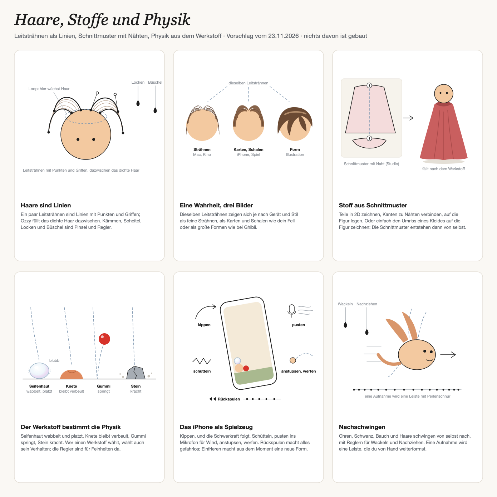

# Ozzy als Suite, Teil 11: Haare, Stoffe und Physik

Stand 23.11.2026. Ohne Agenten, mit zwei Suchen (Physik im Browser, Marvelous Designer). Gelesen: die Fell-Recherche des
Shader-Strangs (Zweig `claude/ozzy-shader`). Vorher: Teil 1 bis 10 (`2026-11-23-ozzy-suite-*.md`). Nichts davon ist gebaut.

**Dein Wort (23.11.):** „Haare und Stoffe sollen sich spielerisch erstellen und animieren lassen. Physik soll Spaß machen.“

## 0 Kurzfassung

1. **Haare sind Linien.** Ein paar Leitsträhnen mit Punkten und Griffen wachsen aus einem Loop auf der Haut. Ozzy füllt das dichte Haar
   dazwischen, so wie es die Haut zwischen den Linien füllt. Kämmen, Scheitel, Locken und Büschel sind Pinsel und Regler; auch Fell
   bekommt so seine Richtung.
2. **Eine Wahrheit, drei Bilder:** dieselben Leitsträhnen als feine Strähnen (Mac, Kino), als Karten und Schalen (iPhone, Spiel; die
   Schalen kommen aus dem Shader-Strang) oder als große Formen (Illustration, wie bei Ghibli).
3. **Stoff aus Schnittmustern.** Teile in Studio zeichnen, Kanten zu Nähten verbinden, auf die Figur legen. Der spielerische Weg: den
   Umriss eines Kleides auf die Figur zeichnen; die Schnittmuster entstehen von selbst.
4. **Der Werkstoff bestimmt die Physik.** Seifenhaut wabbelt und platzt, Knete bleibt verbeult, Gummi springt, Stein kracht, Stoff
   fällt, Haar schwingt. Wer einen Werkstoff wählt, wählt sein Verhalten; die Regler sind für Feinheiten da.
5. **Physik als Spielzeug.** Anstupsen, werfen, kippen (die Schwerkraft folgt dem iPhone), schütteln, ins Mikrofon pusten für Wind.
   Rückspulen macht alles gefahrlos.
6. **Physik als Werkzeug.** Fallenlassen zum Anordnen (Steine, Kissen, Laub) und Einfrieren als neue Form; das Ergebnis wird wieder
   Linien.
7. **Physik als Animation.** Ohren, Schwanz, Bauch, Haare und Kleider schwingen von selbst nach. Eine Aufnahme wird eine Leiste mit
   Perlenschnur, und die Hand schlägt die Physik.
8. **Stil gilt auch für Bewegung:** ein Regler von echter Physik bis Trickfilm (Strecken und Stauchen, Schweben am höchsten Punkt).

## 1 Was es gibt (November 2026)

| Bereich | Beispiele | was wir daraus lernen |
| --- | --- | --- |
| Haare | Spline V2: Strähnen auf der Grafikkarte simuliert, mit Licht, Schatten, Wind und Büscheln (Teil 9); Blender: Haare als Kurven; Spiele: Haarkarten; dein Fell: Schalen | Leitsträhnen plus dichtes Haar ist überall der Kern; einzelne Strähnen sind am Handy zu teuer |
| Stoffe | Marvelous Designer 2026.0 (April): 3D Pencil, also Schnittteile direkt auf die Figur zeichnen, dazu ein Toon Shader; 2026.1 (August): Falten mit dem Pinsel malen, Nähte reißen lassen; seit 2025.1 ein KI-Schnittzeichner (Beta) aus Text oder Skizze | Zeichnen auf der Figur und Falten malen gibt es schon; Ozzy muss es spielerischer, auf dem Handy und fürs Spiel können |
| 2D | Live2D: Haare und Kleider schwingen in 2D-Illustrationen | dasselbe soll in Studio gehen |
| Spielzeug | Crayon Physics Deluxe (Zeichnungen werden Körper), Algodoo (Physik-Sandkasten) | Physik macht Spaß, wenn sie sofort antwortet und man nichts kaputt machen kann |
| Rechenwege | XPBD (2016), Vertex Block Descent (2024), Augmented Vertex Block Descent (2025); Rapier und Jolt für harte Körper im Browser; Box2D v3 für 2D | AVBD läuft schon im Browser mit three.js und WebGPU, auch in Safari 26 auf dem iPhone (three-avbd: Seile, Federn, Stoff, Fahne im Wind) |

## 2 Haare

- **Wo und wie:** Ein Loop auf der Haut sagt, wo Haar wächst. Leitsträhnen setzt du mit P wie jede Linie (Punkte, Griffe). Das dichte
  Haar dazwischen mischt Ozzy aus den nächsten Leitsträhnen.
- **Regler:** Länge, Dichte, Locken (Spiralen um die Leitsträhne), Büschel (Haare ziehen sich zu Strähnen zusammen), zerzaust, Dicke
  zur Spitze hin.
- **Pinsel:** kämmen (schiebt Leitsträhnen), scheiteln (eine Linie auf dem Loop, das Haar fällt zu beiden Seiten), kürzen, toupieren.
- **Fell:** Die Fellrichtung zeichnest du als Linien auf der Haut; die Schalen aus dem Shader-Strang folgen ihr. Federn sind eine Reihe
  von Bausteinen entlang einer Linie (Flügel) und wachsen mit der Leiter (Teil 3).
- **Haar als Form:** In Illustrationen sind Haare große Strähnen. Jede ist ein Körper, entlang der Leitsträhne gezogen und zur Spitze
  verjüngt (Grammatik: entlang ziehen, Rundung). Ein Glanzband wie im Anime ist ein Loop (Teil 9).
- **Zeigen je Gerät:** Strähnen am Mac in Ruhe und im Stil Kino, Karten oder Schalen am iPhone und im Spiel, Formen in der
  Illustration. Ein Regler oder der Stil entscheidet; die Leitsträhnen bleiben dieselben.
- **Bewegung:** Simuliert werden nur die Leitsträhnen (wenige hundert Linien mit wenigen Punkten), das dichte Haar folgt. Im Spiel
  genügen Federn je Leitsträhne.

## 3 Stoffe

- **Schnittmuster in Studio:** Teile sind Loops, Nähte sind Paare von Kanten. Ozzy kennt Nähte schon aus dem Strang „Objekte, Spiegel und
  Nähte“; beim Stoff heißt Naht dasselbe: die Stelle, an der zwei Teile verbunden sind. Teile um die Figur legen, nähen, der Stoff fällt.
- **Spielerisch:** Den Umriss eines Kleides, Capes oder Schals zeichnest du in der Front auf die Figur (Projektionsansicht). Ozzy macht
  daraus Vorder- und Rückenteil mit Nähten; die Teile bleiben in Studio bearbeitbar. Marvelous Designer hat mit dem 3D Pencil seit April
  2026 dasselbe Prinzip; Ozzy macht es am Handy und fürs Spiel.
- **Werkstoff Stoff:** Seide, Leinen, Wolle, Strick, Leder, Papier, Gummi, Stoff aus Seifenhaut. Regler: Gewicht, Steifheit, Dehnung,
  Knittern, Glanz.
- **Gewollte Falten zeichnen:** Eine Linie quer über den Stoff wird eine Falte, die sich beim Bewegen wieder einstellt (Marvelous malt
  Falten seit 2026.1 mit dem Pinsel). Ungewollte Falten in der Haut bleiben Fehler.
- **Einfrieren:** Der gefallene Stoff wird eine Form mit Linien, für Standbilder und fürs Spiel.
- **Im Spiel:** Kleidung meist eingefroren und mit Knochen bewegt, dazu Nachschwingen; echter Stoff nur, wo er billig ist (Cape, Fahne,
  Schal).

## 4 Physik aus dem Werkstoff

| Werkstoff | Verhalten |
| --- | --- |
| Seifenhaut | leicht, wabbelt, platzt an Spitzem, verschmilzt mit anderen Blasen |
| Knete | weich, bleibt verbeult, klebt ein wenig |
| Gummi | federt, springt |
| Stein | schwer, hart, kann brechen |
| Metall | schwer, verbiegt sich, klingt |
| Holz | leicht, splittert |
| Stoff | fällt, flattert |
| Haar | schwingt |
| Wasser, Sand | fließen und rieseln, als Ströme (Teil 1) |

- **Regler mit klaren Namen:** Gewicht, Härte, Federn, Kleben, Rutschen, Luftwiderstand, zerbrechlich.
- **Klang aus dem Werkstoff** (Idee): Stein klackt, Gummi ploppt, die Seifenblase macht blubb.
- **Physik bewegt die Linien.** Seil, Schwanz und Haar sind Linien, deren Punkte die Physik bewegt; Stoff und weiche Körper sind Netze
  aus Loops. Friert man ein, schreibt Ozzy das Ergebnis als Linien zurück, und es bleibt bearbeitbar.

## 5 Die Spielwiese

- **Ein Schalter: Formen oder Spielen.** Beim Spielen lässt sich alles anstupsen, greifen, werfen und mit zwei Fingern quetschen.
- **Das Gerät als Spielzeug:** kippen (die Schwerkraft folgt dem Lagesensor), schütteln, pusten (das Mikrofon misst nur die Lautstärke;
  nichts wird aufgenommen oder verschickt; Safari fragt einmal um Erlaubnis), mehrere Finger zugleich.
- **Kräfte als Dinge:** Ventilator, Magnet, Wirbel, kleine Planeten mit eigener Schwerkraft (die Kugel aus Teil 8 im Kleinen), Feder,
  Seil, Gelenk, Scharnier, Motor; jedes mit Reglern.
- **Rückspulen und Einfrieren:** Die letzten Sekunden liegen als Leiste bereit; zurückfahren, neu werfen. Einfrieren übernimmt einen
  Moment als neue Form oder Pose.
- **Fallenlassen zum Anordnen:** Steine auf einen Haufen, Kissen aufs Sofa, Laub auf den Weg, Bücher ins Regal; dann einfrieren.

## 6 Physik als Animation

- **Nachschwingen ist Standard für jede Figur:** Ohren, Schwanz, Bauch, Haare, Kleider; Regler für Wackeln, Nachziehen und Federn. Es
  läuft live über der Pose (Pose ist Knochen plus Blendshape), ist billig und läuft auch im Spiel.
- **Strecken und Stauchen** mit gleichem Volumen bei Sprüngen und beim Verschmelzen im 2048-Spiel (Teil 3).
- **Aufnehmen:** Eine Simulation wird eine Leiste mit Perlenschnur (Studio, Teil 5).
- **Hand schlägt Physik:** Du greifst einen Moment und änderst ihn; Ozzy rechnet den Rest so, dass er glaubhaft bleibt und durch deinen
  Moment geht. In der Forschung heißt die Idee „Spacetime Constraints“ (Witkin und Kass 1988).
- **Stil für Bewegung:** ein Regler von echt bis Trickfilm (Teil 9 im Bewegten): mehr Strecken und Stauchen, Schweben am höchsten Punkt,
  übertriebene Sprünge.
- **Ströme** (Teil 1): Regen, Schnee, Funken, Laub, Seifenblasen; sie stoßen an Gelände und Formen.

## 7 In 2D (Studio)

Dieselben Linien: Haare und Kleider schwingen auch in 2D (wie bei Live2D), harte Körper rechnet Box2D v3, und die Schnittmuster entstehen
ohnehin in Studio.

## 8 Scribble statt Prompt

| Strich | wird |
| --- | --- |
| kurzer Pfeil auf einen Körper | Stoß in diese Richtung; die Länge ist die Stärke |
| Wellenlinien | Wind aus dieser Richtung |
| Spirale | Wirbel |
| Zickzack zwischen zwei Körpern | Feder |
| durchhängende Linie zwischen zwei Punkten | Seil |
| kleiner Kreis an einem Punkt | Gelenk |
| Kreuz auf einem Punkt | angeheftet |
| kurze Striche aus einem Loop heraus | Leitsträhnen |
| Kringel an einer Strähne | Locken |
| Umriss eines Kleides in der Front | Kleid; die Schnittmuster entstehen von selbst |
| gestrichelte Linie zwischen zwei Stoffkanten | Naht |
| Linie quer über einen Stoff | gewollte Falte |
| Blitz | zerbrechen |
| Rotstift: durchstreichen, umkreisen mit Fragezeichen | entfernen; Claude fragen |

## 9 Claude

- **Befehle:** `haare_wachsen`, `leitstraehne_setzen`, `kaemmen`, `schnittmuster_setzen`, `naehen`, `werkstoff_setzen`, `kraft_setzen`,
  `simulieren`, `einfrieren`, `aufnehmen`.
- **Fleißarbeit im Zweig:** eine Frisur nach einem Bild als Leitsträhnen, ein Kleid nach einem Schnitt, Regler so stellen, dass ein Stoff
  wie Seide fällt.
- **Wächter:** Nichts fährt durch etwas hindurch; Haare stecken nicht in der Haut; Stoff zittert nicht und reißt nicht ungewollt; die
  Rechnung bleibt stabil; das Budget hält.
- **Idee: Bewegung nach Vorbild.** Du filmst echten Stoff oder echtes Haar, und Ozzy und Claude stellen die Regler so, dass die
  Simulation ähnlich schwingt. Das ist Forschungsarbeit (Abschnitt 12).

## 10 Tempo auf dem iPhone 16

- **Ein Löser** für Seile, Haare, Stoff und weiche Körper auf der Grafikkarte (Vertex Block Descent oder XPBD); harte Körper mit Rapier
  oder Jolt. Ruhende Körper schlafen und kosten nichts (Teil 9).
- **Schätzung, ungemessen:** einige tausend Stoffpunkte, einige hundert Leitsträhnen und einige hundert harte Körper live; mehr in der
  Ruhe oder gebacken. Gemessen wird auf der Messseite aus Teil 2.
- **Ohne WebGPU in der App** (Teil 9): Physik auf dem Prozessor (WebAssembly) in kleinerem Maß, oder gebacken.
- **Im Spiel** nur, was immer gleich ausgeht und billig ist (Nachschwingen, kleine Spielereien mit festem Takt); der Rest wird gebacken.

## 11 Wirklichkeit und Stil

Haar mit echtem Licht (Kino) oder mit Glanzband und Formen (Anime, Ghibli); Stoff mit dem Schimmer von Samt und Seide oder in flachen
Stufen; Bewegung von echt bis Trickfilm. Alles nach Teil 9: die Wirklichkeit als Kern, der Stil als Regler.

## 12 Ehrlich in Frage gestellt

1. **Strähnenhaar live auf dem iPhone 16 ist zu teuer** (Teil 2); am iPhone gibt es Karten, Schalen oder Formen. Spline hat Strähnen am
   Rechner; Ozzy gewinnt mit Linien als Leitsträhnen, mit Stil und auf dem Handy, nicht mit mehr Strähnen.
2. **Kleidung, die beim Bewegen nicht durch den Körper fährt, ist schwer.** Fürs Spiel kleine Kleidung (Cape, Schal, Hut, Fahne); große
   Kleider eingefroren und mit Knochen bewegt.
3. **Physik kann Formen zerstören;** darum Rückspulen, Einfrieren und „Hand schlägt Physik“.
4. **Bewegung nach Vorbild ist Forschung;** die Probe kommt später.
5. **Marvelous Designer kann Zeichnen auf der Figur und Falten malen schon.** Ozzy kopiert das nicht, sondern verbindet es mit Linien,
   Werkstoffen, Studio und dem Spiel.
6. **Was ich am bisherigen Konzept ändern würde:** Der Werkstoff (Teil 4) bekommt das Verhalten dazu; Aussehen und Physik kommen aus einer
   Hand. Nachschwingen wird ein Standard-Verhalten jeder Figur (Teil 1). Der Stilregler aus Teil 9 gilt auch für Bewegung.

## 13 Bausteine und Proben

| Reihenfolge | Baustein | Probe (Vorschlag) |
| --- | --- | --- |
| 1 | Spielwiese mit Nachschwingen | deine Form auf der Spielwiese: anstupsen, werfen, kippen; Ohren und Bauch schwingen nach; drei Werkstoffe fühlen sich verschieden an. Kriterium: Du spielst freiwillig weiter, und auf dem iPhone 16 ruckelt nichts |
| 2 | Physik aus dem Werkstoff, Rückspulen, Einfrieren | Steine fallen auf einen Haufen, eingefroren und als Linien bearbeitbar |
| 3 | Haare aus Leitsträhnen mit Kämmen | eine Mähne für eine deiner Formen in fünf Minuten; dieselben Strähnen als Form und als Karten |
| 4 | Stoff aus Umriss und Schnittmuster | ein Cape oder Schal, der glaubhaft fällt und sich einfrieren lässt |
| 5 | Aufnahme als Leiste, Hand schlägt Physik | eine Wurfbahn aufnehmen, einen Moment ändern, der Rest passt sich an |
| 6 | Scribble-Kräfte und Claude | von zehn Kraft-Scribbles erkennt Ozzy mindestens acht richtig |

## 14 Offene Entscheidungen (deine)

1. Haare: Leitsträhnen als Linien (Empfehlung) oder Pinsel direkt auf dichtem Haar?
2. Stoffe: erst den Umriss zeichnen, die Schnittmuster darunter (Empfehlung), oder gleich klassische Schnittmuster?
3. Erste Probe: Spielwiese mit Nachschwingen an deiner Form (Empfehlung) oder zuerst Haare?

## 15 Quellen

- Physik im Browser: [three-avbd](https://github.com/sbobyn/three-avbd/wiki), [AVBD (Utah)](https://graphics.cs.utah.edu/research/projects/avbd/),
  [Vertex Block Descent](https://arxiv.org/pdf/2403.06321), [Stoff mit WebGPU (Studie 2025)](https://arxiv.org/pdf/2507.11794),
  [webphysics](https://github.com/jure/webphysics)
- Marvelous Designer: [2026.0](https://digitalproduction.com/2026/04/15/marvelous-designer-2026-0-adds-3d-pencil-and-lacing/),
  [2026.1](https://digitalproduction.com/2026/08/25/marvelous-designer-2026-1-rips-seams/),
  [2026.1 (CG Channel)](https://www.cgchannel.com/2026/08/clo-virtual-fashion-releases-marvelous-designer-2026-1/),
  [2025.1](https://www.cgchannel.com/2025/08/clo-virtual-fashion-releases-marvelous-designer-2025-1/)
- Spline V2 (Haare): Changelog, siehe Teil 9.
- Forschung (ohne Link): M. Macklin, M. Müller, N. Chentanez, „XPBD: Position-Based Simulation of Compliant Constrained Dynamics“, MIG
  2016; A. H. Chen, Z. Liu, Y. Yang, C. Yuksel, „Vertex Block Descent“, SIGGRAPH 2024; C. Giles, E. Diaz, C. Yuksel, „Augmented Vertex
  Block Descent“, SIGGRAPH 2025; A. Witkin, M. Kass, „Spacetime Constraints“, SIGGRAPH 1988; J. Lengyel, E. Praun, A. Finkelstein,
  H. Hoppe, „Real-Time Fur over Arbitrary Surfaces“, I3D 2001; E. Turquin, J. Wither, L. Boissieux, M.-P. Cani, J. F. Hughes, „A
  Sketch-Based Interface for Clothing Virtual Characters“, IEEE CG&A 2007.
- Werkzeuge (ohne Link): Live2D Cubism, Crayon Physics Deluxe, Algodoo, Rapier, Jolt Physics, Box2D v3.
- Im Repo: Fell-Recherche `docs/research/2026-11-21-fell-flausch-recherche.md` (Zweig `claude/ozzy-shader`); Teil 1 (Ströme,
  Perlenschnur), Teil 3 (Leiter, Verschmelzen), Teil 4 (Grammatik, Werkstoff), Teil 5 (Studio: Leisten, Sätze), Teil 9 (Schlaf,
  Wirklichkeit als Kern).
