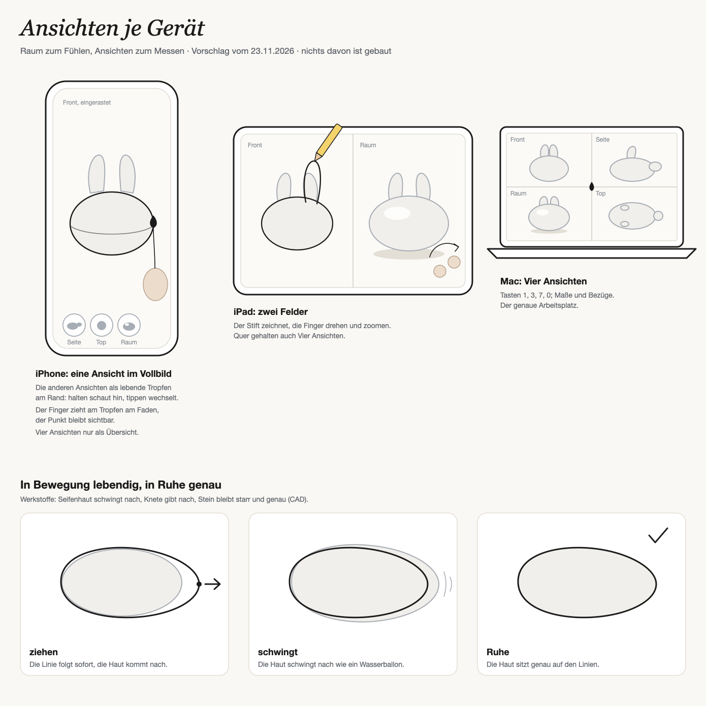
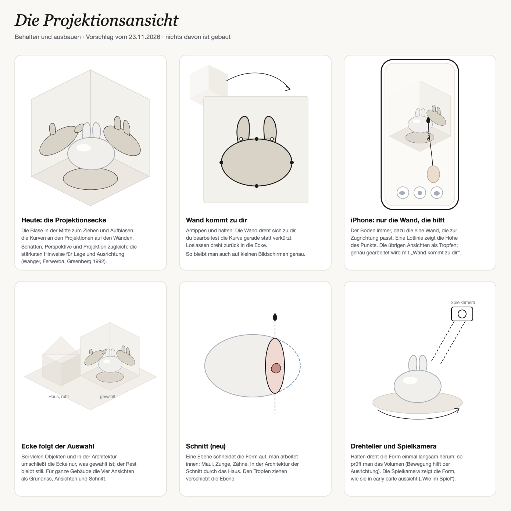

# Ozzy als Suite, Teil 2: Tempo auf dem Handy, Ansichten, lebendig und genau

Stand 23.11.2026. Fortsetzung von [`2026-11-23-ozzy-suite-recherche-und-konzept.md`](2026-11-23-ozzy-suite-recherche-und-konzept.md).

**Deine Fragen (23.11.):**

- „Ist es realistisch, dass eine vollwertige 3D-Suite auf einem guten Handy läuft und auch meine Kurven dort gut editierbar sind mit
  den Fingern? Bei meinen Shadertests ruckelt es jetzt schon sehr.“
- „Wie macht das z. B. Spline? In deren Demovideos sind aufwändige Shapes mit Haarpartikeln in realistischem Look, die live bearbeitet
  werden. Ist so etwas auf einem guten Handy (ab iPhone 16) bereits technisch möglich? Es soll in jeder Hinsicht besser sein als
  Spline und auch das echte, genaue Bearbeiten und Erstellen von 3D-Formen ermöglichen.“
- „Wie und wo die erarbeiteten Ansichten optimal sind und wie sie eingesetzt werden und ob sie auch mobil eine echte Lösung bieten,
  ist mir noch nicht klar.“
- „Man soll deutlich merken, dass Ozzy anders arbeitet. In 3D arbeitet man oft von statischen Formen eine genaue Form aus. Ozzy
  arbeitet mit organischen Formen, die dynamisch und lebendig wirken, auch beim Ziehen. Man soll aber auch CAD-genaue bzw.
  architektonische 3D-Modelle mit hohem Detail und verschiedensten Materialien und Shadern in hoher Qualität und bester Performance
  erarbeiten können.“

**Was dieses Papier ist:** Rechnung und Recherche, keine Messung. Auf dem iPhone ist bisher weder Ozzy noch ein Shader gemessen. Alle
iPhone-Zahlen sind aus Mac-Messungen und öffentlichen Vergleichswerten gerechnet (Studio-Bericht 14c vom 20.11., etwa ±50 % genau).
Nichts davon ist gebaut.

**Inhalt:** 0 Kurzfassung · 1 Was ein iPhone 16 kann · 2 Warum es heute ruckelt · 3 Wie Spline es macht · 4 Was auf dem iPhone geht ·
5 Sieben Regeln für Tempo · 6 Web oder nativ · 7 Mit den Fingern · 8 Die Ansichten · 9 Lebendig · 10 Genau: CAD und Architektur ·
11 Was sich am Weg ändert · 12 Offene Entscheidungen · 13 Quellen

---

## 0 Kurzfassung

1. **Ja, aber nicht so, wie wir heute bauen.** Dass 3D-Bearbeitung auf iPhone und iPad gehen kann, zeigen native Programme wie Nomad
   Sculpt (Nutzer berichten von 5 bis 6 Millionen Dreiecken auf dem iPad). Spline bearbeitet gar nicht auf dem Handy: Der Editor läuft im
   Browser oder in der Desktop-App am Rechner; aufs iPhone kommen nur fertige Szenen, und die spielt Spline mit einem eigenen nativen
   Metal-Renderer ab. Blender hat seine iPad-Fassung im Januar 2026 auf Eis gelegt. Das Feld „echtes 3D-Formen auf dem Handy“ ist frei,
   aber schwer.
2. **Warum es ruckelt, in Zahlen:** Ozzy rechnet beim Ziehen am Mac 11 bis 13 ms je Bild, dein Fell aus dem Shader-Strang braucht am Mac
   26 bis 32 ms je Bild in Bewegung. Die Grafik des iPhone 16 ist drei- bis viermal schwächer als die deines M3 Pro, warm vier- bis
   fünfeinhalbmal, und unter Dauerlast hält es nur 66 bis 78 % seiner Leistung. Für 60 Bilder je Sekunde hat ein Bild 16,7 ms. Das
   Fell bräuchte auf dem iPhone gerechnet ein Mehrfaches davon. Ozzys Ziehen läge knapp bei 60 Bildern, ohne Reserve.
3. **Wie man es schnell macht: sieben Regeln.** Hand und Linien immer im vollen Takt, die Haut darf eine Spur nachkommen (der Plan
   „Löser neben dem Bild“, E2, liegt seit dem 18.11. vor); die Haut auf die Grafikkarte (E1); jeder Look in drei Stufen (Ziehen, Live,
   Ruhe); 3D in geringerer Dichte, Linien gestochen scharf; nur zeichnen, was sich ändert; backen, was ruht; auf dem Gerät messen.
4. **Das Schönste daran:** Regel 1 ist zugleich dein organisches Prinzip. Die Haut, die beim Ziehen wie ein Wasserballon nachschwingt und
   in Ruhe genau auf den Linien sitzt, verdeckt genau die Rechenzeit, die das Handy braucht. „In Bewegung lebendig, in Ruhe genau“ ist
   Gefühl und Technik in einem.
5. **Web oder nativ?** Für das iPhone als ernstes Arbeitsgerät spricht viel für einen eigenen, schnellen Kern: Speicher, Zwischenbilder
   im schnellen Speicher auf dem Chip, keine Pausen der Speicherbereinigung, Vorhersage von Finger und Stift. Offen ist sogar, ob die
   Capacitor-App überhaupt WebGPU bekommt. Empfehlung: zuerst messen, dann zwischen drei Wegen entscheiden.
6. **Ansichten:** Raum zum Fühlen, Ansichten zum Messen. Mac: Vier Ansichten. iPad: zwei Felder, der Stift zeichnet, die Finger drehen.
   iPhone: eine Ansicht im Vollbild, die anderen als lebende Tropfen am Rand; ein Tropfen am Faden als Griff, damit der Finger den Punkt
   nicht verdeckt. Auf dem Handy formt man eher mit Strichen (Scribble), am Mac mit Punkten. Für Architektur sind die Ansichten genau,
   was Architekten benutzen: Grundriss und Ansichten; es fehlt der Schnitt.
7. **CAD und Architektur:** Linien bleiben die Wahrheit; ein Werkstoff entscheidet, ob daraus eine Seifenhaut oder ein fester Körper wird.
   Feste Körper entstehen durch Hochziehen, Drehen, Ausschneiden, Abrunden und Reihen, mit Maßen und harten Bezügen. Hohe Qualität mit
   Tempo: live gerastert, in Ruhe Bild für Bild verfeinert („belichtet“).
8. **Vorschlag:** zuerst eine Messseite und 20 Minuten mit deinem iPhone 16. Danach E2 (Löser neben dem Bild) als erster Bau, weil er
   Tempo und das Lebendige zugleich bringt.

## 1 Was ein iPhone 16 kann

Zahlen aus dem Studio-Bericht 14c (öffentliche Vergleichswerte, Rechnungen etwa ±50 %).

| | iPhone 16 | MacBook Pro mit M3 Pro |
| --- | --- | --- |
| Prozessorkern, kurze Last | gleich schnell (±10 %) | |
| Prozessor unter Dauerlast | 1,3- bis 1,5-mal langsamer; im Stromsparmodus rund 2,5-mal | |
| Grafik | drei- bis viermal schwächer, warm vier- bis fünfeinhalbmal | |
| Speicherbandbreite | rund 60 GB/s | 150 GB/s |
| Bildpunkte | 3,0 Millionen (dreifache Dichte) | 5,9 bis 7,7 Millionen, je nach Modell |
| Bildschirm | 60 Hz | 120 Hz |
| Dauerlast | hält 66 bis 78 % der Grafikleistung | |
| Browser | Stromsparmodus halbiert den Takt auf 30 Hz; Abbrüche des Webprozesses bei 1,25 bis 2 GB beobachtet | |

**Merksatz:** Je Million Bildpunkte kostet derselbe Renderer am Mac 2 bis 3 ms, auf dem iPhone kalt 6 bis 11 ms, warm 8 bis 17 ms
(Studio 14c). Für 60 Bilder je Sekunde hat ein Bild 16,7 ms, für alles zusammen.

## 2 Warum es heute ruckelt

| Posten | Am Mac gemessen | iPhone 16 (Rechnung) |
| --- | --- | --- |
| Ziehen in Ozzy, Rechnen je Bild („strange bird“, „teat firefish“, „maul handgemacht test“) | 11,1 / 11,4 / 12,8 ms (Median), davon der Löser 5 bis 9 ms | kurz etwa gleich, unter Dauerlast 14 bis 19 ms: knapp 60 Bilder, ohne Reserve |
| Fell in Bewegung (Shader-Strang, Runde 7) | 26 bis 32 ms je Bild | ein Mehrfaches der 16,7 ms; wie viel, hängt von der Fenstergröße der Mac-Messung ab |
| Ganze Bühne voller Abstandsfelder (Studio) | 2 bis 3 ms je Million Bildpunkte | 17 bis 34 ms bei voller Dichte |

**Wahrscheinliche Ursachen** (zu messen, nicht geraten):

- **Volle Dichte.** Das iPhone hat 3,0 Millionen Bildpunkte. In zweifacher Dichte wären es 1,3 Millionen, also 56 % weniger Arbeit.
- **Teure Looks.** Fell mit bis zu 32 Schalen und Büschelsuche je Bildpunkt, Rauschen mit vielen Oktaven, Strahlen durch die Form, Dunst.
- **Mehrere Durchgänge mit großen Zwischenbildern** (der Shader-Strang nutzt einen G-Puffer). Handy-Grafikkarten haben wenig Bandbreite
  (rund 60 GB/s). Metal kann Zwischenbilder im schnellen Kachelspeicher auf dem Chip halten; WebGPU bietet das nach meinem Wissen
  nicht verlässlich an (zu prüfen).
- **Übersetzen der Shader beim ersten Erscheinen.** Wer durch die Streifen wischt, wartet auf jeden neuen Shader einmal.
- **Rechnen im Hauptfaden.** Der Löser rechnet heute im selben Takt wie das Bild.

**Folgerung:** Die Ruckler zeigen nicht, dass es nicht geht, sondern dass wir bisher für den Mac gebaut haben. Am Mac sind wir schon
nahe an der Grenze; auf dem iPhone brauchen wir eigene Regeln (Abschnitt 5).

## 3 Wie Spline es macht

- **Der Editor läuft am Rechner.** Im Browser mit WebGPU (WebGL als Rückfall) oder in der Desktop-App von Spline V2. Einen Editor fürs
  iPhone oder iPad habe ich nicht gefunden; „Spline Mirror“ gibt es nur für die Vision Pro.
- **Aufs iPhone kommen fertige Szenen,** und die spielt Spline mit einem eigenen, nativen Metal-Renderer ab (ab A13). Auch Spline geht
  also für Tempo auf dem iPhone nativ.
- **Haare:** In Splines Dokumentation habe ich keine Haar- oder Fell-Funktion gefunden. Realistische Haare aus einzelnen Strähnen sind
  selbst am Rechner teuer; ein großes Spiel zeigte 2025 Strähnenhaar auf starken Grafikkarten. Auf Handys arbeitet man mit Schalen (wie
  dein Fell) oder mit Haarkarten.
  **Korrektur (Teil 9):** Spline V2 hat doch ein Haarsystem: Strähnen aus Kopfhaut-Formen oder jedem Netz, auf der Grafikkarte
  simuliert, mit Licht, Schatten, Wind und Büscheln (Changelog vom 21.08.2026).
- **Demos:** Werbevideos entstehen am Rechner. „Live bearbeitet“ heißt dort: am Mac oder PC mit starker Grafikkarte.

**Was „besser als Spline“ heißen kann:**

1. **Echtes Bearbeiten auf dem Handy.** Spline bietet keins.
2. **Formen aus Linien** statt aus Grundkörpern und Netzbearbeitung.
3. **Lebendig** beim Formen (Abschnitt 9).
4. **KI per Scribble** (Teil 1, Abschnitt 14).
5. **Fertig fürs Spiel** (Backen mit Budget, „Wie im Spiel“).
6. **Am Rechner gleich gute Looks:** Auf dem Mac ist realistische Darstellung wie bei Spline erreichbar (dieselbe Technik, WebGPU).
   Auf dem Handy gibt es sie nur in der Ruhe-Stufe (Abschnitt 5).

„In jeder Hinsicht besser“ ist ein Ziel über Jahre. Zuerst sollte Ozzy dort klar besser sein, wo Spline nichts hat: beim Formen, auf dem
Handy, beim Lebendigen und beim Spiel.

## 4 Was auf dem iPhone 16 geht (eigene Einschätzung, ungemessen)

| Was | live, 60 Bilder | in Ruhe, verfeinert | Bemerkung |
| --- | --- | --- | --- |
| Formen aus Linien: ziehen, Loops, Punkte | ja, mit E2 | | der wichtigste Posten; messen |
| Lebendige Haut (Wasserballon) | ja | | billig, eine Feder je Punkt |
| Stilisierte Looks (Wachs, Cel, Comic, Earle) | ja, in zweifacher Dichte | in voller Dichte | Budget je Look |
| Fell aus Schalen | einfach (wenige Schalen) | voll (32 Schalen) | heute zu teuer |
| Realistische Haare aus Strähnen | nein | grob | auf Handys unüblich |
| Partikel (Funken, Dampf, Tausende) | ja | | auf der Grafikkarte |
| Posen und Animation | ja | | billig |
| Feste Körper mit Booleans | ja, mittlere Größe | | im Hintergrund rechnen |
| Architektur mit vielen Teilen | ja, mit Instanzen und Detailstufen | | Speicher beachten |
| Realistisches Licht (Pfadverfolgung) | nein | ja, über einige Sekunden | „belichten“ |

## 5 Sieben Regeln für Tempo

1. **Zwei Takte.** Zeiger, Linien und Punkte laufen immer im vollen Takt des Bildschirms. Die Haut kommt im Takt des Lösers nach. Genau
   das beschreibt der Plan „Löser neben dem Bild“ (E2, 18.11.): Der Löser zieht in den Hintergrund, im Bild bleiben 4 bis 6 ms; nach dem
   Loslassen steht die Form wie heute. Der Beweis im Kern hält, solange der Löser mindestens so oft rechnet, wie der Zeiger sich meldet.
   Überspringt er Ziele, weicht „strange bird“ um bis zu 0,9 Einheiten ab. Ob das iPhone mithält, muss die Messung zeigen.
2. **Die Haut auf die Grafikkarte** (E1): die glatte Haut und den Netzwechsel im Zug vom Prozessor nehmen.
3. **Drei Stufen je Look.** **Ziehen:** billig, solange etwas bewegt wird. **Live:** 60 Bilder auf dem iPhone in zweifacher Dichte.
   **Ruhe:** volle Schönheit, über mehrere Bilder gesammelt, sobald nichts mehr bewegt wird (das Bild entwickelt sich wie ein Foto oder
   wie die Tinte, die in Paint einläuft). Jeder Look bekommt ein Budget in ms je Million Bildpunkte auf dem iPhone. Das Fell zum Beispiel:
   beim Ziehen Farbe und gemalte Striche, live wenige Schalen, in Ruhe 32.
4. **Dichte nach Bedeutung.** Die Linien sind die Wahrheit und bleiben in voller Dichte gestochen scharf; die weiche Haut darunter darf
   in zweifacher oder wechselnder Dichte gerechnet werden. Das Auge beurteilt Schärfe an Linien und Kanten.
5. **Nur zeichnen, was sich ändert.** Ozzy tut das schon: In Ruhe entsteht kein Bild (S3). Das spart auch Akku und Wärme.
6. **Backen, was ruht.** Muster und Fellfarbe, die nicht von der Blickrichtung abhängen, werden in Texturen gebacken, sobald die Form
   ruht. Teure Rechnung einmal statt in jedem Bild.
7. **Messen auf dem Gerät, bevor Neues dazukommt.** Eine Messseite (Studio 14c, Abschnitt 7), ein Tempo-Tropfen im Editor, ein Budget je
   Posten.

## 6 Web oder nativ?

| | A: Web bleibt | B: gemeinsamer Kern | C: ganz nativ |
| --- | --- | --- | --- |
| Was | TypeScript und three.js mit WebGPU wie heute; der Löser im Hintergrund, rechenstarke Teile als WebAssembly | Löser, Haut, Linien und feste Körper in einem Kern (zum Beispiel in Rust), der als WebAssembly im Browser und nativ in der App läuft; das Bild über WebGPU im Browser und Metal in der App | Swift und Metal für iPhone, iPad und Mac; das Web nur zum Ansehen |
| Tempo iPhone | gut, mit Grenzen: Speicherdeckel, Pausen der Speicherbereinigung, kein sicherer Kachelspeicher, offene Capacitor-Frage | sehr gut | am besten |
| Reichweite | überall, sofort per Link | überall | nur Apple |
| KI-Anbindung | leicht | leicht | leicht (MCP läuft daneben) |
| Aufwand | klein, schrittweise | groß, aber schrittweise (Kern zuerst) | sehr groß, alles neu |
| Risiko | die Decke kommt früh | zwei Bildwege pflegen | kein Web mehr, langsamer Fortschritt |

**Empfehlung:** A jetzt; die Messung entscheidet, ob wir Richtung B gehen. Der Löser als WebAssembly im Hintergrund ist der erste Schritt
von B und hilft auch in A. C nur, wenn die Messung zeigt, dass der Browser grundsätzlich nicht reicht.

**Offene Frage zur App:** Laut `docs/FALLEN.md` bekommt die Capacitor-App unter `capacitor://localhost` vermutlich WebGL2 statt WebGPU
(WebGPU braucht einen sicheren Kontext). Ob das unter iOS 26 noch gilt, ist nicht geklärt; in Apples Entwicklerforen gibt es dazu nur
widersprüchliche Berichte. Zu prüfen: `navigator.gpu` und `window.isSecureContext` in einer Testfassung der App.

## 7 Mit den Fingern auf dem iPhone

**Die Probleme:** Der Finger verdeckt den Punkt, er ist ungenau (Auflage 7 bis 10 mm), der Bildschirm ist klein, es gibt kein Schweben
und keine Tasten.

**Die Antworten:**

1. **Tropfen am Faden als Griff.** Berührt der Finger einen Punkt, hebt sich ein Tropfen über den Finger, an einem Faden mit dem Punkt
   verbunden; man steuert den Tropfen, der Punkt folgt. Das ist die Lupe von iOS, in der Sprache von liquid drop: Die Regler sind dort
   schon Tropfen am Faden.
2. **Lupe beim Verweilen:** Wer kurz still hält, bekommt eine Vergrößerung um den Punkt.
3. **Feinmodus mit dem zweiten Finger:** Ein zweiter Finger irgendwo auf dem Bildschirm macht die Bewegung viermal feiner (Benko,
   Wilson, Baudisch, 2006).
4. **Zögern rastet ein,** mit einem feinen Klick der Haptik (Teil 1, 7.1).
5. **Wenige, große Ziele:** nur die Punkte zeigen, die bei diesem Zoom zählen; weitere erscheinen beim Heranzoomen.
6. **Feste Gesten:** Ein Finger formt, zwei Finger drehen, zoomen und schwenken, zwei Finger tippen nimmt zurück, drei Finger tippen
   holt wieder (wie in Procreate), lange halten öffnet Tropfen mit Möglichkeiten.
7. **Scribble statt Punktarbeit:** Auf dem Handy ist ein Strich über den Umriss oft schneller und genauer als zehn Punkte. **Auf dem
   Handy formt man mit Strichen, am Mac mit Punkten.**

## 8 Die Ansichten

**Grundsatz: Raum zum Fühlen, Ansichten zum Messen.** Im Raum dreht man, zieht, spürt die Form und sieht sie lebendig. In den
eingerasteten Ansichten (Front, Seite, Top) misst man: Umriss, Proportion, Symmetrie. Die Vier Ansichten zeigen alle Maße zugleich.

**Wofür welche Ansicht:**

| Aufgabe | Beste Ansicht |
| --- | --- |
| Silhouette zeichnen, Scribble an den Umriss | eine flache Ansicht (das Blatt, Front oder Seite) |
| Proportionen, Gleichheit, Maße | Vier Ansichten (Mac, iPad quer) |
| Symmetrie und Spiegelachse | Front |
| Profil, Schnauze, Rücken | Seite |
| Füße, Grundriss, Ordnung von oben | Top |
| Loops quer setzen | Raum, mit dem Lichtring |
| Organisch ziehen, Posen, Bewegung | Raum |
| Innen arbeiten (Maul, Räume) | Schnitt (neu, siehe unten) |
| Was die KI sieht | alle festen Ansichten: dort sind Scribbles eindeutig, und die KI vergleicht immer dieselben Blickwinkel |

**Je Gerät** (Tafel oben):

- **Mac:** Vier Ansichten als genauer Arbeitsplatz; Tasten 1, 3, 7, 0.
- **iPad:** zwei Felder (eine flache Ansicht und der Raum). Der Stift zeichnet, die Finger drehen und zoomen. Quer gehalten auch Vier
  Ansichten.
- **iPhone:** eine Ansicht im Vollbild. Die anderen Ansichten liegen als kleine, lebende Tropfen am Rand: Halten schaut kurz hin (wie heute
  die Taste 0), Tippen wechselt. Beim Drehen rastet die Ansicht mit einem Klick der Haptik ein. Die Vier Ansichten gibt es auf dem iPhone
  nur als Übersicht: herauszoomen über „ganz“ hinaus faltet das Kistennetz auf, zum Ansehen, nicht zum Arbeiten. Quer gehalten passen
  zwei Ansichten nebeneinander.

**Für Architektur passen die Ansichten genau:** Top ist der Grundriss, Front und Seite sind die Ansichten. Es fehlt der **Schnitt**:
eine Ebene, die die Form aufschneidet, damit man hineinsieht. Der Schnitt hilft auch beim Maul.

**Echte Lösung auf dem Handy?** Ja, wenn die Ansichten nicht alle gleichzeitig um Platz kämpfen. Auf dem iPhone sind sie Werkzeuge für
den Moment (hinschauen, einrasten, messen), am Mac ein dauernder Arbeitsplatz. Für die KI bleiben sie auf jedem Gerät das Rückgrat.

### 8.1 Nachtrag: die Projektionsansicht

**Deine Frage (23.11.):** „Hältst du meine Projektionsansicht für sinnvoll oder würdest du auf andere Ansichten setzen?“ Gemeint ist der
Raum: in der Mitte die Blase zum Ziehen, Aufblasen und Glätten, an den höchstens drei sichtbaren Wänden die Projektionen von Seite, Front
und Top als weiche Schatten mit den Kurven. Dreht man zu einer Projektion, morpht die Blase zur Ansicht; Tab faltet die Ecke zum
Kistennetz der Vier Ansichten auf (deine Beschreibung vom 15.11.).

**Urteil: behalten und ausbauen, nicht ersetzen.** Sie ist eine der stärksten und eigenständigsten Ideen in Ozzy.

**Warum:**

1. **Fühlen und Messen in einem Bild.** Andere Programme trennen das in vier Fenster (Blender, Maya) oder zeigen nur eine Ansicht mit
   Würfel (Fusion, Shapr3D, Nomad, Spline).
2. **Die Forschung stützt sie.** Bei Wanger, Ferwerda und Greenberg (1992) verbesserten Schatten und Perspektive das Platzieren am
   stärksten, Projektion ohne Perspektive und Bewegung das Ausrichten. Die Projektionsecke zeigt Schatten, Perspektive und Projektion
   zugleich. Schatten als Griffe, die das Objekt nicht verdecken, hat „Interactive Shadows“ (Herndon u. a., 1992) schon vorgeschlagen;
   in den großen Programmen hat sich das nicht durchgesetzt. Ozzy wäre das erste Werkzeug, das die Idee richtig ausbaut.
3. **Sie passt zu deinem Denken:** Für einen Illustrator ist der Umriss die Wahrheit, und die Wände zeigen genau die Umrisse.
4. **Übergänge statt Schnitte:** Der Morph zur Ansicht und das Auffalten zum Kistennetz halten die Orientierung.
5. **Für die KI ideal:** feste Blickwinkel im selben Bild.

**Schwächen:**

1. **Verkürzung:** Kurven auf schräg gesehenen Wänden sind verzerrt und klein; genaues Arbeiten leidet, auf dem iPhone besonders.
2. **Platz:** Drei Wände nehmen Fläche, die Blase wird kleiner.
3. **Nur Umrisse:** Was innen liegt oder sich überdeckt (zwei Ohren hintereinander in der Seite, das Maul), zeigt die Wand schlecht.
4. **Viele Objekte und Architektur:** Die Wände laufen voll.
5. **Kosten:** Jede Wand ist ein weiterer Durchgang. Linien sind billig, weiche Schatten etwas teurer (auf dem iPhone messen).

**Sechs Ergänzungen** (Tafel):

1. **Wand kommt zu dir:** Antippen und halten dreht die Wand zu dir, loslassen dreht zurück. Das baut auf dem vorhandenen Morph zur
   Ansicht auf und hebt die Verkürzung auf.
2. **iPhone: nur die Wand, die hilft:** der Boden immer, dazu die eine Wand, die zur Zugrichtung passt, und eine Lotlinie vom gezogenen
   Punkt zum Boden.
3. **Ecke folgt der Auswahl:** Bei vielen Objekten umschließt die Ecke nur, was gewählt ist.
4. **Schnitt (neu):** eine Ebene, die die Form aufschneidet; für Maul, Zunge und Zähne und für die Architektur.
5. **Drehteller:** Halten dreht die Form einmal langsam herum, so prüft man das Volumen.
6. **Spielkamera:** „Wie im Spiel“ auch als Blick der Kamera von early earle.

**Nicht tun:** auf das übliche Vierfenster oder eine einzelne Ansicht mit Würfel umsteigen. Das haben alle. Ozzys Ecke ist besser und
braucht nur Regeln je Gerät.

**Probe (Vorschlag, ungetestet):** an einer deiner Formen zehn Korrekturen am Umriss, einmal an der schrägen Wand und einmal mit „Wand
kommt zu dir“. Dein Auge entscheidet, dazu die Zeit je Korrektur.

## 9 Lebendig: woran man merkt, dass Ozzy anders arbeitet

**Grundsatz: In Bewegung lebendig, in Ruhe genau.** Studio hat dasselbe Prinzip schon für die Figur: In Ruhe ist die Figur genau ihre
Zeichnung, die Physik schreibt nur Abweichungen, die in Ruhe null sind.

1. **Wasserballon-Haut:** Beim Ziehen folgt die Haut mit kleiner Verzögerung, schwingt über und setzt sich dann genau auf die Linien.
   Eine Feder mit zwei Zahlen (Dauer und Federung, wie bei Apple) reicht. Das kostet fast nichts und verdeckt zugleich die Rechenzeit des
   Lösers (Regel 1).
2. **Volumen bleibt:** Drückt man eine Seite ein, wölbt sich die andere ein wenig (abschaltbar).
3. **Verschmelzen wie Tropfen:** Teile ziehen sich nahe beieinander an und verschmelzen mit einem Hals; zieht man sie auseinander, wird
   der Hals dünn und reißt. Die Bedienung von liquid drop verschmilzt Kreuzungen schon so.
4. **Wachsen:** Formen entstehen sichtbar: Die Silhouette bläst sich auf (gibt es), ein Strich wächst zu einem Schlauch.
5. **Gewicht:** Ein Regler lässt weiche Teile wie Ohren oder Bauch ein wenig hängen.
6. **Atem in Ruhe:** auf Wunsch kaum sichtbar, damit die Szene lebt; bei festen Körpern aus.
7. **Haptik und Klang:** Einrasten klickt, Verschmelzen macht „plopp“ (Studio-Recherche 14d).
8. **Werkstoffe:** Jedes Objekt hat einen Werkstoff, der bestimmt, wie es auf die Hand reagiert, unabhängig vom Look. **Seifenhaut**
   schwingt nach (heute). **Knete** gibt langsam nach, ohne Überschwingen, und behält Dellen. **Stein** bleibt starr und genau, rastet ein,
   zeigt Maße: der Werkstoff für CAD und Architektur. Auch Stein darf sich beim Entstehen lebendig anfühlen: Wände wachsen federnd aus
   dem Grundriss und stehen dann exakt.

## 10 Genau: CAD und Architektur

**Dieselben Linien, ein anderes Ergebnis.** Auch in CAD sind Skizzen aus Linien mit Bezügen die Wahrheit, aus der die Körper entstehen.
Ozzy macht aus Linien eine Seifenhaut; mit dem Werkstoff Stein macht es feste Körper:

- **Werkzeuge:** hochziehen, drehen, entlang führen, zwischen Profilen spannen, vereinen, ausschneiden, abrunden und fasen, reihen und
  spiegeln, Instanzen.
- **Maße und Bezüge:** In Stein sind Bezüge standardmäßig hart (Teil 1, 7.1), Maße stehen an den Kanten, Einrasten wie in SketchUp.
- **Rechenkern für feste Körper:** zuerst eine fertige, robuste Bibliothek für Booleans auf Netzen (zum Beispiel Manifold, offen,
  schnell, als WebAssembly verfügbar, seit Blender 4.5 auch dort im Einsatz). Ein echter CAD-Kern mit exakten Flächen und STEP-Ausgabe
  (zum Beispiel OpenCascade) erst, wenn Fertigung gebraucht wird.
- **Architektur:** Grundriss im Top zeichnen, Wände hochziehen, Öffnungen als Ausschnitte mit Maßen, Treppen als Reihen, eine Bibliothek
  für Fenster und Türen, Schnitt und Ansichten zum Prüfen.

**Hohe Qualität mit Tempo:**

- **Viel Detail, wenig Kosten:** Instanzen (ein Fenster 500-mal kostet fast wie eins), Detailstufen, Weglassen, was nicht zu sehen ist,
  Texturen in Atlanten.
- **Materialien:** eine Bibliothek realistischer Materialien (Holz, Beton, Glas, Metall) neben Ozzys Looks, beide mit den drei Stufen.
- **Licht:** live gerastert mit Bildbeleuchtung und Schattierung in Bildschirmnähe; in Ruhe verfeinert sich das Bild über Sekunden mit
  Pfadverfolgung (wie ein Fotograf, der belichtet, wenn alles still steht). Auf dem iPhone ist das ein Prüfpunkt, kein Versprechen.

## 11 Was sich am Weg ändert

| Reihenfolge | Schritt | Probe |
| --- | --- | --- |
| neu, zuerst | **Tempo-Probe auf deinem iPhone 16:** eine Messseite, die die Zahlen groß zeigt | echte Zahlen für Ziehen an deinen drei Formen; drei Looks (billig, mittel, Fell) in zwei- und dreifacher Dichte; zehn Minuten Dauerlast; Speicher; in der App: WebGPU ja oder nein |
| dann | **E2, Löser neben dem Bild** (Plan vom 18.11.) | Zeiger und Linien mit allen Bildern des Bildschirms, auf dem iPhone 60, am Mac 120; die Haut schwingt nach und sitzt in Ruhe wie heute |
| dann | **Stufe 1, Scribble zu Form** (Teil 1, Abschnitt 14) | wie dort festgelegt |
| begleitend | **Drei Stufen je Look und ein Budget** im Shader-Strang | jeder Look nennt seine Kosten auf dem iPhone |
| später | **Werkstoffe** (Seifenhaut, Knete, Stein), **Schnitt**, feste Körper | je eigene Probe |

Die Entscheidung Web, gemeinsamer Kern oder nativ fällt nach der Tempo-Probe.

## 12 Offene Entscheidungen (deine)

1. **Tempo-Probe jetzt?** Ich baue die Messseite; du brauchst rund 20 Minuten mit dem iPhone.
2. **Hauptgerät:** Ist das iPhone ein Hauptgerät der Suite oder ein Begleiter neben Mac und iPad? Davon hängt ab, wie stark wir in
   Richtung nativ gehen.
3. **E2 bauen** (Plan vom 18.11.), sobald die Messung da ist?
4. **Werkstoffe** als Begriff und Idee: passt das?

## 13 Quellen

**Eigene Berichte und Messungen:** Studio-Bericht 14c `docs/research/2026-11-20-editor/14-nachtrag-tempo-budget-ios.md` (Zweig
`claude/ozzy-animation-physics-294508`); Plan E2 `docs/plans/2026-11-18-ozzy-loeser-neben-dem-bild.md`; Übergabe
`docs/look/ozzy/UEBERGABE.md` (Messung im Zug); Shader-Strang, Runde 7 `docs/plans/2026-11-21-ozzy-shader-runde-7-fell.md` (Zweig
`claude/ozzy-shader`); `docs/FALLEN.md` (Capacitor und WebGPU).

**Spline:** [Native 3D für iOS](https://spline.design/ios), [Native Einbettung für iOS](https://docs.spline.design/native-3d-embeds-for-ios),
[Was ist Spline](https://docs.spline.design/basics/what-is-spline), [Spline Mirror (Vision Pro)](https://apps.apple.com/app/id6477194143),
[Spline V2](https://blog.spline.design/spline-v2)

**Blender auf dem iPad:** [MacRumors](https://www.macrumors.com/2026/02/27/blender-ipad-pro-app-development-halted/),
[9to5Mac](https://9to5mac.com/2026/02/27/blender-for-ipad-development-on-hold-after-prioritizing-android-tablets/),
[heise](https://heise.de/-11195145)

**Nomad Sculpt:** [App Store](https://apps.apple.com/us/app/-/id1519508653),
[Forum](https://forum.nomadsculpt.com/t/got-a-brand-new-ipad-pro-for-nomad-but-performance-is-still-poor/21014)

**WebGPU in iOS und WKWebView:** [WebGPU in iOS 26](https://appdevelopermagazine.com/webgpu-in-ios-26/),
[Apple-Forum: WKWebView ohne GPU](https://developer.apple.com/forums/thread/770862),
[Apple-Forum: WebGPU in WebView](https://developer.apple.com/forums/thread/781602),
[Apple-Forum: Absturz auf iPhone 15 mit iOS 26.4](https://developer.apple.com/forums/thread/822200)

**Haare in Echtzeit:** [Strähnenhaar in einem großen Spiel, Advances 2025](https://www.advances.realtimerendering.com/s2025/content/Strand%20Hair%20in%20IJGC%20-%20Final%20Slides%20(Post-Conference).pdf),
[NVIDIA, Hair Course 2010](https://developer.download.nvidia.com/presentations/2010/SIGGRAPH/HairCourse_SIGGRAPH2010.pdf)

**Projektionsansicht:** [Interactive Shadows (Herndon u. a., UIST 1992)](https://researchr.org/publication/HerndonZRCSD92),
[Wanger, Ferwerda, Greenberg 1992](https://en-cg-web.coecis.cornell.edu/pubs/1992/WFG92.html)

**Ohne Link:** Benko, Wilson, Baudisch: „Precise Selection Techniques for Multi-Touch Screens“ (CHI 2006); Apple, WWDC 2023: „Animate
with springs“ (Federn mit Dauer und Federung); Manifold (Bibliothek für robuste Booleans, in Blender seit 4.5).
