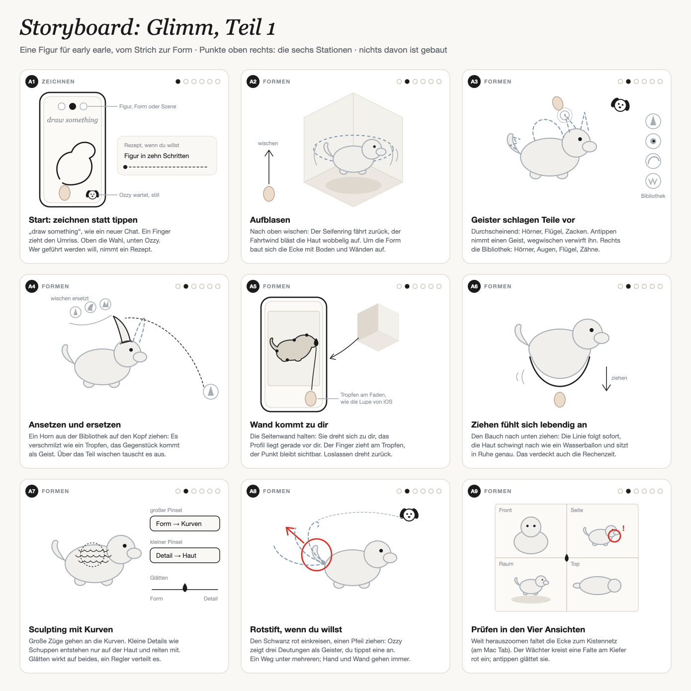
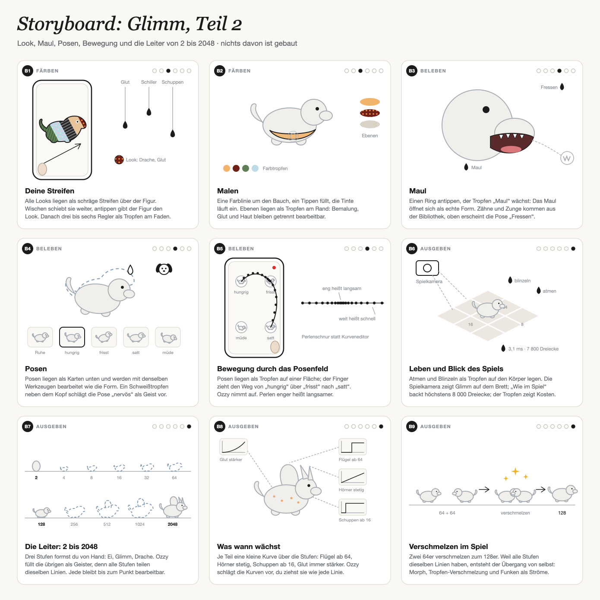
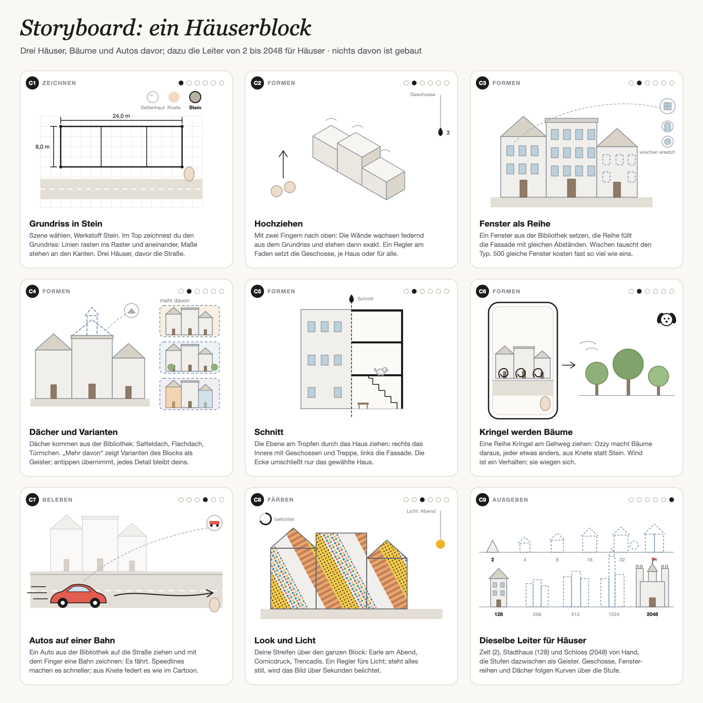

# Ozzy als Suite, Teil 3: Storyboard, Zeiger und Sculpting mit Kurven

Stand 23.11.2026. Fortsetzung von Teil 1 ([`2026-11-23-ozzy-suite-recherche-und-konzept.md`](2026-11-23-ozzy-suite-recherche-und-konzept.md))
und Teil 2 ([`2026-11-23-ozzy-suite-teil-2-tempo-ansichten.md`](2026-11-23-ozzy-suite-teil-2-tempo-ansichten.md)). Nichts davon ist
gebaut oder getestet.

**Deine Fragen (23.11.):** Gibt es schon Programme, die auf dem Handy mit so einem Zeiger arbeiten? Ergibt Sculpting Sinn, wenn
große Bearbeitungen an den Kurven landen und kleine Details wie Schuppen nur auf der Haut, und Glätten beides glättet? Und: ein
ausgefeiltes Storyboard für eine komplette Figur mit Posen und Animation für early earle und für einen kleinen Häuserblock mit Bäumen
und Autos davor, mit Navigation, Ansichten, spielerischer Führung ohne Kontrollverlust, KI, Gesten und Scribbles, auf dem Handy, deiner
Streifen-Ansicht, Teilen aus einer Bibliothek und Versionen von 2 bis 2048, auch für Häuser.

**Notiert:** Scribble als Sprache überzeugt dich noch nicht ganz; das arbeiten wir später gesondert aus. Im Storyboard kommt es nur
dort vor, wo es klar hilft (A8 Rotstift, B4 Comic-Zeichen, C6 Kringel, C7 Bahn), immer neben Hand und Wand.

## Die drei Tafeln

Die Punkte oben rechts in jedem Bild zeigen die sechs Stationen (Zeichnen, Formen, Färben, Beleben, Inszenieren, Ausgeben).

## 1 Gibt es Programme mit so einem Zeiger?

**Ja, das Prinzip ist bekannt. In einem 3D-Werkzeug für Kurven habe ich es nicht gefunden.**

- **Forschung:** Der versetzte Zeiger („Offset Cursor“) stammt aus den späten 1980er-Jahren. „Shift“ (Vogel und Baudisch, CHI 2007)
  zeigt beim Berühren eine vergrößerte Kopie dessen, was unter dem Finger liegt, und darin einen Zeiger am echten Berührungspunkt. Bei
  kleinen Zielen gab es deutlich weniger Fehler, bei großen war es schneller als der versetzte Zeiger. Es erscheint nur, wenn der
  Finger wirklich etwas verdeckt.
- **Im Alltag:** die Lupe von iOS beim Text und der Trackpad-Modus über die Leertaste.
- **Zeichen-Apps fürs iPhone:** Draw XP („Cursor Finger“, ein Zeiger über dem Finger), Draw Companion (ein Zeiger, den der Finger nicht
  verdeckt; gezeichnet wird mit Doppeltippen oder einem zweiten Finger), Picotap (Pixel-Art, Zeiger pixelweise), iDesign (Vektor-App
  mit versetzten Griffen). Im SketchUp-Forum wünschen sich Nutzer genau das fürs Messen auf dem iPhone.

**Was daraus für den Tropfen am Faden folgt:** Man zielt direkt auf den Punkt (wie bei Shift, nicht daneben wie beim versetzten
Zeiger). Der Tropfen hebt sich erst über den Finger, wenn der Punkt klein ist oder verdeckt wäre; große Dinge greift man direkt.

## 2 Sculpting und Kurven

**Deine Idee:** So weit wie möglich arbeiten die Werkzeuge an den Kurven und ihren Punkten (Ziehen, Glätten). Schuppen und kleine
Details entstehen automatisch nur auf der Haut. Glätten glättet Kurve und Detail.

**Ja, das ergibt Sinn.** Es ist Frequenztrennung, wie du sie aus Photoshop kennst: Die groben Formen leben in den Kurven, die feinen als
Detail-Ebene auf der Haut. In der Forschung heißt das Mehrauflösungs-Bearbeitung (Zorin, Schröder, Sweldens 1997); ZBrush arbeitet mit
Unterteilungsstufen und Ebenen nach demselben Gedanken, und die Laplace-Bearbeitung (Sorkine u. a. 2004) zeigt, wie Details beim
Verformen erhalten bleiben.

**Wie es gehen würde:**

1. **Der Pinsel teilt sich selbst auf.** Was die Kurven darstellen können, wandert in die Punkte: Der Löser sucht die Punktbewegung, die
   den Pinselzug am besten nachbildet (Ozzy hat schon einen Pinsel, der Punkte mitnimmt). Was übrig bleibt, landet als Detail auf der
   Haut. Ein großer Pinsel gibt fast alles an die Kurven, ein kleiner fast alles an die Haut.
2. **Details reiten auf der Haut.** Sie liegen in den Feldern zwischen den Linien, in Koordinaten, die die Linien aufspannen. Ändert sich
   eine Kurve, wandern Schuppen und Falten mit, auch in jeder Pose und auf jeder Stufe der Leiter.
3. **Glätten mit einem Regler:** von „nur Form“ über „beides“ bis „nur Detail“.
4. **Fehlt eine Linie, schlägt Ozzy eine vor.** Will der Pinsel eine Beule mitten in einem Feld, die keine Kurve tragen kann, erscheint
   ein Geist: hier eine Linie? Antippen setzt sie, und die Beule wird Form statt Detail.
5. **Ebenen für Details** wie in Paint: Schuppen, Falten, Narben je auf einer eigenen Ebene, ein- und ausblendbar, mit Stärke.
6. **Fürs Spiel** werden die Details zu einer Normalen-Textur auf dem Spielnetz mit höchstens 8 000 Dreiecken gebacken, wie bei
   jedem Spiel.
7. **Looks und Details spielen zusammen:** Ein Look kann gemalte Rillen dunkler färben, und ein Muster aus dem Shader-Strang lässt sich
   in Details umwandeln, um es von Hand nachzuarbeiten.

**Vorsicht:** Dehnt sich ein Feld stark, verzerren seine Details (wie Schuppen auf einem gedehnten Ballon) und müssen neu verteilt
werden. Details kosten Tempo; auf dem iPhone kommen sie als Normalen-Textur, nicht als echte Geometrie.

## 3 Storyboard Figur „Glimm“ (kleiner Glutdrache für early earle)

| Nr | Was du tust | Was Ozzy tut | Ansicht |
| --- | --- | --- | --- |
| A1 | „draw something“: Ein Finger zieht den Umriss; oben die Wahl Figur, Form oder Szene; auf Wunsch ein Rezept | wartet still | Blatt |
| A2 | nach oben wischen | Seifenring fährt zurück, die Haut bläst sich wobbelig auf, die Ecke baut sich auf | Raum mit Projektionsecke |
| A3 | Geister antippen oder wegwischen | schlägt Hörner, Flügel, Zacken als Geister vor; Bibliothek als Tropfen | Raum |
| A4 | Horn aus der Bibliothek auf den Kopf ziehen; über das Teil wischen | verschmilzt wie ein Tropfen, Gegenstück als Geist; tauscht aus der Bibliothek | Raum |
| A5 | Seitenwand halten, am Tropfen am Faden ziehen | dreht die Wand zu dir, Punkt bleibt sichtbar | Wand kommt zu dir |
| A6 | Bauch ziehen | Linie sofort, Haut schwingt nach, sitzt in Ruhe genau | Raum |
| A7 | großer Pinsel, kleiner Pinsel, Glätten | Form an die Kurven, Schuppen auf die Haut | Raum |
| A8 | Schwanz rot einkreisen, Pfeil (wenn du willst) | drei Deutungen als Geister | Raum |
| A9 | weit herauszoomen (Mac: Tab) | Kistennetz; Wächter kreist eine Falte ein | Vier Ansichten |
| B1 | durch die Streifen wischen, einen antippen | ganze Figur bekommt den Look; drei bis sechs Regler am Faden | Streifen |
| B2 | Farblinie um den Bauch, tippen | füllt, Tinte läuft ein, Ebenen als Tropfen | Raum |
| B3 | Ring antippen, Tropfen „Maul“ | Maul als echte Form, Zähne und Zunge aus der Bibliothek, Pose „Fressen“ | Raum |
| B4 | Pose wählen und bearbeiten; Schweißtropfen zeichnen | Pose „nervös“ als Geist | Posenkarten |
| B5 | Finger zieht durchs Posenfeld; Perlen schieben | nimmt auf, Perlenschnur fürs Timing | Posenfeld |
| B6 | Verhalten auf den Körper legen | Spielkamera, „Wie im Spiel“, Kosten im Tropfen | Spielkamera |
| B7 | drei Stufen formen (2, 128, 2048) | füllt die übrigen acht als Geister | Leiter |
| B8 | Wachstumskurven ziehen | schlägt Kurven je Teil vor | Leiter |
| B9 | im Spiel zwei 64er zusammenschieben | Morph, Tropfen-Verschmelzung, Funken | Spiel |

## 4 Storyboard Häuserblock

| Nr | Was du tust | Was Ozzy tut | Ansicht |
| --- | --- | --- | --- |
| C1 | Szene, Werkstoff Stein, Grundriss zeichnen | rastet ins Raster, Maße an den Kanten | Top als Grundriss |
| C2 | mit zwei Fingern nach oben; Regler Geschosse | Wände wachsen federnd und stehen exakt | Raum |
| C3 | ein Fenster aus der Bibliothek setzen; wischen | Reihe füllt die Fassade, gleiche Abstände; tauscht den Typ | Front |
| C4 | Dach aus der Bibliothek; „mehr davon“ | Varianten des Blocks als Geister | Front |
| C5 | Schnittebene am Tropfen ziehen | Innen mit Geschossen und Treppe; Ecke nur ums gewählte Haus | Schnitt |
| C6 | Kringel am Gehweg (Handy) | Bäume, jeder anders, aus Knete; Wind als Verhalten | Front |
| C7 | Auto aus der Bibliothek, Bahn zeichnen, Speedlines | Auto fährt die Bahn, federt aus Knete | Front |
| C8 | Streifen über den Block, Licht-Regler | Looks auf den Fassaden; in Ruhe belichtet | Raum |
| C9 | Zelt, Stadthaus, Schloss formen | Zwischenstufen als Geister: Geschosse, Fenster, Dächer | Leiter |

## 5 Die Leiter von 2 bis 2048

- **Die Stufe ist ein Regler.** Alle Stufen teilen dieselben Linien; eine Stufe ist ein Stand der Linien, Looks und Teile, wie eine Pose.
- **Schlüsselstufen von Hand, der Rest als Geister.** Du formst zum Beispiel 2, 128 und 2048; Ozzy füllt die übrigen. Jede Stufe
  übernimmst du und änderst sie bis zum letzten Punkt.
- **Wachstumskurven je Teil:** Flügel ab 64, Hörner stetig, Schuppen ab 16, Glut stärker. Sie sind Linien wie alle anderen. Teile, die
  später kommen, wachsen wie Tropfen aus dem Körper, statt plötzlich da zu sein.
- **Verschmelzen im Spiel:** Weil zwei Stufen dieselben Linien haben, ist der Übergang ein Morph, dazu das Verschmelzen wie Tropfen und
  Funken als Ströme. Für die elf Stufen braucht es keine eigene Animation je Stufe.
- **Häuser:** dieselbe Leiter mit dem Werkstoff Stein. Geschosse, Fensterreihen, Dächer aus der Bibliothek und Anbauten folgen Kurven
  über die Stufe; die Schlüsselstufen Zelt, Stadthaus und Schloss machst du von Hand.
- **Varianten liegen quer zur Leiter:** „mehr davon“ auf jeder Stufe (Farbe, Laune, Zierde).

## 6 Navigation und Führung

- **Sechs Stationen** als Punkte; man springt frei, Ozzy schlägt die nächste vor.
- **Rezepte** führen, wer geführt werden will (A1); jeder Schritt ist eine normale Bearbeitung, man weicht jederzeit ab.
- **Keine Kontrolle geht verloren:** Geister sind nur Vorschläge. Alles Erzeugte (Zwischenstufen, Bäume, Fensterreihen, Varianten) besteht
  aus normalen Linien, Punkten und Reglern. Jeder Schritt, auch von Ozzy, liegt im Verlauf und lässt sich zurücknehmen.
- **Ozzy meldet sich nur,** wenn du ihn rufst (Rotstift, „?“, „mehr davon“) oder wenn ein Wächter etwas findet.
- **Gesten auf dem Handy:** ein Finger formt; zwei Finger drehen und zoomen; nach oben wischen bläst auf; halten schaut hin oder holt die
  Wand zu dir; über ein Teil wischen ersetzt es; zwei Finger tippen nimmt zurück; zwei Finger nach oben ziehen Wände hoch.

## 7 Was davon schon da ist und was neu wäre

| Schon in einem Strang | Neu zu bauen |
| --- | --- |
| „draw something“, Aufblasen, Seifenhaut, Projektionsecke, Vier Ansichten, Linien, Loops, Punkte (Ozzy) | Bibliothek für Teile, Fenster, Dächer, Autos |
| Maul, Zähne, Zunge, Posen, Backen „Wie im Spiel“ (Maul-Strang) | Geister-Vorschläge, Wand kommt zu dir, Tropfen am Faden |
| Malen mit Tinte, Ebenen (Paint-Strang) | Werkstoffe Stein und Knete, Grundriss, Hochziehen, Reihen |
| 94 Looks, Streifen, Fell aus Schalen (Shader-Strang) | Detail-Ebene fürs Sculpting |
| Mehrere Objekte, Spiegel (Objekte-Strang) | Posenfeld, Perlenschnur, Verhalten, Bahnen |
| Physik, Posen, Regler für 2D (Studio-Plan) | Leiter mit Wachstumskurven, Spielkamera, Schnitt, Ozzy als KI |

## 8 Quellen

**Zeiger:** [Shift (Vogel, Baudisch, CHI 2007)](https://projects.csail.mit.edu/hci-reading/papers/chi2007-vogel.pdf),
[HCI-Museum zu Shift](https://hci-museum.lisn.upsaclay.fr/shift), [Karlson u. a. (Microsoft Research)](https://www.microsoft.com/en-us/research/wp-content/uploads/2008/01/p1399-karlson.pdf),
[Patent US7692629](https://patents.google.com/patent/US7692629), [Draw XP](https://apps.apple.com/app/draw-xp/id6461867536),
[Draw Companion](https://apps.apple.com/app/draw-companion/id6596776784), [Picotap](https://www.producthunt.com/products/picotap),
[iDesign](https://apps.apple.com/ml/app/idesign/id342790226),
[SketchUp-Forum: Versatz fürs Messen auf dem iPhone](https://forums.sketchup.com/t/iphone-app-add-offset-to-touch-point-to-make-measure-tool-usable/313248)

**Ohne Link:** Zorin, Schröder, Sweldens: „Interactive Multiresolution Mesh Editing“ (SIGGRAPH 1997); Sorkine u. a.: „Laplacian Surface
Editing“ (2004); Motion Doodles (2004) und Line of Action (2013) für Bahn und Pose (Teil 1, Abschnitt 14).
