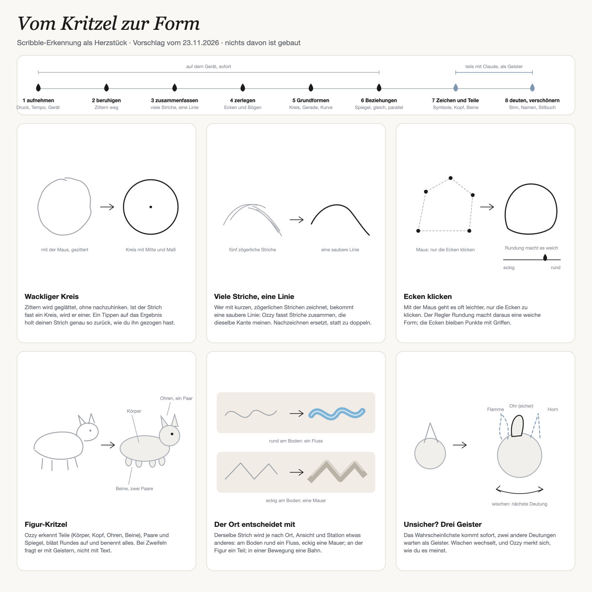

# Ozzy als Suite, Teil 6: Scribble-Erkennung als Herzstück

Stand 23.11.2026. Ohne Agenten, mit drei Suchen. Vorher: Teil 1 (Abschnitt 14: Zeichnen statt Worte, Zeichensprache, Rotstift) bis
Teil 5 (`2026-11-23-ozzy-suite-*.md`). Nichts davon ist gebaut oder getestet.

**Dein Wort (23.11.):** „Die Scribbleeingabe muss ein eigentliches Herzstück sein und sehr elegant. Die meisten Menschen können nicht
gut oder genau scribbeln und schon gar nicht mit der Maus. Daher muss die Erkennung sehr ausgefeilt sein und sehr intelligent, so dass
aus allem etwas wirklich Cooles gemacht wird und Anfänger wie Profis zum Staunen bringt.“

## 0 Kurzfassung

1. **Das Ziel:** Aus jedem Strich etwas Gutes machen, ohne die Absicht zu verfälschen. Ozzy trifft, was du meinst, gibt Geschmack dazu,
   und dein eigener Strich bleibt immer zurückholbar.
2. **Ehrlich zur KI:** Bild-KIs lesen grobe Skizzen 2025/26 noch unzuverlässig; Studien zeigen, dass sie hinter Menschen deutlich
   zurückliegen. Deshalb arbeitet die Erkennung in zwei Stufen. Schnelle, genaue Geometrie auf dem Gerät erledigt Form und Zeichen.
   Claude kommt für Bedeutung, Namen und Verschönerung dazu, und zwar immer als Geist.
3. **Acht Schritte:** aufnehmen, beruhigen, zusammenfassen, zerlegen, Grundformen, Beziehungen, Zeichen und Teile, deuten und
   verschönern. Die ersten sechs laufen sofort auf dem Gerät.
4. **Der Kontext entscheidet mit:** Ort, Ansicht, Station, Stift, Werkstoff, Auswahl und Stilbuch. Derselbe Strich wird am Boden ein Fluss
   und an der Figur ein Teil.
5. **Mehrere Deutungen statt einer Wette:** Die beste kommt sofort, zwei weitere warten als Geister; Wischen wechselt, und Ozzy lernt,
   wie du es meinst.
6. **Jedes Gerät bekommt eigene Hilfe.** Für die Maus heißt das: stärker beruhigen, Ecken klicken und runden, halten zum Einrasten. Beim
   Finger hilft eine Vorschau über dem Finger. Der Stift bekommt wenig Hilfe und viel Treue.
7. **Erste Probe:** 30 Scribbles von dir, Nicole und einem Einsteiger, mit Maus, Finger und Stift; Kriterien in Abschnitt 9.

## 1 Was die Erkennung leisten muss

1. **Absicht treffen:** Was wolltest du zeichnen (Kreis, Ohr, Fluss, Bewegung)?
2. **Geschmack dazugeben:** glatte Kurven ohne Dellen, ausgewogene Proportionen, lesbare Silhouette, Symmetrie, wo du fast symmetrisch
   gezeichnet hast.
3. **Nichts verfälschen:** Was du genau gezeichnet hast, bleibt genau. Deine Schlüssel und deine Linien gehören dir.
4. **Sofort antworten:** Die erste Antwort kommt im selben Moment, nicht nach Sekunden.
5. **Ohne Text fragen:** Ist etwas unklar, zeigt Ozzy Möglichkeiten als Geister.
6. **Lernen:** Mit jeder Wahl und Korrektur versteht Ozzy deine Hand besser.
7. **Staunen auslösen:** Der Moment, in dem aus dem Kritzel eine schöne Form wird, soll sich wie Zauberei anfühlen.

## 2 Was es schon gibt

| Gebiet | Beispiele | Was wir übernehmen |
| --- | --- | --- |
| Schöner zeichnen, während man zeichnet | Pegasus (Igarashi 1997): mehrere Vorschläge, man wählt; Procreate QuickShape; Formen in Apple Notizen | Vorschläge statt Zwang; halten zum Einrasten |
| Vorschläge beim 3D-Zeichnen | Chateau (Igarashi, Hughes 2001): Vorschläge als kleine Bilder | Geister |
| Grundformen erkennen | PaleoSketch (Paulson, Hammond 2008): Gerade, Bogen, Kreis, Ellipse, Spirale mit hoher Trefferquote; Ecken finden (ShortStraw 2008; Sezgin 2001: Menschen werden an Ecken langsamer) | Schritte 4 und 5 |
| Zittern glätten | 1€-Filter (Casiez, Roussel, Vogel 2012): passt die Glättung dem Tempo an, also wenig Verzug und wenig Zittern | Schritt 2 |
| Viele Striche zu einer Linie | StripMaker (2023): fasst rohe Striche in Zeichenreihenfolge zusammen, so gut wie von Hand; Benchmark zum Säubern grober Skizzen (2020) | Schritt 3 |
| Zeichen aus wenigen Beispielen | $P-Erkenner (2012) | eigene Zeichen beibringen |
| Mehrdeutigkeit | Mankoff, Hudson, Abowd (2000): Vermittler zwischen mehreren Deutungen | n beste Deutungen, wischen |
| Kritzel zu fertigen Bildern | Google AutoDraw, Quick, Draw! (Millionen Kritzel in 345 Begriffen) | Daten für allgemeine Zeichen (Lizenz prüfen) |
| Skizze zu 3D mit Teilen | Doodle Your 3D (2024), PASTA (2025): zerlegt in Teile, Teile hinzufügen, löschen, verschieben; Monster Mash (2020) | Teile erkennen, Teile bearbeitbar |
| Sprach-KIs und Skizzen | SketchAgent (2025) zeichnet Strich für Strich mit einer Sprach-KI; Studien (AAAI) und SketchJudge (2026): Bild-KIs verstehen Handskizzen deutlich schlechter als Menschen | Claude nur für Bedeutung, nie allein |

**Folgerung:** Jedes Teil gibt es. Niemand verbindet sie für ein kreatives 3D-Werkzeug mit Kontext, Geschmack und Lernen.

## 3 Die acht Schritte

| Schritt | Was passiert | Wo, wie schnell |
| --- | --- | --- |
| 1 **Aufnehmen** | Punkte mit Zeit, Druck, Neigung und Gerät; dazu die Zwischenpunkte und die Vorhersage des Browsers, damit nichts ruckelt; beim Stift und bei der Maus auch das Schweben | Gerät, sofort |
| 2 **Beruhigen** | ein Filter, der sich dem Tempo anpasst (1€-Filter): Zittern weg, ohne nachzuhinken; die Maus bekommt mehr Ruhe, der Stift fast keine; auf Wunsch ein Zügel, an dem die Linie hinterherläuft | Gerät, sofort |
| 3 **Zusammenfassen** | Mehrere Striche, die dieselbe Kante meinen, werden eine Linie; Nachzeichnen ersetzt statt zu doppeln | Gerät, sofort |
| 4 **Zerlegen** | Ecken und glatte Stücke trennen (wo du langsamer wirst und die Richtung kippt); offen oder geschlossen; Überkreuzungen | Gerät, sofort |
| 5 **Grundformen** | Gerade, Bogen, Kreis, Ellipse, Rechteck, Vieleck, Spirale oder freie Kurve mit möglichst wenigen Punkten und Griffen. Gewählt wird die einfachste Beschreibung, die deinen Strich gut genug erklärt; wer schnell zeichnet, bekommt mehr Spielraum | Gerät, sofort |
| 6 **Beziehungen** | Spiegel, gleich lang, parallel, rechtwinklig, tangential, an vorhandene Linien und Punkte, Reihen; als weiche Bezüge angeboten, nicht erzwungen (Teil 1, 7.1) | Gerät, sofort |
| 7 **Zeichen und Teile** | die Zeichensprache (=, //, Pfeile, Comic-Zeichen, ?, Haken, Kreuz) mit einem kleinen Erkenner, der aus drei Beispielen lernt; Teile einer Figur (Körper, Kopf, Ohren, Beine) aus geschlossenen Flächen, Enthaltensein, Berührung und Symmetrie | Gerät, sofort; Claude bei Zweifel |
| 8 **Deuten und verschönern** | was es ist und welche Rolle es spielt, Namen, Rundung und Werkstoff aus dem Charakter des Strichs, Verschönerung nach dem Stilbuch, stärkere Fassungen | Claude, in Sekunden, als Geister |

**Wichtig:** Schritte 1 bis 6 sind klassische Geometrie, schnell und vorhersagbar. Sie liefern schon ohne Claude gute Ergebnisse,
auch ohne Netz. Claude macht aus „gut“ dann „cool“ und benennt, was es ist.

## 4 Der Kontext entscheidet mit

| Signal | Beispiel |
| --- | --- |
| **Ort** | auf dem Umriss formt um; außen und berührend wird ein Teil; im Leeren eine neue Form; auf dem Boden Weg, Fluss oder Mauer |
| **Ansicht** | in einer flachen Ansicht gilt der Strich in ihrer Ebene, im Raum auf der Haut |
| **Station oder Linse** | Formen: Form; Färben: Farbe oder Muster; Beleben: Bahn oder Pose; Spiel: Weg oder Regel |
| **Stift** | Tinte zeichnet die Sache, der Rotstift eine Anweisung |
| **Werkstoff** | in Stein werden Ecken scharf und Linien rasten ein; in Seifenhaut wird es rund |
| **Charakter des Strichs** | rund gezeichnet wird geblasen, eckig gezeichnet gezogen; wie scharf die Ecken sind, setzt die Rundung |
| **Auswahl und Verlauf** | was gewählt ist und was du gerade getan hast; ein zweites Ohr nach dem ersten ist wahrscheinlich ein Ohr |
| **Stilbuch** | dein Geschmack: keine Outlines, Verläufe in harten Stufen, Proportionen |

## 5 Wie aus schlechten Strichen etwas Cooles wird

- **Treue:** ein Regler von „genau wie gezeichnet“ bis „Ozzy macht es schön“. Ozzy stellt ihn selbst ein, nach Gerät, Tempo und danach,
  wie oft du seine Verschönerung zurücknimmst; du kannst ihn jederzeit festlegen. Für dich als Profi steht er hoch, für Einsteiger tief.
- **Verschönern heißt: deine Absicht plus Geschmack.** Kurven ohne Dellen, gleichmäßige Verjüngungen, ausgewogene Proportionen, eine
  lesbare Silhouette und Symmetrie, wo du fast symmetrisch gezeichnet hast. Die Rundung folgt dem Charakter deines Strichs.
- **Der Moment des Staunens:** Die Tinte zieht sich zur sauberen Linie zusammen, wie ein Tropfen; die Form bläst sich auf. Man sieht die
  Verwandlung, statt dass etwas plötzlich ausgetauscht wird.
- **Zauberstab:** Doppeltippen auf ein Ergebnis zeigt drei Fassungen mit mehr Charakter als Geister (größere Augen, schwungvollere
  Linie, mutigere Proportionen). Du nimmst eine oder keine.
- **Immer zurückholbar:** Dein Strich bleibt gespeichert. Halten zeigt ihn, ein Tippen holt ihn zurück.

## 6 Mehrere Deutungen und Lernen

- **Die beste Deutung sofort, zwei als Geister.** Ein kleiner Tropfen mit einer Zahl zeigt, dass es weitere gibt; Wischen über das
  Ergebnis wechselt.
- **Bei geringer Sicherheit wird nicht geraten:** Dein Strich bleibt Strich, die Geister bieten an.
- **Lernen auf dem Gerät:** Jede Wahl und jede Korrektur verschiebt die Gewichte für dich. Das bleibt bei dir, nichts geht ungefragt
  hinaus.
- **Eigene Zeichen:** dreimal zeichnen, dann die Wirkung antippen.
- **Stilbuch als Pinnwand:** Bilder statt Regeln in Worten (Teil 1, 14.5).

## 7 Maus, Finger, Stift

| Gerät | Problem | Hilfe |
| --- | --- | --- |
| **Maus** | zittrig, langsam, Ecken werden rund, Kreise eckig | mehr Beruhigung; nur die Ecken klicken und mit der Rundung weich machen; halten zum Einrasten; Zügel; Schweben zeigt die Vorschau |
| **Finger** | verdeckt den Strich, ist ungenau und dick | Vorschau über dem Finger (Tropfen am Faden), mehr Spielraum, ein zweiter Finger für den Feinmodus |
| **Stift** | genau, mit Druck und Neigung | wenig Hilfe, hohe Treue; der Druck setzt Linienstärke und Gewicht; Schweben zeigt, was passieren wird |

## 8 Grenzen

- **Bild-KIs lesen grobe Skizzen noch unzuverlässig.** Deshalb trägt die Geometrie auf dem Gerät; Claude ergänzt nur, und wie gut, zeigt
  erst die Probe.
- **Zu viel Verschönerung tötet den eigenen Strich.** Deshalb gibt es die Treue, und deine Linien bleiben unangetastet.
- **Mehrdeutigkeit bleibt,** besonders bei Einsteigern. Die Geister fangen sie auf, aber sie dürfen nicht nerven.
- **Daten:** Für eigene Zeichen und Teile braucht es eigene Beispiele (du, Nicole, Einsteiger). Bei öffentlichen Sammlungen wie
  Quick, Draw! ist die Lizenz zu prüfen.
- **Wartezeit und Kosten bei Claude:** Die Geometrie antwortet sofort; Claudes Deutung kommt als Geist dazu, sobald sie da ist.

## 9 Erste Probe

- **Material:** 30 Scribbles, nämlich 10 Figuren, 10 Dinge (Haus, Auto, Baum, Fluss, Mauer und andere) und 10 Zeichen und Korrekturen.
  Gezeichnet von dir, Nicole und einem Einsteiger, jeweils mit Maus, Finger und Stift.
- **Kriterien (Vorschlag):**
  - Die erste Deutung passt ohne Korrektur bei mindestens 7 von 10.
  - Die richtige ist unter den drei angebotenen bei mindestens 9 von 10.
  - Schritte 1 bis 6 brauchen auf dem iPhone 16 weniger als 16 ms.
  - Von den zehn Figuren findest du mindestens sieben „cool“.
- **Bauweise:** zuerst eine Studie neben Ozzy mit den Schritten 1 bis 6, ganz auf dem Gerät. Danach die Zeichen, dann Claudes Deutung.
  Jede Stufe endet mit einem Bild vorher und nachher.

## 10 Offene Entscheidungen (deine)

1. **Treue:** automatisch, als Regler oder beides?
2. **Zauberstab:** mit Claude (bessere Ideen, kostet Aufrufe) oder nur auf dem Gerät?
3. **Erste Probe:** so bauen, mit diesen 30 Scribbles und Kriterien?

## 11 Quellen

- StripMaker (2023): [Paper](https://www.cs.ubc.ca/labs/imager/tr/2023/stripmaker/stripmaker_authorversion.pdf)
- Benchmark zum Säubern grober Skizzen (2020): [Paper](https://cragl.cs.gmu.edu/sketchbench/A%20Benchmark%20for%20Rough%20Sketch%20Cleanup%20(Chuan%20Yan,%20David%20Vanderhaeghe,%20Yotam%20Gingold%202020%20SIGGRAPH%20Asia).pdf)
- Deep Sketch Vectorization (2024): [Paper](https://techmatt.github.io/pdfs/deepSketchVectorization.pdf)
- SketchAgent (CVPR 2025): [Paper](https://openaccess.thecvf.com/content/CVPR2025/papers/Vinker_SketchAgent_Language-Driven_Sequential_Sketch_Generation_CVPR_2025_paper.pdf)
- SketchAgent für Diagramme (IJCAI 2025): [arXiv](https://arxiv.org/html/2508.01237v1)
- Bild-KIs und Handskizzen (AAAI): [Paper](https://ojs.aaai.org/index.php/AAAI/article/view/42450/46411); SketchJudge (2026): [arXiv](https://web3.arxiv.org/pdf/2601.06944)
- Doodle Your 3D (CVPR 2024): [arXiv](https://arxiv.org/abs/2312.04043?context=cs); PASTA (2025): [arXiv](https://arxiv.org/abs/2503.12834v1)
- Ohne Link: Pegasus (Igarashi u. a., 1997); Chateau (Igarashi, Hughes, 2001); PaleoSketch (Paulson, Hammond, 2008); ShortStraw
  (Wolin u. a., 2008); Sezgin u. a. (2001); 1€-Filter (Casiez, Roussel, Vogel, 2012); $P-Erkenner (Vatavu, Anthony, Wobbrock, 2012);
  Mankoff, Hudson, Abowd (2000); Google AutoDraw und Quick, Draw! (2017); Monster Mash (2020); Motion Doodles (2004).
