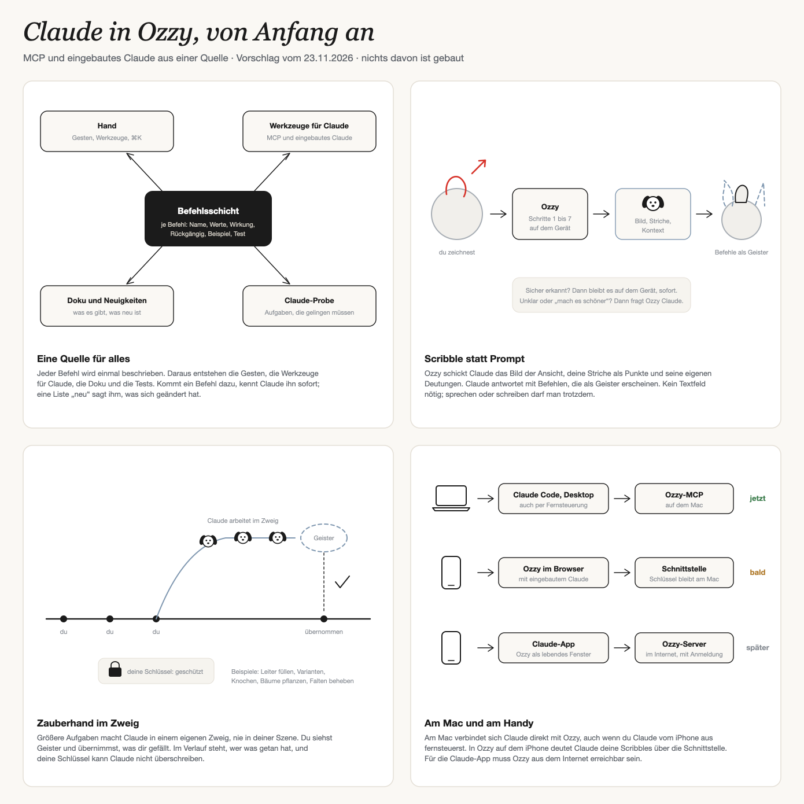

# Ozzy als Suite, Teil 7: Claude von Anfang an (MCP)

Stand 23.11.2026. Ohne Agenten, mit zwei Suchen und der Recherche vom 18.11. („Claude direkt in Ozzy“, Zweig
`claude/ozzy-direct-integration-5cd812`). Vorher: Teil 1 bis 6 (`2026-11-23-ozzy-suite-*.md`). Nichts davon ist gebaut.

**Dein Wort (23.11.):** „Der Claude-MCP soll von Anfang an mitentwickelt werden, dass Claude immer auf dem neuesten Stand ist und so
viel wie möglich auch von Zauberhand selbst machen kann. Gerne auch am Handy, wenn alles richtig verknüpft ist.“ Und: „am besten über
Scribble-Eingabe statt Prompts.“

## 0 Kurzfassung

1. **Eine Quelle für alles.** Jeder Befehl in Ozzy wird einmal beschrieben (Name, Werte, Wirkung, Rückgängig, Beispiel, Test). Daraus
   entstehen automatisch die Gesten, die Werkzeuge für Claude, die Doku und die Tests. Kommt ein Befehl dazu, kennt Claude ihn sofort.
2. **Zwei Türen, ein Schlüsselbund.** Der MCP-Server lässt Claude Ozzy von außen bedienen (Claude Code, Desktop, später die App).
   Eingebautes Claude lässt Ozzy selbst Claude fragen, etwa für Scribbles, über die Schnittstelle mit Schlüssel. Beide nutzen dieselben
   Befehle.
3. **Scribble statt Prompt.** Ozzy erkennt so viel wie möglich selbst auf dem Gerät (Teil 6). Ist etwas unklar oder soll es schöner
   werden, schickt Ozzy Claude das Bild, die Striche und seine eigenen Deutungen; Claude antwortet mit Befehlen, die als Geister
   erscheinen.
4. **Zauberhand im Zweig.** Größere Aufgaben (Leiter füllen, Varianten, Knochen, Bäume, Falten beheben) macht Claude in einem eigenen
   Zweig. Du übernimmst, was dir gefällt; deine Schlüssel kann Claude nicht überschreiben.
5. **Stand der Technik zwingt zu einer klaren Wahl:** Der MCP-Stand vom 28.07.2026 erklärt „Sampling“ für veraltet. Ozzy kann also
   nicht über eine verbundene Claude-App Claude um Rat fragen; dafür braucht es die Schnittstelle mit Schlüssel. Konnektoren für die
   Claude-App müssen aus dem Internet erreichbar sein.
6. **Am Handy:** jetzt per Fernsteuerung von Claude Code auf dem Mac (wie du heute arbeitest); bald Ozzy im Browser des iPhones mit
   eingebautem Claude; später die Claude-App mit Ozzy als lebendem Fenster über einen Ozzy-Server im Internet.
7. **Sicherheit:** nur beschriebene Befehle, kein freier Code (anders als der offizielle Blender-Server), Grenzen je Aufruf, Rückfrage
   bei Heiklem, keine Anmeldung mit dem Claude-Abo in Ozzy.

## 1 Stand der Technik (November 2026)

| Thema | Stand | Was es für Ozzy heißt |
| --- | --- | --- |
| MCP-Spezifikation | Fassung vom 28.07.2026: zustandslos (keine Sitzung, jede Anfrage trägt Version und Fähigkeiten), Pflicht-Aufruf `server/discover`, Zwischenergebnisse „Eingabe nötig“ für Rückfragen, schärfere Anmeldung; **Sampling, Roots und Logging gelten als veraltet** (mindestens zwölf Monate Übergang) | Ozzy baut auf die neue Fassung; Rückfragen an dich laufen über „Eingabe nötig“ oder über Geister; für Ozzys eigene Fragen an Claude nicht auf Sampling bauen |
| MCP Apps | Werkzeuge zeigen Oberflächen im Gespräch (Januar 2026); „interaktive Konnektoren“ gibt es laut Berichten seit März 2026 auch in der iOS-App (von Anthropic für Mobilgeräte nicht ausdrücklich als MCP Apps bestätigt) | Ozzy als lebendes Fenster in der Claude-App ist möglich, muss aber geprüft werden |
| Konnektoren in Claude | eigene Konnektoren auf Web und Desktop einrichten, danach auch in der iOS-App nutzbar; der Server muss aus dem Internet erreichbar sein, weil Claude ihn aus Anthropics Cloud anspricht | Für die Claude-App braucht Ozzy einen Server im Internet mit Anmeldung; am Mac reicht der lokale Server |
| Regeln (Recherche 18.11.) | Anmeldung mit dem Claude-Abo in fremden Apps verboten und seit Januar 2026 technisch gesperrt; erlaubt sind Ozzy als Claude-Seite, die Schnittstelle mit Schlüssel (Max- und Ultra-Abos enthalten monatliches Guthaben dafür) und MCP | eingebautes Claude über einen Schlüssel auf dem Mac; nie ein „Anmelden mit Claude“ in Ozzy |
| Andere Kreativwerkzeuge | Blender: offizieller Server, führt freien Code aus (mächtig, ohne Schutz); Spline V2: eigener Agent und MCP mit denselben Werkzeugen; Rive: eine Textform der Datei für Agenten; Adobe: lokale MCP-Anbindung in Vorschau; tldraw: MCP-App zum Zeichnen | Textform wie Rive, dieselben Werkzeuge für Hand und KI wie Spline, aber kein freier Code wie bei Blender |

## 2 Eine Quelle für alles: die Befehlsschicht

Jeder Befehl hat einen festen Steckbrief:

| Feld | Beispiel |
| --- | --- |
| Name | `form.aufblasen` |
| Beschreibung | in klaren Worten, deutsch, mit Beispiel |
| Werte | genaue Beschreibung der Eingaben (welche Linie, wie stark) |
| Wirkung | was sich ändert, und als ein Schritt zurücknehmbar |
| Rechte | sicher, oder nur mit deiner Bestätigung (etwa Löschen) |
| Test | ein automatischer Test, der den Befehl prüft |

**Daraus entstehen automatisch:** die Befehlssuche ⌘K und die Gesten, die Werkzeuge für Claude, die Doku für Claude und die Tests. Neue
Befehle erscheinen damit überall zugleich. Das ist der Kern von „Claude ist immer auf dem neuesten Stand“: Es gibt nichts, was man für
Claude extra nachziehen müsste. Studio hat dieses Register schon vorgesehen (Teil 5).

## 3 Was Claude bekommt

**Wenige, starke Werkzeuge statt Hunderter.** So bleibt Claude schnell und treffsicher; die vielen Einzelbefehle findet es über die Suche.

| Werkzeug | Was es tut |
| --- | --- |
| `szene_lesen` | die Szene oder ein Objekt in der Textform: Linien, Körper, Rundung, Verbindungen, Werkstoffe, Regler, Posen |
| `ansicht_zeigen` | ein Bild aus einer festen Ansicht (Front, Seite, Top, Raum, Spielkamera), auf Wunsch mit den Namen der Teile |
| `befehle_suchen` | findet Befehle nach Stichwort und liefert ihren Steckbrief |
| `befehle_ausfuehren` | führt eine Folge von Befehlen als einen Schritt aus, in der Szene oder in einem Zweig |
| `scribble_lesen` | holt deine letzten Striche als Punkte, mit Ozzys eigenen Deutungen und dem Kontext |
| `geister_zeigen` | zeigt Ergebnisse als Geister; du wählst |
| `waechter_pruefen` | meldet Falten, Kerben, schwebende Teile und Kosten auf dem iPhone |
| `zweig_oeffnen`, `zweig_zeigen` | ein eigener Arbeitsbereich für größere Aufgaben |

**Dazu Ressourcen zum Lesen:** die Szene, die Bilder der Ansichten, der Verlauf mit Herkunft, das Stilbuch (deine Pinnwand), die
Bibliothek, die Doku aller Befehle und eine Liste „neu“ mit den Änderungen seit der letzten Fassung.

**Und eine Anleitung für Claude** (als Skill oder Vorlage), erzeugt aus derselben Doku: die Grammatik, deine Regeln („keine Outlines“,
„in Ruhe genau“), und dass Claude Ergebnisse immer als Geister anbietet und in festen Ansichten prüft.

## 4 Scribble statt Prompt

1. Du zeichnest, mit Tinte oder dem Rotstift.
2. Ozzy erkennt auf dem Gerät, was es kann (Teil 6, Schritte 1 bis 7). Ist es sicher, ist es sofort fertig; Claude wird nicht gefragt.
3. Ist es unklar, oder hast du um mehr Schönheit gebeten (Zauberstab, Rotstift), schickt Ozzy Claude ein Paket: das Bild der Ansicht mit
   deinen Strichen, die Striche als Punkte, Ozzys eigene Deutungen mit ihrer Sicherheit, den Kontext (Ort, Station, Auswahl, Stilbuch).
4. Claude antwortet mit Befehlen. Ozzy zeigt sie als Geister; nichts geschieht ohne dein Tippen.
5. Deine Wahl fließt ins Lernen zurück (Teil 6, Abschnitt 6).

Sprechen oder Schreiben bleibt möglich, als Notausgang. Die Mitte ist der Strich.

## 5 Zauberhand

- **Arbeit im Zweig:** Claude öffnet einen Zweig, arbeitet dort in vielen Schritten und zeigt das Ergebnis als Geister. Übernimmst du
  es, wird es ein normaler Schritt im Verlauf, mit Herkunft „Claude“.
- **Beispiele:** die Leiter 2 bis 2048 zwischen deinen Schlüsselstufen füllen; sechs Varianten eines Looks; Knochen vorschlagen und
  Probewackeln; einen Gehweg mit Bäumen bepflanzen; Fensterreihen setzen; die Falten melden und beheben, die ein Wächter gefunden hat;
  eine Kamerafahrt entlang einer gezeichneten Bahn einrichten.
- **Schutz:** Deine Schlüssel und deine Linien kann Claude nicht überschreiben (Studios Schutzregel). Es schlägt nur vor.
- **Sichtbar:** Wenn Claude arbeitet, sieht man es als zweiten Zeiger oder als Ozzy, den Hund, am Rand (Teil 1, 14.7). Man kann es
  jederzeit anhalten.
- **Kosten im Blick:** Ein Tropfen zeigt, was ein Auftrag ungefähr kosten wird, bevor er startet.

## 6 Am Mac und am Handy

| Weg | Wie | Wann |
| --- | --- | --- |
| **Mac** | Claude Code oder Claude Desktop verbindet sich mit dem Ozzy-Server auf dem Mac. Vom iPhone aus steuerst du Claude Code wie heute fern. | jetzt möglich, sobald es den Server gibt |
| **iPhone, Ozzy im Browser** | Du zeichnest in Ozzy auf dem iPhone (wie heute über das WLAN). Für das Deuten fragt Ozzy Claude über die Schnittstelle; der Schlüssel bleibt auf dem Mac, nie im Browser. | bald |
| **iPhone, Claude-App** | Die Claude-App verbindet sich über einen eigenen Konnektor mit einem Ozzy-Server im Internet, mit Anmeldung bei Ozzy. Als lebendes Fenster zeigt sie Ozzy direkt im Gespräch. | später, nach einer Probe |
| **Fremde Nutzer** | Ozzy als Claude-Seite: Jeder nutzt sein eigenes Claude-Konto (Recherche 18.11., Weg A) | nach einem Lauftest |

## 7 Sicherheit

1. **Nur beschriebene Befehle.** Claude kann nichts tun, was nicht im Register steht. Kein freier Code, anders als beim offiziellen
   Blender-Server.
2. **Grenzen je Aufruf:** höchstens so viele Objekte, so viele Schritte, so viel Rechenzeit.
3. **Rückfrage bei Heiklem:** Löschen oder Ersetzen nur mit deinem Tippen (als Geist oder als Rückfrage „Eingabe nötig“).
4. **Schutzregel:** Deine Schlüssel und Linien bleiben deine.
5. **Anmeldung:** lokal am Mac ohne Netz; im Internet mit dem Anmeldeverfahren der MCP-Spezifikation (inklusive der neuen Prüfung gegen
   vertauschte Anmeldungen). Nie ein Claude-Abo in Ozzy.
6. **Schlüssel nur auf dem Mac** oder später auf einem eigenen Server, nie im Browser.
7. **Verlauf als Nachweis:** Jeder Schritt von Claude ist sichtbar und zurücknehmbar.

## 8 Wie Claude aktuell bleibt, auch in Jahren

- **Werkzeuge und Doku entstehen aus dem Register,** also nie veraltet.
- **Versionen:** Ozzy meldet über `server/discover` seine Fassung; die Liste „neu“ erklärt Änderungen; veraltete Befehle bekommen einen
  Übergang statt eines harten Bruchs.
- **Claude-Probe:** ein Aufgabenheft (etwa „Baue aus diesem Scribble eine Form“, „Fülle die Leiter“, „Setze Fenster in die Fassade“),
  das nach größeren Änderungen läuft und zeigt, ob Claude es noch schafft. Weil jeder Lauf Aufrufe kostet, läuft es nicht bei jedem
  Commit, sondern auf dein Wort oder vor einer neuen Fassung.

## 9 Bausteine und Proben

| Reihenfolge | Baustein | Probe (Vorschlag) |
| --- | --- | --- |
| 1 | Befehlsschicht und Textform der Szene in Ozzy | Jeder heutige Handgriff ist ein Befehl; die Szene lässt sich als Text lesen und genau zurückschreiben |
| 2 | Ozzy-Server auf dem Mac mit den acht Werkzeugen | Claude baut in Claude Code aus zehn Scribbles Startformen (Probe aus Teil 6) und füllt eine Leiter; jeder Schritt sichtbar und zurücknehmbar |
| 3 | Eingebautes Claude für den Rotstift und den Zauberstab | Auf dem iPad und dem iPhone erscheinen die Geister in wenigen Sekunden; der Schlüssel verlässt den Mac nie |
| 4 | Claude-Probe als Aufgabenheft | läuft auf Knopfdruck und zeigt Erfolg je Aufgabe |
| 5 | Ozzy-Server im Internet und lebendes Fenster in der Claude-App | Ozzy erscheint im Gespräch auf dem iPhone und reagiert auf Antippen |

## 10 Grenzen

- **Sampling ist veraltet:** Ozzys eigene Fragen an Claude kosten Guthaben über die Schnittstelle; sie laufen nicht über dein Abo.
- **Lebendes Fenster in der iOS-App ist nicht sicher bestätigt;** das muss eine Probe zeigen.
- **Ein Server im Internet** bringt Pflichten mit (Anmeldung, Sicherheit, Betrieb). Deshalb kommt er erst, wenn der Weg am Mac trägt.
- **Bild-KIs lesen Skizzen noch unzuverlässig** (Teil 6): Claude ergänzt, die Geometrie auf dem Gerät trägt.
- **Wartezeit:** Claude antwortet in Sekunden, nicht im selben Bild. Deshalb kommen seine Antworten als Geister dazu.

## 11 Offene Entscheidungen (deine)

1. Eingebautes Claude für dich und Nicole über den API-Schlüssel mit dem Guthaben aus deinem Abo?
2. Die acht Werkzeuge als erste Fassung, oder fehlt dir etwas?
3. Ein Ozzy-Server im Internet erst nach der Probe am Mac, einverstanden?

## 12 Quellen

- MCP-Fassung 2026-07-28: [Änderungen](https://modelcontextprotocol.io/specification/2026-07-28/changelog), [Blog](https://blog.modelcontextprotocol.io/posts/2026-07-28/), [Claude dazu](https://claude.com/blog/bringing-mcp-2026-07-28-to-claude), [Übersicht](https://composio.dev/blog/mcp-2026-07-28-update-statelessness-apps-auth)
- Konnektoren in Claude: [Hilfe](https://support.claude.com/en/articles/11176164-use-connectors-to-extend-claude-capabilities), [Remote-MCP auf iOS und Android](https://dev.to/zhizhiarv/how-to-set-up-remote-mcp-on-claude-iosandroid-mobile-apps-3ce3), [interaktive Konnektoren auf Mobilgeräten](https://buttondown.com/verified/archive/anthropics-interactive-connectors-hit-claude)
- MCP Apps: [Claude](https://claude.com/blog/interactive-tools-in-claude), [Übersicht](https://modelcontextprotocol.io/extensions/apps/overview.md)
- Andere Werkzeuge: Teil 1, Abschnitt 2.1 (Adobe, Figma, Spline V2, Rive, Blender, Onshape, tldraw)
- Eigene Recherche: `docs/research/2026-11-18-claude-in-ozzy.md` (Zweig `claude/ozzy-direct-integration-5cd812`)
