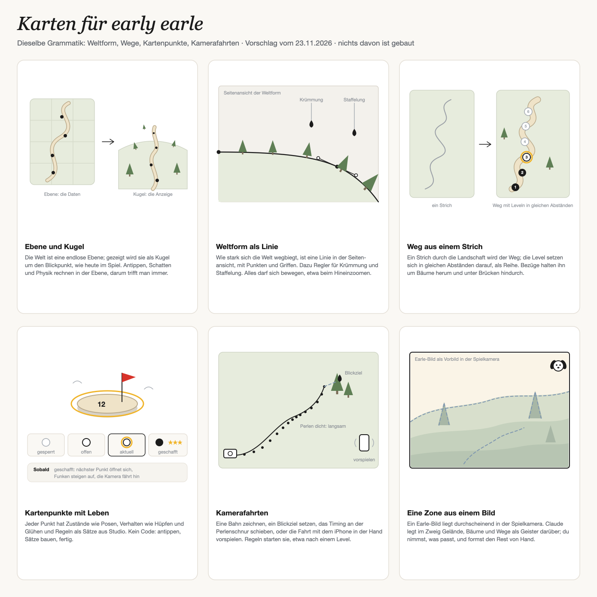

# Ozzy als Suite, Teil 8: Karten für early earle

Stand 23.11.2026. Ohne Agenten. Gelesen: ADR 0002 („unendliche Kugel“), `packages/render/src/earle/display.ts` und
`lightCurvature.ts`, STYLE 5.7 und 5.8, das Messprotokoll `docs/progress/karte-perf-iphone16.md`, die Übergabe zu Karte v5.
Vorher: Teil 1 bis 7 (`2026-11-23-ozzy-suite-*.md`). Nichts davon ist gebaut; das Spiel bleibt unangetastet.

**Dein Wort (23.11.):** „Außerdem plane ich für early earle ja eine aufwändige 3D-Map mit Geometrieshadern, die die Welt verzerren.
Auch so was würde ich gerne direkt in Ozzy bauen können, mit allem Drum und Dran: Kamerafahrten, interaktiven Elementen, animierten
Mappoints. Und alles muss nach wie vor auch von der KI optimal steuerbar sein. Am besten über Scribble-Eingabe statt Prompts.“



## 0 Kurzfassung

1. **Die Karte ist eine Szene wie jede andere.** Gelände, Wege, Bäume, Häuser und Kartenpunkte entstehen mit derselben Grammatik
   (Linie, Körper, Rundung, Verbindung, Teil 4). Neu sind nur drei Dinge, die zur ganzen Szene gehören: die **Weltform**, der **Weg**
   mit den Leveln und die **Kamera**.
2. **Ebene und Kugel wie heute.** Gebaut, angetippt und gerechnet wird auf der flachen Ebene; nur das Bild wird gebogen. Darum trifft
   der Finger immer, und Licht und Schatten bleiben ruhig.
3. **Die Weltform ist eine Linie.** Statt `R = 32` und Boost 0,14 im Code ziehst du in der Seitenansicht an einer Linie. Zwei Regler
   (Krümmung, Staffelung) formen sie; **Verbieger** (Lupe, Rolle, Falz, Welle, Strudel) liegen als Ebenen darüber. Alles ist animierbar.
4. **Weg aus einem Strich, Kartenpunkte als Vorlage.** Ein Strich wird der Weg, die Level reihen sich darauf. Jeder Kartenpunkt ist
   eine kleine Form mit Zuständen (Posen), Verhalten und Regeln in Sätzen; eine Änderung an der Vorlage gilt für alle 184.
5. **Fortschritt als Regler.** Ein Regler von 0 bis 184 spielt die ganze Reise durchs Spiel vor: welche Punkte offen sind, wie der
   Nebel weicht, wann eine Zone ihre Farbe bekommt.
6. **Kamerafahrten zeichnen oder vorspielen.** Bahn, Blickziel und Perlenschnur fürs Tempo; oder die Fahrt mit dem iPhone in der Hand
   aufnehmen.
7. **Scribble und Claude.** Striche werden Wege, Wälder, Flüsse, Fahrten und Regeln. Claude übernimmt die Fleißarbeit im Zweig und
   prüft mit Wächtern (Tippgröße, Sichtbarkeit, Draw Calls).
8. **Ins Spiel als Ozzy-Player.** Das Spiel behält Brett, Level und Spielstand; die Karte läuft als Ozzy-Szene, die Werte vom Spiel
   bekommt (Fortschritt) und Ereignisse zurückgibt (Punkt angetippt).

## 1 Was es heute gibt

- **Ebene und Kugel (ADR 0002).** Die Welt ist eine endlose Ebene. Gezeigt wird sie als Kugel um einen Fokus am Scheitel:
  azimutal und abstandstreu (`α = Abstand / R`, R = 32), dazu der Krümmungs-Boost c = 0,14, der die Ferne zusätzlich absinken lässt
  („übertriebene Perspektive“). Die Abbildung steht einmal für GPU und CPU in `display.ts` und läuft in allen Materialien. Sie hat eine
  geschlossene Umkehrung (`toFlat`).
- **Licht in der Ebene.** Normalen werden nicht gebogen: Jede Stelle sieht die Sonne gleich flach (STYLE 5.7). `lightCurvature.ts`
  dreht die Lichtrichtung je Bildpunkt ein Stück mit (Lichtkugel, Stärke 0,4).
- **Inhalt (Karte v5).** 15 Zonen nach Earle-Vorbildern, 184 Level, Route in `content/zones/route.json`, Landmarken, gestreute Bäume
  (eine Instanzgruppe je Baumart), Müll, Brücken, Aufzüge, Wasser, eine Kamera je Welt (Blickwinkel 80 bis 88 Grad). Gestreut wird mit
  Zufall und Samen (`packages/world`).
- **Budget.** Pixeldichte höchstens 2, Draw Calls beim Schwenken höchstens 80 im Median und 100 im Höchstfall, Schatten höchstens
  1,5 ms, Schattenpass nur in Bewegung.
- **Der Bruch:** Wer heute etwas an der Karte ändern will, ändert Zahlen in Code und JSON. Genau diesen Bruch soll Ozzy schließen.

## 2 Die Weltform

### 2.1 Eine Linie statt einer Formel

In der **Seitenansicht der Weltform** liegt eine Linie: links der Fokus, nach rechts der Abstand auf der Ebene, nach unten, wie weit
die Welt dort absinkt. Ein Kreisbogen ist die heutige Kugel. Du ziehst an Punkten und Griffen wie überall in Ozzy.

- **Zwei Regler formen die Linie:** *Krümmung* (wie rund) und *Staffelung* (wie stark die Ferne zusätzlich absinkt; heute der Boost
  0,14). Greifst du die Punkte selbst, merkt sich Ozzy deine Form, und die Regler wirken weiter als Faktor (wie bei der Rundung, Teil 4).
- **Abstände bleiben.** Der Abstand auf der Ebene wird zur Länge entlang der Linie. Level-Abstände auf dem Weg bleiben gleich, egal wie
  die Welt sich biegt; nur die Staffelung ändert sie absichtlich.
- **Rundum oder getrennt.** Standard: eine Linie für alle Richtungen (Kugel). Mit einem Schalter getrennt für längs zum Weg und quer:
  daraus werden Rolle, Sattel oder Schüssel.
- **Fokus als Bezug.** Der Mittelpunkt der Biegung folgt heute dem Blick. In Ozzy kann er dem Blick folgen, der Figur, still stehen oder
  eine eigene Bahn fahren. Bleibt der Fokus auf der Figur, während die Kamera hinausfährt, wird die Welt zum kleinen Planeten unter ihr.

### 2.2 Verbieger

Verbieger liegen als Ebenen über der Weltform. Jeder hat einen Bereich (ein Loop auf der Karte mit weicher Kante), eine Stärke von 0
bis 1 und eine Reihenfolge.

| Verbieger | Was er tut | Wofür |
| --- | --- | --- |
| **Kugel** | rundum gleich gebogen (heute) | die ganze Karte |
| **Rolle** | nur längs gebogen, quer gerade, wie ein rollender Stamm | der Weg läuft über den Horizont, die Seiten bleiben ruhig |
| **Lupe** | die Gegend um den aktuellen Punkt wird größer, der Rest rückt zusammen (Fokus und Kontext) | 184 Level: Nahes lesbar, Fernes als Übersicht |
| **Falz** | an einer Linie klappt die Welt hoch wie eine Seite im Pop-up-Buch | eine Zone klappt beim Freischalten auf |
| **Welle** | die Welt wogt (Höhe, Länge, Tempo) | Meer, Traum, Beben |
| **Strudel** | die Welt dreht sich mit dem Abstand | Übergang zwischen Welten, eine Zauberzone |

Alles daran ist ein Regler und damit animierbar und an Regeln gebunden: „Sobald Zone 4 frei ist: Falz von 0 auf 1 in 1,2 s.“ Die
Weltform kann dem Zoom folgen: nah flach und lesbar, weit ein kleiner Planet.

### 2.3 Licht

Ein Regler *Licht folgt der Biegung*: 0 heißt wie gemalt (jede Stelle sieht die Sonne gleich, STYLE 5.7), 1 heißt echt gebogen (der
Horizont dunkelt ab). Der Standard ist der heutige Wert (Lichtkugel 0,4). Ein Falz, der eine Seite aufstellt, darf seinen eigenen Wert
haben.

### 2.4 Technik: kein Geometrieshader nötig

- **Geometrieshader gibt es in WebGPU nicht** (nur Vertex-, Fragment- und Compute-Shader), und Metal hat auch keinen. Das ist kein
  Verlust: Das Verbiegen gehört in den Vertex-Shader, so wie heute `toDisplay` in allen Materialien. Neue Geometrie (Gras, Halme, Blüten,
  Funken, Wellenkämme) schreiben Compute-Shader in Puffer, gezeichnet als Instanzen.
- **Die Linie wird eine Tabelle.** Ozzy legt die Weltform als kleine Tabelle ab (etwa 256 Werte: je Abstand der Ort und die
  Hochrichtung). Der Shader liest sie; das kostet so viel wie die heutige Formel. Die heutige Abbildung lässt sich genau als Startlinie
  ablegen, damit Ozzy und Spiel deckungsgleich beginnen.
- **Antippen über einen Lage-Puffer.** Für eine frei gezeichnete Weltform mit Verbiegern gibt es keine geschlossene Umkehrung mehr.
  Deshalb zeichnet Ozzy beim Tippen einen winzigen Zusatzpass nur für den Bildpunkt unter dem Finger: Dort steht, welcher Körper es ist
  und wo auf der Ebene. Das trifft auch dann, wenn sich die Welt überschlägt.
- **Dichte.** Lange flache Teile (Boden, Wege, Wasser) biegen sich nur, wenn sie genug Punkte haben. Ozzy unterteilt sie nach der
  sichtbaren Biegung, einmal beim Ändern der Weltform, nicht in jedem Bild.

## 3 Gelände und Zonen (kurz; Landschaften folgen als eigener Teil)

- **Gelände ist ein Körper wie jeder andere:** Hügel blasen (rund), Felsen und Plateaus ziehen (eckig), ein Fluss ist eine Linie, die eine
  Rinne schneidet (Verbindung „ausschneiden“) und Wasser bekommt.
- **Zonen sind Gruppen** mit eigenem Stil, Licht und eigener Palette nach dem Earle-Vorbild. Ihre Grenzen sind Loops mit weicher Kante;
  dort gehen Stil und Farbe ineinander über.
- **Streuen mit Gedächtnis.** Bäume, Blumen, Steine und Müll streut Ozzy in einen Loop (Dichte, Größe, Abstand, Samen), so wie heute
  `packages/world`. Einzelne Bäume darfst du greifen und versetzen; sie bleiben, wo du sie hinstellst, auch wenn du danach die Dichte
  änderst (Hand schlägt Regler, und der Regler bleibt wirksam, Teil 4).

## 4 Der Weg und die Level

- **Ein Strich wird der Weg.** Ozzy beruhigt und glättet ihn (Teil 6) und macht daraus eine Linie mit wenigen Punkten und Griffen.
  Der Weg-Körper wird entlang der Linie gezogen; der Rundungsregler macht den Rand weich (Trampelpfad) oder kantig (Pflaster), der
  Werkstoff entscheidet über Erde, Stein oder Holzsteg.
- **Die Level sind eine Reihe auf der Linie:** nach Abstand oder nach Anzahl, je Zone ein Abschnitt. Einzelne Punkte darfst du
  verschieben; sie bleiben, wo du sie hinstellst.
- **Feste Kennung, freie Nummer.** Jeder Kartenpunkt trägt eine feste Kennung, die auf seinen Level im Spiel zeigt. Die Nummer auf
  dem Schild ergibt sich aus der Reihenfolge. Fügst du einen Level ein, ändern sich Nummern, aber kein Spielstand geht verloren.
- **Bezüge statt Handarbeit.** Der Weg liegt auf dem Gelände und hält Abstand zu Bäumen (die Bäume weichen). Kreuzt er Wasser oder einen
  anderen Weg, schlägt Ozzy Brücke, Steg oder Unterführung als Geist vor; wird er zu steil, Treppe oder Aufzug.
- **Abzweigungen** (Bonuslevel, Geheimnisse) sind Linien, die von einem Punkt des Wegs ausgehen, wie die Abzweigungen mit P.
- **Die Figur geht den Weg.** Sie läuft die Linie entlang (Gehzyklus aus der Bewegung, Tempo als Regler); tippst du einen Punkt an,
  läuft sie hin.

## 5 Kartenpunkte

- **Vorlage:** eine kleine Form (Sockel, Fahne, Schild, gern auch eine Figur). Ihre **Zustände sind Posen:** gesperrt, offen, aktuell,
  geschafft (ein bis drei Sterne). Die Übergänge zwischen ihnen sind kurze Bewegungen: Der Sockel hebt sich aus dem Boden, die Fahne
  entrollt sich, Funken steigen auf.
- **Verhalten:** Wippen, Glühen, Atmen; *Laune* für das Seltene (ab und zu schaut eine kleine Form heraus). *Solange* die Figur nah
  ist, hebt sich der Punkt und dreht sich zu ihr.
- **Regeln als Sätze (Studio, Teil 5):** „Sobald angetippt: Kamera fährt hin, Punkt springt, Levelkarte öffnet sich.“ „Sobald
  geschafft: nächster Punkt öffnet sich, Funken, Kamera fährt hin.“ Kein Code: antippen, Sätze bauen, fertig.
- **Vorlage und Abweichung:** Eine Änderung an der Vorlage gilt für alle Punkte. Einzelne Punkte (Zonenende, Bosslevel, Landmarken)
  weichen ab und behalten den Rest.
- **Die Leiter auf der Karte:** Ein Kartenpunkt kann die größte Stufe zeigen, die du in diesem Level erreicht hast. Die Figuren dafür
  kommen aus der Leiter von 2 bis 2048 (Teil 3).

## 6 Fortschritt und andere Spielwerte

- **Spielwerte sind Regler, die das Spiel setzt.** In Ozzy schiebst du sie selbst, um zu sehen, wie die Karte dann aussieht:
  Fortschritt (0 bis 184), Sterne je Level, Tageszeit, Wetter.
- **Am Fortschritt hängt die Reise:** welche Punkte offen sind, wo der Nebel weicht, wann eine Zone von Grau in Farbe wechselt, wann
  eine Brücke steht. Schiebst du den Regler von 0 bis 184, siehst du in Sekunden die ganze Reise durchs Spiel.
- **Wächter prüfen jede Stufe** (Abschnitt 9): Auch bei Fortschritt 117 ist der aktuelle Punkt sichtbar und groß genug zum Tippen.

## 7 Kamerafahrten

- **Folgen (die Spielkamera).** Eine **Kamera-Schiene** ist eine zweite Linie neben dem Weg. Wo die Kamera auf der Schiene steht,
  hängt daran, wo die Figur auf dem Weg ist. In engen Kurven des Wegs bleibt die Schiene ruhig. Abstand, Höhe, Neigung und Brennweite
  sind Regler, je Zone anders (heute: eine Kamera je Welt).
- **Fahrten (inszeniert).** Eine **Bahn** in der Draufsicht zeichnen, die Höhe in der Seitenansicht; ein **Blickziel** (Punkt, Form
  oder Linie); das **Tempo an der Perlenschnur** (dichte Perlen heißt langsam); Regler für Brennweite, Neigung und Wackeln; der Übergang
  zur nächsten Kamera geht von hartem Schnitt bis weich.
- **Vorspielen.** Du bewegst das iPhone wie eine Kamera; Ozzy nimmt die Bewegung über den Lagesensor auf (Safari fragt einmal um
  Erlaubnis), beruhigt sie wie einen Strich und legt sie als Bahn mit Perlen ab. Danach Punkte und Griffe wie überall.
- **Frei.** Wischen und Zoomen innerhalb einer Grenze (ein Loop auf der Karte); die Weltform folgt dem Zoom.
- **Regeln starten Fahrten:** nach einem Level, beim Freischalten einer Zone, beim ersten Start.

## 8 Interaktive Elemente und Abläufe

- **Alles darf antippbar sein:** Bäume wackeln (Federn), Tiere laufen weg, Wolken lassen sich schieben, Müll lässt sich einsammeln
  (das passt zum Tierschutz- und Umweltgedanken des Spiels), Wasser kräuselt sich. Jedes davon ist Verhalten plus Regel.
- **Abläufe** sind mehrere Schritte nacheinander auf einer Leiste (Studio): „Sobald Zone 3 frei ist: Nebel weicht (2 s), die Brücke
  baut sich auf (1,5 s), Fahrt ‚Ankunft‘, der erste Punkt öffnet sich.“
- **Physik** bekommt einen eigenen Teil („Physik soll Spaß machen“).

## 9 Scribble statt Prompt

| Strich | wird |
| --- | --- |
| langer, gewundener Strich (Draufsicht) | Weg; eine geschriebene Zahl daneben („12“) setzt die Anzahl der Level |
| Kringel, eng oder locker | Baumgruppe; je enger, desto dichter |
| Wellenlinie | Fluss; die Breite kommt aus Strichstärke und Tempo |
| geschlossener Umriss, schraffiert | See |
| Zickzack-Umriss | Felsen oder Berg |
| kleines Haus, mehrere davon | Haus, Dorf |
| Linie in der Seitenansicht über dem Horizont | neue Weltform |
| Spirale um einen Punkt | Kamerafahrt „umkreisen“ |
| Pfeil auf einen Punkt | Kamerafahrt „heranfahren“ |
| Pfeil von Kartenpunkt A nach B | Regel „Sobald A geschafft ist, öffnet sich B“ |
| Rotstift: durchstreichen, umkreisen mit Fragezeichen | entfernen; Claude fragen |

Der Kontext entscheidet (Teil 6): Derselbe Kringel ist auf der Karte ein Baum und an einer Figur eine Locke. Ist ein Strich mehrdeutig,
erscheinen die Deutungen als Geister zur Wahl.

## 10 Claude in der Karte

- **Dieselben acht Werkzeuge** wie in Teil 7. Die Befehlsschicht bekommt Kartenbefehle: `weg_ziehen`, `reihe_setzen`,
  `kartenpunkt_setzen`, `weltform_setzen`, `verbieger_setzen`, `streuen`, `kamerafahrt_bauen`, `regel_setzen`, `ablauf_bauen`.
- **Die Karte als Text** (Ozzy-Schrift), damit Claude sie lesen und genau zurückschreiben kann:

  ```text
  weltform: kugel(radius 32, staffelung 0.14), lupe(um: aktueller_punkt, stärke 0.3)
  weg w1: linie(18 punkte), reihe k × 12, zone "Herbstwald"
  vorlage k: form "Fahne", zustände [gesperrt, offen, aktuell, geschafft]
  regel: sobald k[3] geschafft → k[4] öffnen, kamera "zum Punkt"
  ```

- **Fleißarbeit im Zweig:** 184 Punkte verteilen, 15 Zonen nach ihrem Vorbild füllen, Fahrten zu allen Zonen bauen, Varianten als
  Geister. Du nimmst, was passt.
- **Wächter für die Karte:** (1) Jeder offene Kartenpunkt ist in der Ruhelage der Kamera sichtbar und mindestens 44 pt groß. (2) Keine
  zwei Punkte decken sich in der gebogenen Anzeige. (3) Der Weg wird nirgends steiler als erlaubt. (4) Draw Calls und Schatten bleiben im
  heutigen Budget. (5) Das gilt bei jedem Fortschritt von 0 bis 184.
- **Eine Zone aus einem Bild** (Tafel, Bild 6). Ein Earle-Bild liegt durchscheinend in der Spielkamera. Ozzy findet auf dem Gerät die
  Ebenen (Himmel, Hügelreihen, Bäume, Weg); Claude deutet sie und legt Gelände, Bäume und Weg im Zweig als Geister in die richtige Tiefe,
  so dass die Spielkamera das Bild wiedererkennt (eine Form der Projektionsansicht aus Teil 2). Ob Claude Gemälde verlässlich in Ebenen
  zerlegt, ist unbewiesen. Ich teste es, Kriterium: Bei mindestens zwei von drei Earle-Bildern behältst du die Aufteilung.

## 11 Ansichten beim Bauen

- **Spielkamera** (gebogen, wie im Spiel) ist die Hauptansicht. Du baust direkt darin; Ziehen folgt dem Finger, weil Ozzy jeden Griff in
  die Ebene zurückrechnet.
- **Plan** (Draufsicht, flach) für Überblick, genaue Abstände und lange Wege.
- **Seitenansicht der Weltform** für die Linie und die Verbieger.
- **Je Gerät (Teil 2):** Am iPhone die Spielkamera groß, der Plan als kleine Karte in der Ecke, die Weltform als Leiste am Rand. Am Mac
  und iPad alle drei nebeneinander.

## 12 Ins Spiel

| Weg | Wie | Urteil |
| --- | --- | --- |
| A Nur Export | Ozzy schreibt JSON und Netze für die heutige Karte | sicher, aber jede neue Idee (Verbieger, Regeln, Fahrten) braucht wieder Spielcode |
| B Alles in Ozzy | auch Brett, Level und Spielstand laufen in Ozzy | Ozzy würde eine Spiel-Engine; zu viel |
| **C Ozzy-Player (Empfehlung)** | das Spiel bettet einen kleinen Player ein, der die Kartenszene abspielt; das Spiel setzt die Spielwerte, der Player meldet Ereignisse | alles Sichtbare und Inszenierte gehört Ozzy, die Spiellogik bleibt im Spiel |

So arbeitet auch Rive mit Zustandsautomaten, Eingaben und Ereignissen. Weil Spiel und Ozzy beide auf three.js mit WebGPU und TSL laufen,
ist der Player kein Fremdkörper. Beim Ausgeben backt Ozzy wie heute: Instanzen für Wiederholtes, Atlanten, ein Biege-Knoten für alle
Materialien.

**Karte v5 wird die erste Szene.** Ozzy liest `route.json`, die Zonen und die Kugelwerte (nur lesend) und macht daraus Weg, Reihe,
Kartenpunkte und Weltform. Nichts geht verloren, und das Spiel bleibt unberührt, bis du entscheidest.

## 13 Tempo auf dem iPhone 16

- **Kartenpunkte:** eine Instanzgruppe je Vorlage; Zustände und Posen stehen als Werte je Punkt in einem Puffer. 184 Punkte, ein Draw
  Call.
- **Weltform:** ein Tabellenzugriff mehr je Punkt; so teuer wie heute.
- **Dichte:** wird beim Ändern der Weltform gerechnet, nicht in jedem Bild.
- **Verhalten und Regeln:** wenige Zahlen je Punkt und Bild; vernachlässigbar.
- **Antippen:** ein winziger Zusatzpass, nur beim Tippen.
- **Messen statt glauben:** Die Messseite aus Teil 2 bekommt den Kartenfall. Kriterium wie im heutigen Protokoll (Draw Calls beim
  Schwenken höchstens 80 im Median und 100 im Höchstfall, Schatten höchstens 1,5 ms), dazu 60 Bilder pro Sekunde beim Wischen.

## 14 Ehrlich in Frage gestellt

1. **„Geometrieshader“** ist das falsche Wort für das, was du willst; das Richtige gibt es schon (Vertex-Shader heute, Compute für neue
   Geometrie). An deinem Ziel ändert das nichts.
2. **Freie Weltformen können die Lesbarkeit kosten:** Eine stark rollende Welt versteckt Level hinter dem Horizont. Deshalb die Wächter,
   und der Standard bleibt die heutige Kugel.
3. **Ozzy soll keine Spiel-Engine werden.** Die Grenze ist die Liste der Spielwerte und Ereignisse; alles dahinter bleibt im Spiel.
4. **Karte v5 nicht wegwerfen.** Importieren; deine Zonen nach Earle bleiben der Maßstab.
5. **Das Spiel bleibt unangetastet.** Ozzy bekommt einen eigenen Biege-Knoten nach dem Vorbild von `display.ts`. Ob das Spiel später
   den Ozzy-Player nutzt, entscheidest du.
6. **Was ich am bisherigen Konzept ändern würde:** (a) *Spielwerte* sind eine eigene Art Regler, die von außen gesetzt wird (Teil 1
   kannte nur Regler, die man selbst setzt); sie gelten auch für Figuren (Hunger, Laune, Stufe) und Häuser (Stufe 2 bis 2048). (b) Die
   Szene bekommt eine *Weltform*, so wie sie Stil und Licht hat (Teil 4). (c) Kamerafahrten brauchen keine eigene Zeitleiste: Bahn,
   Perlenschnur und Regeln reichen.

## 15 Bausteine und Proben

| Reihenfolge | Baustein | Probe (Vorschlag) |
| --- | --- | --- |
| 1 | Biege-Knoten mit Weltform-Linie (Tabelle) und Lage-Puffer | Ozzy zeigt Karte v5 an drei Stellen deckungsgleich mit dem Spiel (Vergleichsbild, gleiche Ansicht); du ziehst einen Punkt der Weltform und die Spielansicht geht auf dem iPhone 16 ruckelfrei mit; jeder Tipp trifft den richtigen Punkt |
| 2 | Weg, Reihe, feste Kennungen, Import von Karte v5 | 184 Punkte stehen auf dem Weg; der Fortschrittsregler spielt die Reise von 0 bis 184 |
| 3 | Kartenpunkt-Vorlage mit Zuständen, Verhalten und Sätzen | der Ablauf „Sobald geschafft“ läuft ohne Code |
| 4 | Kamera: Schiene, Fahrten, Perlenschnur, Vorspielen | eine Fahrt aus einem Scribble und eine vom iPhone vorgespielt |
| 5 | Verbieger (Lupe, Rolle, Falz, Welle, Strudel) | die Weltform wechselt beim Zoomen, eine Zone klappt beim Freischalten auf |
| 6 | Ozzy-Player im Spiel | die Karte läuft im Spiel im heutigen Budget (Messprotokoll) |
| 7 | Claude: Kartenbefehle, Wächter, Zone aus einem Bild | Claude füllt eine Zone nach einem Earle-Bild; du behältst die Aufteilung bei zwei von drei Bildern |

## 16 Offene Entscheidungen (deine)

1. Die Karte im Spiel als Ozzy-Player mit Spielwerten und Ereignissen (Empfehlung), nur als Export in die heutige Karte, oder ganz in
   Ozzy?
2. Karte v5 übernehmen (Empfehlung) oder in Ozzy neu aufbauen?
3. Welche Verbieger zuerst: Kugel, Rolle und Lupe (Empfehlung), oder hast du eigene Bilder im Kopf (Pop-up-Buch, Strudel, …)?

## 17 Quellen

- Im Repo: `docs/ADR/0002-unendliche-kugel.md`, `packages/render/src/earle/display.ts`, `packages/render/src/earle/lightCurvature.ts`,
  `docs/STYLE.md` (5.7 und 5.8), `docs/progress/karte-perf-iphone16.md`, `content/zones/route.json`, `packages/world/src`.
- WebGPU: [Spezifikation](https://www.w3.org/TR/webgpu/) (Shader-Stufen: Vertex, Fragment, Compute).
- Fokus und Kontext: G. W. Furnas, „Generalized Fisheye Views“, CHI 1986.
- Tippziele: Apple Human Interface Guidelines (mindestens 44 × 44 pt).
- Vorher: Teil 1 (Bausteine, Perlenschnur), Teil 2 (Tempo, Ansichten, Projektionsansicht), Teil 3 (Leiter 2 bis 2048), Teil 4
  (Grammatik, Rundung), Teil 5 (Studio: Leisten, Sätze), Teil 6 (Scribble-Erkennung), Teil 7 (Claude, Befehlsschicht, Wächter).
