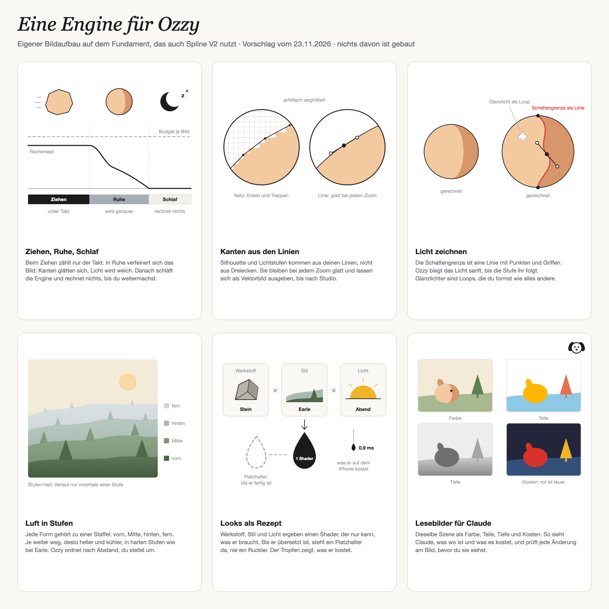

# Ozzy als Suite, Teil 9: Eine eigene Engine

Stand 23.11.2026. Ohne Agenten, mit drei Suchen (Spline V2, WebGPU in eingebetteten Webansichten auf iOS). Gelesen: die
Earle-Bausteine des Spiels (`packages/render/src/earle/`), `docs/FALLEN.md`, Teil 2 (Tempo) und der Stand des Shader-Strangs.
Vorher: Teil 1 bis 8 (`2026-11-23-ozzy-suite-*.md`). Nichts davon ist gebaut.

**Dein Wort (23.11.):** „Gerne auch eigene, bessere Render-Engines als die von Spline V2.“ Davor: „Es soll in jeder Hinsicht besser
sein als Spline.“ Und vom 17.11.: „Die Performance muss immer top sein.“

## 0 Kurzfassung

1. **Spline V2 steht auf unserem Fundament.** Laut Changelog vom 21.08.2026 hat Spline seinen Renderer neu auf WebGPU gebaut, mit
   einem Backend auf TSL (der Shader-Sprache von three.js, die auch Spiel und Ozzy benutzen) und WebGL als Rückfall. Dazu kommen PBR,
   Bildlicht, HDR, Spiegelungen im Bild, zwischengespeicherte weiche Schatten und ein Haarsystem; aufs iPhone kommt ein eigener
   Metal-Player. Ein anderes Fundament macht Ozzy also nicht besser. Besser wird es durch das, was darauf läuft.
2. **Empfehlung: eigener Bildaufbau auf three.js** (Weg B). Ozzy bestimmt, wie jedes Bild entsteht: Licht, Kanten, Looks, Takte,
   Lesebilder. three.js bleibt der Unterbau (WebGPU, WebGL2, TSL). Teile, die bremsen, ersetzen wir einzeln.
3. **Nicht realistischer, sondern eigen.** Ozzy gewinnt mit einer Engine für Illustration: Kanten aus den Linien (glatt bei jedem
   Zoom, als Vektorbild ausgebbar), Licht zum Zeichnen (die Schattengrenze ist eine Linie), Luft in Stufen wie im Siebdruck, Stile als
   Teil des Bildes. Realismus bleibt ein Stil unter vielen („Kino“, wie beim T-Rex).
4. **Tempo von Anfang an:** Ziehen, Ruhe, Schlaf; Flächen günstig, Kanten scharf; Looks als übersetzte Rezepte mit Platzhalter; ein
   Kostenbuch je Gerät.
5. **Für Claude gebaut:** Lesebilder (Farbe, Teile, Tiefe, Licht, Kosten); gleiche Eingabe gibt gleiches Bild; Bildvergleich als
   Wächter.
6. **Eine Engine für Ozzy und Spiel:** der Ozzy-Player aus Teil 8. Was du in Ozzy siehst, ist das Spiel.
7. **Zuerst eine Zehn-Minuten-Frage:** Bekommt die App auf deinem iPhone WebGPU? Heute vermutlich nicht (`docs/FALLEN.md`: Die App
   läuft unter `capacitor://localhost` und fällt auf WebGL2 zurück). Davon hängt ab, was im Spiel geht.
8. **Korrektur zu Teil 2:** Spline V2 hat doch Haare: Strähnen, auf der Grafikkarte simuliert, mit Licht, Schatten, Wind und Büscheln.

## 1 Was Spline V2 rendert

| Bereich | Spline V2 (Changelog 21.08.2026) |
| --- | --- |
| Fundament | neues WebGPU-Backend auf TSL, WebGL als Rückfall; manches nur mit WebGPU (Spiegelungen im Bild) |
| Licht und Material | PBR überarbeitet, Bildlicht (IBL), HDR-Farbkette, eine Staubschicht (Staub und Schnee auf Flächen, die nach oben zeigen) |
| Schatten und Tempo | weiche Schatten schneller und zwischengespeichert, schnellere Umgebungsverdeckung, Lecks im Leerlauf behoben, Unterteilung gebündelt in WASM |
| Haare | Strähnen aus Kopfhaut-Formen oder jedem Netz, auf der Grafikkarte simuliert, mit Licht, Schatten, Wind und Büscheln |
| Geräte | Editor im Browser und als Desktop-App; aufs iPhone kommen fertige Szenen mit einem nativen Metal-Player (Teil 2) |
| nicht gefunden | Pfadverfolgung (Path Tracing), Bearbeiten auf dem Handy |

Spline ist stark im Realismus und wird dort weiter zulegen, mit einem eigenen Team und demselben Unterbau. Diesen Wettlauf auf dem
iPhone zu suchen, wäre der falsche Kampf.

## 2 Was „besser“ heißen soll

1. **Dein Look statt Standard.** Die Engine ist für Illustration gebaut: Earle, Spider-Verse, Ghibli, Sin City, die Seifenhaut von
   liquid drop. Realismus ist ein Stil darunter.
2. **Schärfer.** Kanten wie in einer Vektorgrafik, bei jedem Zoom.
3. **Schneller, auch beim Formen.** Auf dem iPhone 16 flüssig beim Bearbeiten, nicht nur beim Abspielen; im Leerlauf keine Last.
4. **Steuerbar.** Jede Entscheidung über den Look ist eine Linie oder ein Regler: Schattengrenze, Glanzlicht, Staffel, Stufen.
5. **Lesbar für Claude.** Die Engine zeigt nicht nur ein Bild, sie erklärt es auch.
6. **Dasselbe Bild in Ozzy und im Spiel.**

## 3 Bauweise: vier Wege

| Weg | Was | Gewinn | Preis | Urteil |
| --- | --- | --- | --- | --- |
| A three.js, wie es ist | Szenen und Materialien von three.js, Nachbearbeitung obendrauf | schneller Start | sieht aus wie bei anderen (Spline nutzt dasselbe) | zu wenig |
| **B Eigener Bildaufbau auf three.js (Empfehlung)** | Ozzy besitzt den Ablauf jedes Bildes, das Licht, die Kanten, die Looks und die Takte; three.js liefert Grafikschnittstelle, TSL und Mathematik | der Unterschied entsteht dort, wo man ihn sieht; WebGPU und WebGL2 aus einem Shader | Wochen statt Jahre; ein eigener Bildablauf will gepflegt sein | ja |
| C Eigene Engine direkt auf WebGPU | ohne three.js | volle Kontrolle, kleiner | Monate Grundarbeit, der WebGL2-Rückfall doppelt, Spiel und Shader-Strang müssten umziehen | erst, wenn B wiederholt an Grenzen stößt |
| D Nativ (Metal) | eigener Kern in Swift oder Rust | Speicher auf dem Chip, Mesh-Shader, Strahlverfolgung in Hardware; all das bietet WebGPU nicht | eine zweite Codebasis | nach der Messung; vielleicht nur als Player, wie bei Spline |

Ein Beispiel, wo B ein Stück three.js ersetzt: `BatchedMesh` zeichnet in three r186 mit WebGPU pro Instanz (`docs/FALLEN.md`). Ozzy
bekommt dafür einen eigenen Zeichenweg für Instanzgruppen.

Was eine Engine von Grund auf kostet, zeigt Dreams: Media Molecule hat für das Gefühl beim Erschaffen eine ganz eigene Grafik gebaut,
über Jahre. Für Ozzy liegt der Unterschied nicht im Fundament, sondern darüber.

## 4 Der Bildaufbau

### 4.1 Ziehen, Ruhe, Schlaf

- **Ziehen:** Hand, Linien und Haut laufen im vollen Takt (Teil 2, Regel 1), jeder Look in seiner Stufe „Ziehen“. Läuft eine
  Bewegung von selbst, gilt derselbe Takt mit der Stufe „Live“.
- **Ruhe:** Hört die Bewegung auf, verfeinert die Engine das Bild über einige Bilder: Kanten werden gesammelt geglättet, weiche
  Schatten und Licht fertig gerechnet, aufwendige Looks laufen in voller Güte. Nach etwa einer halben Sekunde steht das genaue Bild.
- **Schlaf:** Danach rechnet die Engine nichts mehr, bis eine Eingabe kommt oder eine Regel etwas bewegt. Das spart Akku und Wärme,
  und das iPhone hat für den nächsten Zug die volle Leistung. Auch Spline arbeitet daran (Changelog: Lecks im Leerlauf behoben); bei
  Ozzy ist der Schlaf von Anfang an Teil des Aufbaus.

### 4.2 Durchgänge

Ein Bild entsteht in festen Durchgängen. Jeder Stil sagt, welche er braucht; die anderen fallen weg.

1. **Teile und Tiefe:** welcher Körper wo ist, Tiefe, Normale, Lichtstufe. Daraus entstehen auch die Lesebilder und das Antippen.
2. **Licht in Stufen:** Lichtbänder, gezeichnetes Licht (Abschnitt 6), Schatten.
3. **Flächen:** Werkstoff und Bemalung; darf in halber Auflösung laufen (Abschnitt 5.2).
4. **Kanten:** Silhouetten und Stufenkanten in voller Auflösung.
5. **Luft:** Staffeln und Nebel (Abschnitt 7).
6. **Stil:** Druck, Raster, Papier, Farbversatz.
7. **Feinschliff:** nur in Ruhe; sammelt über mehrere Bilder.

Der Ablauf steht auch als Text da (welche Durchgänge laufen, was sie kosten). So kann Claude ihn lesen und günstigere Wege vorschlagen.

## 5 Kanten wie Vektoren

### 5.1 Aus den Linien statt aus Dreiecken

- Die Haut entsteht in Ozzy aus den Linien; die Engine kennt deshalb an jeder Stelle die genaue Normale. Lichtstufen werden so glatt wie
  die Form selbst, auch auf einem groben Netz.
- Stufenkanten werden im Bild genau geglättet, über die Änderung je Pixel, so wie das Spiel es heute bei Schatten tut (`hardShadow.ts`:
  `smoothstep(0.5 ± ½·fwidth)`).
- **Silhouetten:** Wo sich die Fläche vom Blick wegdreht, unterteilt die Engine das Netz feiner, abhängig von Zoom und Blick. Keine
  Facetten, auch bei achtfacher Vergrößerung.

### 5.2 Flächen günstig, Kanten scharf

Illustration hat große ruhige Flächen und wenige Kanten. Die Engine rechnet Flächen in halber Auflösung und Kanten in voller. An jeder
Kante entscheidet ein feines Bild aus Teilen und Stufen, zu welcher Fläche ein Pixel gehört. Bei flachen Stilen ist das fast
verlustfrei und spart auf dem iPhone viel. Stile mit feinem Muster (Rasterpunkte, Schraffur) melden, dass sie volle Auflösung brauchen.

### 5.3 Vektorbild ausgeben

Weil jede Lichtstufe eine Fläche ist und jede Silhouette eine Kurve, kann Ozzy eine Ansicht als echtes Vektorbild ausgeben: als SVG
oder als bearbeitbare Zeichnung in Studio (Teil 5), jede Stufe eine Fläche, jede Kante eine Linie. Das verbindet 3D und 2D. Zuerst
robust über ein feines Rasterbild, das nachgezogen wird; später genau aus den Linien (dort ist die Sichtbarkeit der Kanten die schwere
Stelle). Vorbilder aus der Forschung: Eisemann und andere 2008, Bénard und Hertzmann 2019.

## 6 Licht zeichnen

- **Schattengrenze als Linie.** Du zeichnest auf der Form, wo der Schatten beginnen soll; die Linie hat Punkte, Griffe, eine helle
  und eine dunkle Seite. Ozzy biegt dafür die Normalen sanft um, bis die Lichtstufe genau der Linie folgt, und lässt die Form sonst
  unberührt. Arc System Works hat das für Guilty Gear Xrd von Hand gemacht, Normale für Normale (GDC 2015); Ozzy rechnet es aus deiner
  Linie. Der Löser für dünn besetzte Gleichungen (`packages/shape/src/loeser/`) kann diese neue Aufgabe übernehmen; an der Rechnung der
  Haut ändert sich nichts.
- **Wenn das Licht wandert:** Die gebogenen Normalen gelten weiter, die Grenze wandert mit. Für große Lichtwechsel zeichnest du zwei
  oder drei Grenzen für verschiedene Lichtrichtungen, und Ozzy blendet zwischen ihnen. So lösen Anime-Spiele die Schatten im Gesicht.
- **Glanzlicht als Loop.** Ein Glanzlicht ist eine Form, die auf der Fläche sitzt und mit dem Licht wandert: Stern, Fenster, Sichel
  (Anjyo und Hiramitsu 2003).
- **Schatten als Formen.** Schlagschatten mit Reglern für Härte, Versatz und Farbe. Die Schattenfarbe ist eine eigene Farbe der
  Palette, nie Schwarz, wie im Spiel (Schatten ist Stufe 0 der Palettenzeile, `EarleMaterial.ts`).
- **Randlicht und Lichtfarbe je Stufe** als Regler; **Licht folgt der Biegung** (Teil 8).

## 7 Luft in Stufen und Siebdruck

- **Das Spiel kann das schon:** Siebdruckstufen mit Verlauf innen (`gradients.ts`: „Der Verlauf läuft nie über eine Stufenkante“),
  der Himmel in harten Bändern (`skyFog.ts`), Nebelbänke als Airbrush, die Hügel und Bänke staffeln (`mist/mistBanks.ts`). Das ist das
  Vorbild für den Stil „Earle“ in Ozzy.
- **Neu in Ozzy:** Jede Form gehört zu einer Staffel (vorn, Mitte, hinten, fern), automatisch nach Abstand und von Hand umstellbar. Je
  Staffel ein Schritt zur Luftfarbe hin und weniger Kontrast, in harten Stufen. Ein Regler bestimmt, wie viele Staffeln es gibt.
- **Papier und Druck:** Körnung, Rasterpunkte, Farbversatz. Ein Regler entscheidet, ob ein Muster an der Form haftet oder am Bild. Der
  Shader-Strang hat gelernt: Striche müssen an der Figur haften.

## 8 Looks als Rezept

- **Ein Rezept, ein Shader.** Werkstoff × Bemalung × Stil × Licht (Teil 4) wird in einen eigenen Shader übersetzt, der nur kann, was er
  braucht. Kein Riesen-Shader mit Weichen; auf dem iPhone ist das der Unterschied zwischen flüssig und zäh.
- **Nie ein Ruckler beim Wechseln.** Bis der Shader übersetzt ist, zeigt Ozzy einen Platzhalter (derselbe Look, einfacher). Fertige
  Shader liegen im Zwischenspeicher; das Spiel übersetzt schon heute im Hintergrund vor (`compileAsync`).
- **Die 94 Shader werden die Bibliothek.** Was der Shader-Strang gebaut hat, wird sortiert: in Werkstoffe (Fels, Schuppen, Fell,
  Schleim, Opal …) und Stile (Spider-Verse, Earle, Sin City, Ghibli, Ukiyo-e …). Jeder Werkstoff lässt sich dann in jedem Stil zeigen;
  wo eine Mischung nicht trägt, bekommt der Stil eine eigene ausgefeilte Fassung (deine Regel aus Runde 9: einzelne Shader richtig
  ausfeilen statt vieler Kombinationen).
- **Kostenbuch.** Auf jedem Gerät misst Ozzy einmal, in etwa 20 Sekunden, was jeder Look je Bildfläche kostet. Der Tempo-Tropfen (Teil 1)
  sagt dann vorher, was eine Szene auf dem iPhone 16 braucht, und der Wächter warnt, bevor es ruckelt.

## 9 Für Claude gebaut

- **Lesebilder.** `ansicht_zeigen` (Teil 7) liefert auf Wunsch Farbe, Teile (jeder Körper eine Farbe, mit Liste), Tiefe, Licht (die
  Stufen) und Kosten (rot ist teuer). Damit sieht Claude, was wo ist und was es kostet, statt aus einem schönen Bild zu raten.
- **Gleiche Eingabe, gleiches Bild:** feste Samen, feste Zeit. Darauf bauen Bildvergleiche: Claude ändert etwas im Zweig, Ozzy
  vergleicht vorher und nachher, und der Wächter meldet, wenn sich mehr geändert hat als gewollt.
- **Bildaufbau als Text:** welche Durchgänge laufen und was sie kosten. Claude kann günstigere Looks vorschlagen, die gleich aussehen.
- **Unsichtbar am Mac:** Der Ozzy-Server (Teil 7) rendert auch in einem unsichtbaren Fenster. Claude kann prüfen, während du unterwegs
  bist.

## 10 Tempo auf dem iPhone 16

- Ein Bild hat bei 60 Bildern je Sekunde 16,7 ms; in der App sind höchstens 60 möglich (`docs/FALLEN.md`). Die Grafik des iPhone 16 ist
  drei- bis viermal schwächer als die des M3 Pro und hält unter Dauerlast 66 bis 78 % (Teil 2). Ziel: beim Ziehen höchstens 10 ms
  Grafik, damit Reserve bleibt und das Gerät kühl.
- **Regeln:** nur zeichnen, wenn sich etwas ändert; Ruhe, dann Schlaf; Flächen halb, Kanten voll; Pixeldichte der Flächen höchstens 2;
  Instanzen für alles Wiederholte; Schatten zwischenspeichern (das Spiel rechnet sie nur in Bewegung neu, Spline V2 speichert sie
  inzwischen auch); komprimierte Texturen (ASTC); Shader im Hintergrund übersetzen; bei Wärme die Auflösung der Flächen senken, nie die
  der Kanten.
- **Zwei Unterbauten, ein Shader.** Solange die App vielleicht nur WebGL2 bekommt, muss die Engine beides können. TSL übersetzt
  dieselben Shader in beide Sprachen. Was nur mit WebGPU geht (Rechen-Shader, etwa die Haut auf der Grafikkarte oder dichtes Fell),
  braucht in der App einen Ersatz oder wird gebacken.

## 11 Eine Engine für Ozzy und Spiel

- Der Ozzy-Player aus Teil 8 ist diese Engine samt Regeln, Verhalten und Kamera. Das Spiel bettet ihn ein; der Schalter „Wie im Spiel“
  (Maul, Etappe 9) zeigt dann keine Annäherung mehr, sondern genau das Bild des Spiels.
- Budgets werden Wächter: höchstens 8 000 Dreiecke je Form, Draw Calls wie im Messprotokoll der Karte.
- Das alte Spiel bleibt unangetastet, bis du entscheidest, ob und wann es den Player nutzt.

## 12 Ideen am Rand

- **Belichten am Mac:** für Standbilder in Ruhe Pfadverfolgung (für three.js gibt es sie, etwa `three-gpu-pathtracer`), für
  Präsentationsbilder im Stil „Kino“.
- **Fotoscan als Vorbild:** Gaussian Splats (für three.js mit WebGPU verfügbar) als Vorbild im Raum. Einen Raum oder ein Ding mit dem
  iPhone scannen und die Linien darüberlegen; gut für Architektur.
- **Stil malen:** einen Stil nur auf einen Teil der Form malen (Teil 4, Bemalung), etwa Spider-Verse-Druck nur im Gesicht.

## 13 Ehrlich in Frage gestellt

1. **„Eigene Engine“ heißt hier eigener Bildaufbau, nicht eigenes Fundament.** Eine Engine von Grund auf kostet Jahre, und Spline nutzt
   dasselbe Fundament wie wir. Der Unterschied liegt darüber.
2. **Den Wettlauf um Realismus nicht auf dem iPhone suchen.** Stil zuerst; Realismus als Stil, am Mac voll, am iPhone in Ruhe.
3. **WebGPU in der App ist offen.** Bekommt die App dauerhaft nur WebGL2, wird ein nativer Player wie bei Spline wahrscheinlicher
   (Weg D nur fürs Abspielen).
4. **Schattenkanten bleiben eine Grenze.** Sie wirken nur vektorhaft, solange ein Schattentexel höchstens ein bis zwei Bildpunkte groß
   ist (`hardShadow.ts`). Ozzy legt die Schattenkarte deshalb eng um das, was du gerade ansiehst.
5. **Vektorausgabe genau aus den Linien ist Forschungsarbeit;** robust zuerst über das Raster.
6. **Korrektur zu Teil 2:** Spline V2 hat Haare (Abschnitt 1). An der Empfehlung aus Teil 2 ändert das nichts: Auf dem Handy bleiben
   Schalen und Haarkarten der Weg. Haare bekommen ihren eigenen Teil.
7. **Was ich an Teil 2 ändern würde:** Die drei Stufen je Look (Ziehen, Live, Ruhe) bleiben; darüber kommt der Takt des ganzen Bildes
   (Ziehen, Ruhe, Schlaf). Der Schlaf fehlte bisher.

## 14 Bausteine und Proben

| Reihenfolge | Baustein | Probe (Vorschlag) |
| --- | --- | --- |
| 0 | Zehn-Minuten-Frage | in der App auf deinem iPhone prüfen, ob WebGPU da ist (zusammen mit der Messseite aus Teil 2) |
| 1 | Bildaufbau mit Durchgängen, Takten und Lesebildern | im Leerlauf null Bilder je Sekunde; nach dem Loslassen in unter einer Sekunde das genaue Bild; Claude liest das Teile-Bild richtig |
| 2 | Kanten aus den Linien; Flächen günstig, Kanten scharf | Vergleichsbild an deiner Form, gleiche Ansicht, achtfach vergrößert: keine Facetten, keine Treppen; auf dem iPhone mindestens 30 % weniger Bildzeit bei gleichem Bild |
| 3 | Licht zeichnen | an deiner Form: Die Schattengrenze folgt deiner Linie ohne Flecken, und das Licht lässt sich weiter drehen |
| 4 | Looks als Rezept, die 94 Shader einsortiert, Kostenbuch | zehn Looks hintereinander wechseln ohne Ruckler; der Tropfen sagt die Bildzeit auf dem iPhone auf 20 % genau vorher |
| 5 | Luft in Stufen, Siebdruck, Papier | eine Szene im Stil Earle, die du neben ein Earle-Bild legst und behältst |
| 6 | Vektorbild und Studio | eine Ozzy-Ansicht wird in Studio eine bearbeitbare Zeichnung |
| 7 | Player im Spiel | eine Form oder die Karte läuft in der App im heutigen Budget |

## 15 Offene Entscheidungen (deine)

1. Bauweise: eigener Bildaufbau auf three.js (Empfehlung), eine ganz eigene Engine auf WebGPU oder nativ?
2. Stil zuerst (Empfehlung) oder Realismus wie bei Spline zuerst?
3. Erste Engine-Probe: Kanten und Licht zeichnen an deiner Form (Empfehlung), davor die Zehn-Minuten-Frage auf deinem iPhone?

## 16 Quellen

- Spline V2: [Changelog](https://updates.spline.design/changelog/introducing-spline-v2), [Blog](https://blog.spline.design/spline-v2),
  [AlternativeTo](https://alternativeto.net/news/2026/8/spline-v2-launches-with-rebuilt-3d-editor-ai-agents-webgpu-and-new-desktop-app/),
  [Create With](https://createwith.com/tool/spline/updates/spline-v2-rebuilds-the-browser-3d-editor-around-ai-agents)
- WebGPU auf iOS: [Stand der Umsetzungen](https://github.com/gpuweb/gpuweb/wiki/Implementation-Status),
  [Apple-Forum: WebGPU in WKWebView](https://developer.apple.com/forums/thread/781602),
  [Apple-Forum: WKWebView ohne Grafikzugriff](https://developer.apple.com/forums/thread/770862)
- three.js: [three-gpu-pathtracer](https://github.com/gkjohnson/three-gpu-pathtracer),
  [Gaussian Splat Lite](https://discourse.threejs.org/t/gaussian-splat-lite-1-0-webgpu-streaming-lod-and-depth-rendering-for-three-js/94234)
- Forschung und Vorträge (ohne Link): J. C. Motomura, „Guilty Gear Xrd's Art Style: The X Factor Between 2D and 3D“, GDC 2015;
  K. Anjyo und K. Hiramitsu, „Stylized Highlights for Cartoon Rendering and Animation“, IEEE CG&A 2003; E. Eisemann, H. Winnemöller,
  J. C. Hart und D. Salesin, „Stylized Vector Art from 3D Models with Region Support“, EGSR 2008; P. Bénard und A. Hertzmann, „Line
  Drawings from 3D Models: A Tutorial“, 2019.
- Im Repo: `packages/render/src/earle/` (`EarleMaterial.ts`, `gradients.ts`, `hardShadow.ts`, `skyFog.ts`, `mist/mistBanks.ts`),
  `docs/FALLEN.md`, Teil 2 (Tempo), Shader-Strang (Zweig `claude/ozzy-shader`, `docs/look/ozzy/shader/UEBERGABE.md`).
